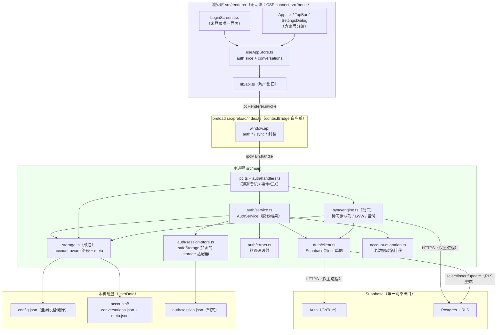
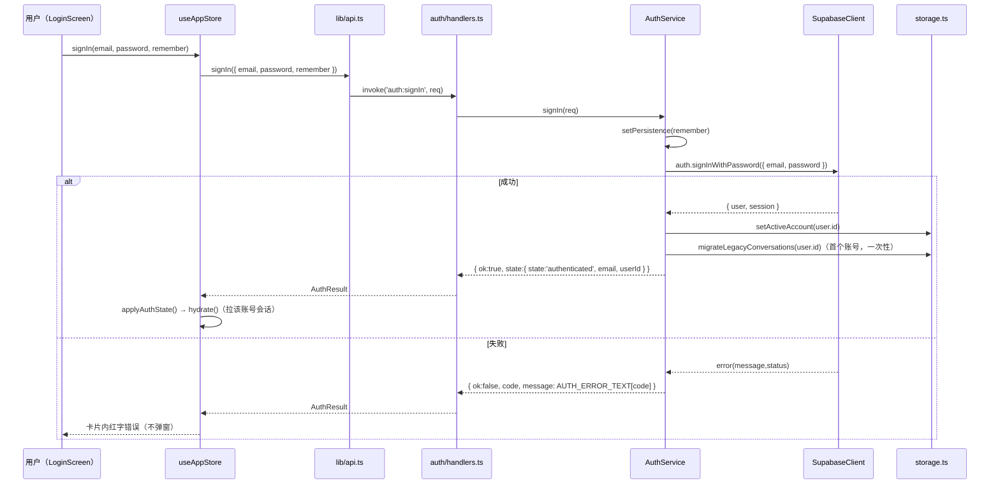
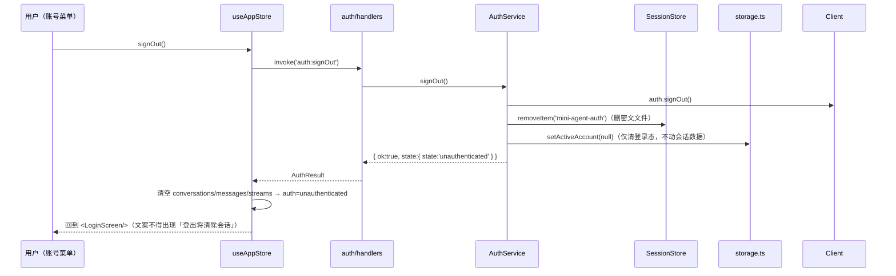
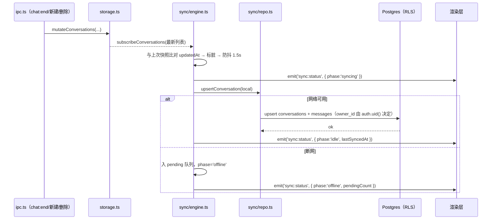

# mini-agent · 系统设计：账号体系 + 云端会话同步

> 版本：v1.0 · 编写：高见远（架构师） · 输入：`docs/AUTH-PRD.md`（许清楚）、`docs/PROJECT-GUIDE.md`、现有源码
> 性质：**增量设计**，只描述本次新增 / 变更的部分，不重写 `docs/ARCHITECTURE.md` 与 `docs/HARNESS-ARCHITECTURE.md`。
> 下游：寇豆码（工程师）。配套任务清单见 `docs/AUTH-TASKS.md`。
> 🚫 项目级硬性禁令：不得执行任何命令；本文所有验收判据为「静态核对」或「用户手动运行肉眼确认」。

---

## 0. 结论速览（TL;DR）

| 关注点 | 结论 |
|---|---|
| Supabase 客户端位置 | **只在主进程**（`src/main/auth/client.ts` 单例）。渲染层 CSP `connect-src 'none'`，物理上发不出请求 |
| 密钥级别 | 只允许 **publishable key（`sb_publishable_`）**；`secret` / `service_role` 永不进仓库与安装包 |
| 登录方式 | 仅 **邮箱 + 密码**（`signUp` / `signInWithPassword` / `signOut` / `resetPasswordForEmail`） |
| 登录态存放 | **`<userData>/auth/session.json`**，整体经 **Electron `safeStorage` 加密**（base64 密文）；不可用时**不降级明文**，仅内存持有，重启需重登 |
| 渲染层可见 | 只有 `{ state, email, userId }` 三态 + 邮箱，**永不接触 token**（与 `hasApiKey` 纪律一致） |
| 本地数据分区 | 会话从 `<userData>/conversations.json` 迁到 **`<userData>/accounts/<accountId>/conversations.json`**（`accountId` = Supabase `user.id`） |
| 老数据迁移 | **改名保留**：`conversations.json` → `accounts/<首个登录账号>/conversations.json`，原文件改名为 `conversations.legacy-backup-<ts>.json`，**永不删除** |
| `ui.lastConversationId` 归属 | 从 `config.json` **迁到按账号** `<userData>/accounts/<accountId>/meta.json`；`config.json` 只留设备级偏好 |
| 云端隔离 | Postgres **RLS**（`auth.uid() = owner_id`），建表即就位；SQL 可直接粘贴进 Supabase SQL Editor 执行 |
| 离线策略 | 有登录态即可进主界面；仅「从未登录 / 已登出」锁在登录页 |
| 依赖 | `@supabase/supabase-js`（**package.json 已声明 `^2.117.2`**）；安装命令见 §11 |
| 落地批次 | 批一 = 账号体系（T01–T05）；批二 = 云同步（T06–T08） |

---

## 1. 设计前提与边界

### 1.1 直接继承的锁死前提（来自 PRD §0）

| # | 前提 | 本设计的落点 |
|---|---|---|
| P1 | 目标就是 mini-agent 本身，不新建 Web 项目 | 在主进程内加 `src/main/auth/` 层 |
| P2 | 后端仅 Supabase | 只引 `@supabase/supabase-js` |
| P3 | 仅邮箱 + 密码 | 不做 OAuth / 手机号 / 魔法链接 |
| P4 | Supabase 客户端只在主进程 | §3 分层图，渲染层零网络能力 |
| P5 | 只有 publishable / anon key 可进应用 | §8、§9；静态检索禁词 |
| P6 | 未登录不能进主界面 | §5 状态机、`App.tsx` 分支渲染 |
| P7 | 分两批：账号 / 云同步 | §4 文件清单与 TASK 分层 |

### 1.2 架构师新增的锁死决策

| # | 决策 | 理由 |
|---|---|---|
| A1 | 会话数据**按账号物理分区**（目录级隔离），不共用一个文件 | G3「不串号」最彻底的实现；且天然满足「批一无云副本也能安全登出」 |
| A2 | `config.json` 保持**设备级全局**（providers / API Key / theme / memoryEnabled） | API Key 是设备凭据、主题是设备偏好，都**不随账号走**；避免把账号数据塞进白名单陷阱高危区 |
| A3 | 登录态存**独立文件**，不写进 `config.json` | refresh token 是凭据，与明文配置文件分离，降低泄露面 |
| A4 | 会话 id 保持本机生成（`randomUUID`），上传云端**沿用同一 id** | id 全局唯一，避免「本地 id ↔ 云端 id」两套映射带来的同步复杂度 |
| A5 | 同步引擎**监听存储变更**而非散落埋点 | 单一触发源，未来加写入路径不会漏同步（见问题 11） |
| A6 | 云端 soft-delete 用 `deleted` 布尔列，**不做物理删除**（批二） | D3：让「A 删→B 消」可传播；物理清理策略留待后续（见 §13 风险） |

---

## 2. 设计问题逐条结论（12 条）

> 编号 1–9 为**批一（账号体系）实现级**，10–12 为**批二（云同步）设计级**。
> 每条给出「结论 + 关键落点」，详细展开见对应章节。

### 批一 · 账号体系

**Q1. Supabase 客户端放哪、URL/Key 怎么注入、IPC 通道怎么加？**
- 客户端**只在主进程**，`src/main/auth/client.ts` 内做**进程级单例**（`createClient` 只调一次，库自身持有 auth 状态与自动刷新，多实例会互相打架）。
- URL / publishable key 经 **electron-vite 环境变量**注入：`import.meta.env.MAIN_VITE_SUPABASE_URL` / `MAIN_VITE_SUPABASE_PUBLISHABLE_KEY`（`.env` 文件，gitignore；`.env.example` 入库）。缺失时**不崩溃**，`AuthService` 直接返回 `AUTH_SERVICE_UNAVAILABLE`，登录页给出可读文案。
- 新通道统一登记进 `src/shared/ipc-channels.ts`（仓库禁止硬编码通道字符串）：`auth:getState` / `auth:signUp` / `auth:signIn` / `auth:signOut` / `auth:resetPassword` / `auth:deleteAccount` / `auth:clearLocalData`，事件推送 `auth:changed`。

**Q2. 注册 / 登录 / 登出 / 忘记密码的主进程封装？**
- `src/main/auth/service.ts` 暴露 `AuthService`：`restore()` / `signUp()` / `signIn()` / `signOut()` / `resetPassword()` / `deleteAccount()` / `getState()`，全部**返回脱敏结果**（`{ ok, state:{state,email,userId}, code?, message? }`）。
- 登录成功 → `storage.setActiveAccount(user.id)` → 返回 `state=authenticated`；登出 → `storage.setActiveAccount(null)` + 清 session 文件 + 返回 `state=unauthenticated`。详见 §6。

**Q3. 登录态 token 存放位置？（★重点）**
- 存 **`<userData>/auth/session.json`**，内容为 **`safeStorage` 加密后的 base64 密文**（key→cipher 的映射）。**明文 token 只存在于主进程内存**。
- 通过 supabase-js 的 **自定义 `auth.storage` 适配器**接管读写（`getItem/setItem/removeItem`），不落 `localStorage`（渲染层也没有）。
- **`isEncryptionAvailable()` 为假时不降级明文**：适配器退化为**仅内存 Map**（与 `secret.ts` 的 API Key 纪律完全一致）。代价：重启需重登 —— 在设置页 / 登录页以黄条明示。
- 渲染层**永远拿不到 token**（D5）。详见 §8。

**Q4. 启动时如何判定登录态、未登录如何锁死、离线如何放行？**
- 主进程 `bootstrap()` 在**建窗口之前** `await authService.restore()`：读 session → 若有则 `setActiveAccount`；续期失败且断网 → 标 `expired`（**仍放行**）；续期失败且在线 → 视为失效，清除 session（`unauthenticated`）。
- 渲染层 `main.tsx` 在 `createRoot().render()` **之前** `await store.initAuth()`（与现有 `initTheme()` 并列），拿到 `{state,email}` 再决定首帧渲染登录页还是主界面，**避免闪一下主界面**。
- 准入判据 = **本机是否有登录态**（`authenticated | expired` 放行），**不是**「联网校验通过」。仅 `unauthenticated`（从未登录 / 已登出）全屏锁死。详见 §5。

**Q5. 本地数据按账号分区的路径方案、老数据迁移、`lastConversationId` 归属？（★重点）**
- 路径：会话文件迁到 `<userData>/accounts/<accountId>/conversations.json`；账号附加态（`lastConversationId` 等）放同目录 `meta.json`；`accountId` = Supabase `user.id`（UUID，文件系统安全）。
- 迁移：**首个登录账号**登录时，若 `<userData>/conversations.json` 存在 → 内容并入该账号目录，原文件**改名为** `conversations.legacy-backup-<ts>.json`（**永不删除**）。因改名即「消费」，第二个账号不会再被误认领。
- `lastConversationId`：从 `config.json` **迁到** `accounts/<accountId>/meta.json`，迁移时顺带把旧值拷过去；`config.json` 不再写它。**批一不新增 `config.json` 字段** → `normalizeConfig()` 无需改动（规避 §8.2 白名单陷阱）。详见 §7。

**Q6. 未登录全屏锁死怎么实现（渲染层如何知道）？**
- 渲染层 store 新增 `auth: AuthState` 与 `authChecked: boolean`；`App.tsx` 顶层分支：`authChecked && isAuthed(auth) ? <主界面> : <LoginScreen />`。**不渲染主界面任何组件**（PRD 问题六「不做半开状态」）。
- 主进程通过 `auth:changed` 事件在 token 刷新 / 被登出时推送最新 `AuthState`，渲染层据此实时切换。

**Q7. 登录相关错误码与中文文案映射？**
- 新增 `AuthErrorCode` + `AUTH_ERROR_TEXT`（放 `src/shared/types.ts`，全仓唯一来源，与现有 `ERROR_TEXT` 并列）：`INVALID_EMAIL` / `INVALID_CREDENTIALS` / `EMAIL_NOT_CONFIRMED` / `EMAIL_ALREADY_REGISTERED` / `WEAK_PASSWORD` / `NETWORK` / `RATE_LIMIT` / `SERVICE_UNAVAILABLE` / `UNKNOWN`。
- `src/main/auth/errors.ts` 负责把 supabase `error.message/status` 映射为 `AuthErrorCode`（**不把英文原文透给用户**）。见 §10。

**Q8. 新增配置字段如何避免 `normalizeConfig` 白名单陷阱？**
- **批一不新增 `config.json` 字段**（`lastConversationId` 已迁出、session 走独立文件）→ 从根上不触发陷阱。
- 规则（写入共享约定）：**任何**未来要进 `config.json` 的字段，必须同步加进 `normalizeConfig()` 的返回对象，否则每次读盘都会被静默丢弃（`PROJECT-GUIDE.md` §8.2）。
- `accounts/<id>/meta.json` 有自己的 `normalizeAccountMeta()`（同样的白名单纪律，只是作用域在账号内）。

**Q9. 依赖与安装命令？（★命令原文）**
- 库：`@supabase/supabase-js`。**当前 `package.json` 已声明 `"@supabase/supabase-js": "^2.117.2"`**（无需再改 package.json）。
- 若本机 `node_modules` 尚未安装该依赖（本仓用 **pnpm**，见 `package.json` 的 `pnpm.onlyBuiltDependencies`），执行：
  ```
  pnpm add @supabase/supabase-js
  ```
  或对现状（已在 package.json 中声明）只需：
  ```
  pnpm install
  ```
- 新增环境变量文件 `.env`（gitignore）：`MAIN_VITE_SUPABASE_URL=` / `MAIN_VITE_SUPABASE_PUBLISHABLE_KEY=`；入库 `.env.example` 占位。

### 批二 · 云端会话同步

**Q10. 云端表 + RLS SQL，是否可直接执行、在哪儿跑？（★重点）**
- 两张表 `conversations` / `messages`，均带 `owner_id uuid default auth.uid()`；RLS 四策略（select / insert / update / delete）全部 `auth.uid() = owner_id`；`messages` 额外校验 `conversation_id` 属于本人。
- SQL **可直接执行**：用户打开 **Supabase Dashboard → SQL Editor → New query → 粘贴 → Run**（项目禁命令，故不提供 CLI 迁移执行，仅把 `.sql` 入库备查）。完整脚本见 §9，落盘于 `supabase/migrations/0001_init.sql`。
- **不存** `workspaceRoot`（本机属性）、**不存** API Key / baseUrl（设备凭据）——只存会话与消息（D2、SY-09）。

**Q11. 同步触发机制（后台静默）？**
- `SyncEngine`（主进程）**订阅存储变更**（`storage` 新增 `subscribeConversations` 观察者）：任一会话被写入 → 与该会话上次快照比对 `updatedAt` → 标脏 → **防抖 ~1.5s** 后批量推送。不发「保存」按钮（D4）。
- 触发点：① 登录后首次全量拉取（增量按 `updated_at` 过滤）；② 会话/消息变更后静默推送；③ 断网期间入 **pending 队列**，恢复网络后补传；④ 手动「立即同步」。状态经 `sync:status` 事件推给渲染层。

**Q12. 冲突处理 / 生成中锁 / 软删除？**
- **会话级 LWW**：比较本机与云端 `updatedAt`，新者胜、**整会话覆盖**；覆盖前把**将被覆盖的一版**写 `<userData>/sync-backup/<conversationId>-<ts>.json`，保留最近 5 份（PRD 问题二）。
- **生成中锁**：云端 `conversations.generating` + `generating_at`；本机开始生成时置位、结束清位；他端读取到「新近生成中」→ 只读并提示「该会话正在其它设备生成中」。**仅在联网时有效**（已知局限，见 §13）。
- **软删除**：`deleted=true` 传播；物理清理策略本次不做。

---

## 3. 分层架构



**边界要点**
1. 渲染层**没有任何** `@supabase/*` / `fetch` 调用（静态可核对）。网络只发生在主进程。
2. preload 仍是「白名单 + 事件订阅返回 unsubscribe」模式，**不暴露**任何 token。
3. `storage.ts` 是会话文件的唯一读写口，改造为「账号感知」，不改其 `enqueue` + `atomicWrite` 机制。

---

## 4. 新增 / 修改文件清单

> 相对路径均以仓库根 `E:\code\LocalAgent\mini-agent\` 为基准。**(新)** = 新建，**(改)** = 修改。

### 批一 · 账号体系

| 文件 | 动作 | 职责 |
|---|---|---|
| `.env.example` | 新 | 环境变量占位（URL + publishable key），入库 |
| `.env` | 新 | 真实值，用户自建，**gitignore** |
| `.gitignore` | 改 | 追加 `.env`（当前未忽略） |
| `src/main/env.d.ts` | 新 | `ImportMetaEnv` 类型声明（`MAIN_VITE_SUPABASE_URL` 等） |
| `src/shared/types.ts` | 改 | 新增 `AuthErrorCode` / `AUTH_ERROR_TEXT` / `AuthState` 相关常量 |
| `src/shared/ipc-channels.ts` | 改 | 新增 `auth:*` 通道常量与请求/响应/事件类型 |
| `src/main/auth/client.ts` | 新 | SupabaseClient 单例 + 环境变量读取 |
| `src/main/auth/session-store.ts` | 新 | safeStorage 加密的 `auth.storage` 适配器（getItem/setItem/removeItem） |
| `src/main/auth/errors.ts` | 新 | supabase 错误 → `AuthErrorCode` 映射 |
| `src/main/auth/service.ts` | 新 | `AuthService`：restore / signUp / signIn / signOut / resetPassword / deleteAccount / getState |
| `src/main/storage.ts` | 改 | 账号感知：`setActiveAccount` / 按账号 `conversations.json` path / `meta.json` 读写 / `subscribeConversations` 观察者 |
| `src/main/account-migration.ts` | 新 | 老 `conversations.json` → 账号分区（改名备份，永不删除） |
| `src/main/auth/handlers.ts` | 新 | 注册 `auth:*` handler + 推送 `auth:changed` |
| `src/main/index.ts` | 改 | `bootstrap()` 中 `await authService.restore()` + `setActiveAccount`；挂载 auth router |
| `src/main/ipc.ts` | 改 | 调 `registerAuthHandlers(...)`；`handleConfigGet` 的 `lastConversationId` 改从账号 meta 取 |
| `src/preload/index.ts` | 改 | 暴露 `getAuthState/signUp/signIn/signOut/resetPassword/deleteAccount/clearLocalData/onAuthChanged` |
| `src/renderer/types/window.d.ts` | 改 | `MiniAgentApi` 补 auth 方法签名 |
| `src/renderer/lib/api.ts` | 改 | auth 方法类型化封装 |
| `src/renderer/store/useAppStore.ts` | 改 | auth slice：`auth` / `authChecked` / `initAuth` / `signIn` / `signUp` / `signOut` / `applyAuthState` |
| `src/renderer/main.tsx` | 改 | `render()` 前 `await store.initAuth()`（与 `initTheme()` 并列） |
| `src/renderer/App.tsx` | 改 | 顶层分支：未登录渲染 `<LoginScreen/>`；订阅 `auth:changed` |
| `src/renderer/components/LoginScreen.tsx` | 新 | 全屏登录/注册卡片（同一卡片切换），错误态红字，loading 禁用 |
| `src/renderer/components/TopBar.tsx` | 改 | 右侧账号区：邮箱 + 点击展开菜单（登出 / 设置） |
| `src/renderer/components/SettingsDialog.tsx` | 改 | 新增「账号」分组：当前邮箱、登出、清除本账号本地数据（P2） |

### 批二 · 云端会话同步

| 文件 | 动作 | 职责 |
|---|---|---|
| `supabase/migrations/0001_init.sql` | 新 | 建表 + RLS + 索引（§9，用户手动在 SQL Editor 执行） |
| `src/main/sync/repo.ts` | 新 | 云端读写封装（pull 增量 / upsert / 软删除） |
| `src/main/sync/engine.ts` | 新 | 待同步队列 / LWW / 覆盖前备份 / 生成中锁 |
| `src/main/sync/handlers.ts` | 新 | 注册 `sync:getStatus` / `sync:now`，推送 `sync:status` |
| `src/main/ipc.ts` | 改 | 调 `registerSyncHandlers(...)`；在生成开始/结束处维护 `generating` 锁 |
| `src/shared/ipc-channels.ts` | 改 | 新增 `sync:*` 通道与 `SyncStatus` 类型 |
| `src/preload/index.ts` + `window.d.ts` + `lib/api.ts` | 改 | 暴露 sync 方法 |
| `src/renderer/store/useAppStore.ts` | 改 | `sync` slice：`syncStatus` / `syncNow` |
| `src/renderer/components/SyncStatusIndicator.tsx` | 新 | 顶栏/设置页同步状态（已同步 / 同步中 / 离线待同步 N） |
| `src/renderer/components/SettingsDialog.tsx` | 改 | 新增「数据与同步」分组：状态、上次同步、立即同步、同步范围说明 |
| `src/renderer/components/MessageList.tsx`（或会话头） | 改 | 工作区缺失提示条（可关闭） |

---

## 5. 数据结构与接口

### 5.1 共享层（`src/shared/`）

```ts
// src/shared/types.ts（新增片段）

/** 账号相关的用户可见错误码（与模型侧 ErrorCode 分开，语义不同） */
export type AuthErrorCode =
  | 'INVALID_EMAIL'            // 邮箱格式不合法
  | 'INVALID_CREDENTIALS'      // 邮箱或密码错误
  | 'EMAIL_NOT_CONFIRMED'      // 邮箱尚未确认
  | 'EMAIL_ALREADY_REGISTERED' // 该邮箱已注册
  | 'WEAK_PASSWORD'            // 密码强度不足
  | 'NETWORK'                  // 网络不可达
  | 'RATE_LIMIT'               // 操作过于频繁
  | 'SERVICE_UNAVAILABLE'      // 登录服务未配置 / 不可用
  | 'UNKNOWN';

/** 全仓唯一来源：AuthErrorCode → 中文文案 */
export const AUTH_ERROR_TEXT: Record<AuthErrorCode, string> = {
  INVALID_EMAIL: '邮箱格式不正确',
  INVALID_CREDENTIALS: '邮箱或密码错误',
  EMAIL_NOT_CONFIRMED: '邮箱尚未确认，请先到邮箱点击确认链接',
  EMAIL_ALREADY_REGISTERED: '该邮箱已注册，请直接登录',
  WEAK_PASSWORD: '密码强度不足（至少 6 位）',
  NETWORK: '无法连接登录服务，请检查网络后重试',
  RATE_LIMIT: '操作过于频繁，请稍后再试',
  SERVICE_UNAVAILABLE: '登录服务未配置，请联系管理员',
  UNKNOWN: '操作失败，请稍后重试',
};
```

```ts
// src/shared/ipc-channels.ts（新增片段）

export const CHANNELS = {
  // …现有 17 个通道保持不变…
  AUTH_GET_STATE: 'auth:getState',
  AUTH_SIGN_UP: 'auth:signUp',
  AUTH_SIGN_IN: 'auth:signIn',
  AUTH_SIGN_OUT: 'auth:signOut',
  AUTH_RESET_PASSWORD: 'auth:resetPassword',   // P1
  AUTH_DELETE_ACCOUNT: 'auth:deleteAccount',   // P2
  AUTH_CLEAR_LOCAL_DATA: 'auth:clearLocalData',// P2
  AUTH_CHANGED: 'auth:changed',                // 事件：主进程 → 渲染层
  SYNC_GET_STATUS: 'sync:getStatus',
  SYNC_NOW: 'sync:now',
  SYNC_STATUS: 'sync:status',                  // 事件：主进程 → 渲染层
} as const;

/** 登录态三态；渲染层只拿到这三态 + 邮箱，绝不接触 token */
export type AuthStateKind = 'unauthenticated' | 'authenticated' | 'expired';

export interface AuthState {
  state: AuthStateKind;
  email?: string;
  /** Supabase user.id；仅用于内部/调试展示，不含任何凭据 */
  userId?: string;
}

/** 注册入参 */
export interface SignUpRequest { email: string; password: string; }

/** 登录入参；remember=false 表示「不记住我」→ session 仅内存持有 */
export interface SignInRequest { email: string; password: string; remember: boolean; }

/** 登录/登出结果 */
export interface AuthResult {
  ok: boolean;
  state: AuthState;
  code?: AuthErrorCode;
  message?: string;   // 已是中文（AUTH_ERROR_TEXT[code]）
}

/** 注册结果：needsEmailConfirm 为 true 表示需去邮箱点确认链接（PRD Q1 按开启处理） */
export interface SignUpResult {
  ok: boolean;
  needsEmailConfirm: boolean;
  code?: AuthErrorCode;
  message?: string;
}

/** 忘记密码入参（P1） */
export interface ResetPasswordRequest { email: string; }

/** 清除本账号本地数据（P2）；带会话数量用于二次确认弹层 */
export interface ClearLocalDataRequest { confirm: boolean; }
export interface ClearLocalDataResult { ok: boolean; removedCount: number; }

/** 同步状态（批二） */
export type SyncPhase = 'idle' | 'syncing' | 'offline' | 'error';
export interface SyncStatus {
  phase: SyncPhase;
  pendingCount: number;      // 离线待同步会话数
  lastSyncedAt?: number;     // 上次成功同步时间戳
}
```

> 注意：`AuthResult` / `SignUpResult` 里**不会**出现 access_token / refresh_token 字段 —— 这是硬约束。

### 5.2 主进程 auth 层

```ts
// src/main/auth/client.ts
import { createClient, type SupabaseClient } from '@supabase/supabase-js';
import { sessionStorage } from './session-store';

let client: SupabaseClient | null = null;

/** 环境变量（electron-vite 注入；缺失时返回 undefined） */
export function readSupabaseEnv(): { url?: string; key?: string } {
  return {
    url: import.meta.env.MAIN_VITE_SUPABASE_URL,
    key: import.meta.env.MAIN_VITE_SUPABASE_PUBLISHABLE_KEY,
  };
}

/** 是否已配置登录服务 */
export function isAuthConfigured(): boolean {
  const { url, key } = readSupabaseEnv();
  return Boolean(url && key);
}

/**
 * 进程级单例。createClient 只调一次：库自身持有 auth 状态与自动刷新，
 * 多实例会导致刷新竞争与状态分裂。
 */
export function getSupabase(): SupabaseClient | null {
  if (client) return client;
  const { url, key } = readSupabaseEnv();
  if (!url || !key) return null;
  client = createClient(url, key, {
    auth: {
      storage: sessionStorage,       // 自定义适配器（safeStorage 加密落盘）
      storageKey: 'mini-agent-auth',
      persistSession: true,
      autoRefreshToken: true,
      detectSessionInUrl: false,     // 桌面端无 URL，必须关（否则隐式流会误触发）
      flowType: 'pkce',
    },
  });
  return client;
}
```

```ts
// src/main/auth/session-store.ts —— supabase-js 的 auth.storage 适配器
import { safeStorage } from 'electron';
import { app } from 'electron';
import { mkdir, readFile, rename, unlink, writeFile } from 'node:fs/promises';
import path from 'node:path';

/** supabase 需要的存储接口（值均为字符串） */
export interface SupportedStorage {
  getItem(key: string): Promise<string | null> | string | null;
  setItem(key: string, value: string): Promise<void> | void;
  removeItem(key: string): Promise<void> | void;
}

/** 不可加密时的内存兜底：绝不明文落盘 */
const memoryStore = new Map<string, string>();
/** 「记住我」开关：false 时一律只写内存（重启即失效） */
let persistenceEnabled = true;

export function setPersistence(enabled: boolean): void { persistenceEnabled = enabled; }

function sessionPath(): string {
  return path.join(app.getPath('userData'), 'auth', 'session.json');
}
function encAvailable(): boolean {
  try { return safeStorage.isEncryptionAvailable(); } catch { return false; }
}
async function readMap(): Promise<Record<string, string>> {
  try { return JSON.parse(await readFile(sessionPath(), 'utf8')) as Record<string, string>; }
  catch { return {}; }
}
async function writeMap(map: Record<string, string>): Promise<void> {
  const dir = path.dirname(sessionPath());
  await mkdir(dir, { recursive: true });
  const tmp = `${sessionPath()}.${process.pid}.${Date.now()}.tmp`;
  try {
    await writeFile(tmp, JSON.stringify(map), 'utf8');   // 原子写：tmp + rename
    await rename(tmp, sessionPath());
  } catch (e) { await unlink(tmp).catch(() => undefined); throw e; }
}

export const sessionStorage: SupportedStorage = {
  async getItem(key) {
    if (!encAvailable() || !persistenceEnabled) return memoryStore.get(key) ?? null;
    const map = await readMap();
    const cipher = map[key];
    if (!cipher) return memoryStore.get(key) ?? null;
    try { return safeStorage.decryptString(Buffer.from(cipher, 'base64')); }
    catch { return null; }   // 换机/钥匙串变更：解不开就当没有 → 重新登录
  },
  async setItem(key, value) {
    if (!encAvailable() || !persistenceEnabled) { memoryStore.set(key, value); return; }
    memoryStore.set(key, value);
    const map = await readMap();
    map[key] = safeStorage.encryptString(value).toString('base64');
    await writeMap(map);
  },
  async removeItem(key) {
    memoryStore.delete(key);
    if (!encAvailable()) return;
    const map = await readMap();
    if (key in map) { delete map[key]; await writeMap(map); }
  },
};
```

```ts
// src/main/auth/errors.ts
import type { AuthErrorCode } from '../../shared/types';

/** 把 supabase 错误（message + status）映射为 AuthErrorCode；不把英文原文透给用户 */
export function toAuthErrorCode(error: unknown): AuthErrorCode {
  const raw = error as { message?: string; status?: number } | null;
  const msg = (raw?.message ?? '').toLowerCase();
  const status = raw?.status ?? 0;
  if (msg.includes('invalid login credentials')) return 'INVALID_CREDENTIALS';
  if (msg.includes('email not confirmed')) return 'EMAIL_NOT_CONFIRMED';
  if (msg.includes('already registered') || msg.includes('already been registered')) return 'EMAIL_ALREADY_REGISTERED';
  if (msg.includes('password should be at least') || msg.includes('weak password')) return 'WEAK_PASSWORD';
  if (msg.includes('unable to validate email') || msg.includes('invalid email')) return 'INVALID_EMAIL';
  if (status === 429 || msg.includes('rate limit') || msg.includes('too many')) return 'RATE_LIMIT';
  if (msg.includes('fetch') || msg.includes('network') || msg.includes('timeout')) return 'NETWORK';
  return 'UNKNOWN';
}
```

```ts
// src/main/auth/service.ts（要点签名）
import type { AuthState, AuthResult, SignUpResult } from '../../shared/ipc-channels';

export interface AuthServiceDeps {
  /** 账号切换回调：由 storage 层实现（设置/清空 activeAccount） */
  onAccountChanged: (accountId: string | null) => Promise<void>;
}

export class AuthService {
  constructor(private deps: AuthServiceDeps) {}

  /** 启动恢复：读 session → 必要时 setActiveAccount；断网且有过登录态 → 'expired' */
  async restore(): Promise<AuthState>;

  getState(): AuthState;

  async signUp(req: SignUpRequest): Promise<SignUpResult>;      // 邮箱格式先本地校验
  async signIn(req: SignInRequest): Promise<AuthResult>;        // 前置 setPersistence(remember)
  async signOut(): Promise<AuthResult>;
  async resetPassword(req: ResetPasswordRequest): Promise<AuthResult>;
  async deleteAccount(): Promise<AuthResult>;                   // P2
}
```

### 5.3 存储层（`src/main/storage.ts` 改造要点）

```ts
// 新增/改造的导出（保留现有 enqueue / atomicWrite / readConfig / mutateConfig 不变）

/** 当前激活账号；null = 未登录（此时会话读写一律返回空 / 静默忽略） */
export function getActiveAccountId(): string | null;

/** 登录/登出时调用；会清空 conversationsCache 并重建路径 */
export async function setActiveAccount(accountId: string | null): Promise<void>;

/** 账号目录：<userData>/accounts/<accountId>/ */
export function accountDir(accountId: string): string;

/** 账号附加态（白名单式 normalize，纪律同 normalizeConfig） */
export interface AccountMeta {
  version: 1;
  lastConversationId?: string;
  legacyMigrated?: boolean;   // 老数据是否已归入本账号
  lastSyncedAt?: number;      // 批二用
}
export async function readAccountMeta(): Promise<AccountMeta>;
export async function mutateAccountMeta<T>(fn: (meta: AccountMeta) => T): Promise<T>;

/** 会话变更观察者（供 SyncEngine 订阅；回传最新列表快照） */
export function subscribeConversations(listener: (list: Conversation[]) => void): () => void;

// 现有函数语义调整：
// - readConversations()：无 activeAccount → 返回 []
// - mutateConversations()：无 activeAccount → 视为空列表（不抛错，避免调用点到处判空）
// - 路径函数 conversationsPath() 改为 account-aware
```

### 5.4 老数据迁移（`src/main/account-migration.ts`）

```ts
/**
 * 首个登录账号登录成功后调用一次。
 * 规则：<userData>/conversations.json 存在时，将其内容并入该账号目录，
 *       再把原文件改名为 conversations.legacy-backup-<ts>.json（永不删除）。
 * 幂等：靠「改名即消费」——第二个账号登录时已找不到源文件，不会被误认领。
 */
export async function migrateLegacyConversations(accountId: string): Promise<{ migrated: boolean; count: number }>;
```

### 5.5 渲染层 store（auth slice）

```ts
// useAppStore 新增状态与动作（其余保持不变）
export interface AuthSlice {
  auth: AuthState;              // 初值 { state: 'unauthenticated' }
  authChecked: boolean;         // initAuth 完成前为 false
  initAuth: () => Promise<void>;
  applyAuthState: (state: AuthState) => void;   // 供 auth:changed 事件调用
  signIn: (email: string, password: string, remember: boolean) => Promise<string | null>; // 返回错误文案或 null
  signUp: (email: string, password: string) => Promise<{ ok: boolean; needsEmailConfirm: boolean; message?: string }>;
  signOut: () => Promise<void>;                 // 成功后清空会话列表 / 消息 / 流
}
```

> 关键：`signIn`/`signUp`/`signOut` **返回值里没有 token**；成功登录后由 `applyAuthState` 触发 `hydrate()` 拉取该账号会话。

---

## 6. 关键调用流程

### 6.1 启动：登录态判定与首帧

```mermaid
sequenceDiagram
  participant Main as 主进程 index.ts
  participant Store as SessionStore
  participant AuthSvc as AuthService
  participant Storage as storage.ts
  participant React as renderer main.tsx
  participant UI as App.tsx

  Main->>Storage: ensureStorageReady()（仅 config.json）
  Main->>AuthSvc: restore()
  AuthSvc->>Store: getItem('mini-agent-auth')
  Store-->>AuthSvc: session（解密成功）| null
  alt 有 session 且可续期（或断网）
    AuthSvc->>Storage: setActiveAccount(user.id)
    AuthSvc-->>Main: { state:'authenticated' | 'expired', email }
  else 无 session / 续期失败且在线
    AuthSvc->>Storage: setActiveAccount(null)
    AuthSvc-->>Main: { state:'unauthenticated' }
  end
  Main->>Main: createMainWindow()
  React->>Store: await initAuth()（调 auth:getState）
  Store-->>React: { state, email }
  React->>React: await initTheme(); createRoot().render()
  UI->>UI: authChecked && isAuthed ? 主界面 : <LoginScreen/>
```

### 6.2 登录 / 注册



### 6.3 登出



### 6.4 批二：后台静默同步（会话变更 → 推送）



---

## 7. 本地存储分区与迁移（问题 5 详解）

### 7.1 路径布局

```
<userData>/                               # app.getPath('userData')
├── config.json                           # 【全局·设备级】activeProviderId / providers(含 apiKeyEnc) / memoryEnabled / ui.theme
├── conversations.json                    # 【遗留】迁移后被改名，不再读写
├── conversations.legacy-backup-<ts>.json # 【迁移产物】永不删除
├── accounts/
│   └── <accountId>/                      # accountId = Supabase user.id（UUID）
│       ├── conversations.json            # 该账号的会话与消息（格式同现状）
│       └── meta.json                     # { version:1, lastConversationId?, legacyMigrated?, lastSyncedAt? }
├── auth/
│   └── session.json                      # safeStorage 加密后的 supabase session（密文）
├── sync-backup/                          # 【批二】整会话覆盖前的本地备份（保留最近 5 份）
│   └── <conversationId>-<ts>.json
├── workspace/                            # 打包后默认工作区（现有）
└── backups/                              # 写工具备份（现有）
```

### 7.2 归属规则

| 数据 | 归属 | 理由 |
|---|---|---|
| 会话与消息 | **按账号** `accounts/<id>/conversations.json` | G3 不串号、离线可用、批一无云副本也能安全登出 |
| `ui.lastConversationId` | **按账号** `accounts/<id>/meta.json` | 「上次看哪个会话」是账号内概念，B 账号不该恢复 A 的会话 |
| `ui.theme` | **全局** `config.json` | 设备偏好 |
| `providers` / `apiKeyEnc` / `memoryEnabled` | **全局** `config.json` | 设备凭据与开关（API Key 绝不随账号走，D2） |

### 7.3 迁移算法（幂等）

```
migrateLegacyConversations(accountId):
  legacy = <userData>/conversations.json
  if legacy 不存在: return { migrated:false }
  target = <userData>/accounts/<accountId>/conversations.json
  if target 不存在:
      content = read(legacy)           // 已 normalize
      write(target, content)           // 原子写
  rename(legacy → <userData>/conversations.legacy-backup-<ts>.json)   // 消费掉源文件，永不删除
  // 迁移 lastConversationId：读 config.ui.lastConversationId（旧值）→ 写入 meta.lastConversationId
  cloneConfigLastConversationIdToMeta(accountId)
  return { migrated:true, count: content.length }
```

- **幂等保证**：`rename` 后源文件消失，第二次登录（无论哪个账号）都命中「legacy 不存在」分支，不会重复迁移、不会二次认领。
- **绝不删除**：源文件只改名不删除（`PROJECT-GUIDE.md` §9.2.5 的同样纪律）。
- **失败不阻塞**：迁移异常只记状态、不阻断登录（账号仍可用，只是没有历史）。

### 7.4 与现有存储机制的兼容

- **不改** `enqueue`（串行队列）与 `atomicWrite`（tmp+rename）——账号切换只是换路径参数。
- `conversationsCache` 在 `setActiveAccount` 时**置空**，下次 `readConversations` 从新账号目录懒加载，避免跨账号读到旧缓存。
- `mutateConfig` / `readConfig` 完全不变（`config.json` 仍是全局单文件）。

---

## 8. 密钥与登录态存放（问题 3 详解）

### 8.1 三层凭据的存放对照

| 凭据 | 存放位置 | 保护 | 渲染层可见性 |
|---|---|---|---|
| Supabase URL | `.env`（构建期注入 `import.meta.env`） | 非密（可公开） | 不可见 |
| **publishable key**（`sb_publishable_`） | `.env`（构建期注入） | 非密（可公开，受 RLS 约束） | 不可见 |
| **登录态 session（含 refresh token）** | `<userData>/auth/session.json` | **safeStorage 加密**（base64 密文） | **不可见**（D5） |
| 用户 API Key（DeepSeek） | `config.json` 的 `apiKeyEnc`（现有） | safeStorage 加密（现有） | 不可见（`hasApiKey`） |

### 8.2 为什么这样选

| 方案 | 取舍 |
|---|---|
| ✅ **safeStorage 加密 + 独立文件** | 与现有 API Key 纪律**完全一致**；密文落盘、明文只在主进程内存；`session.json` 与 `config.json` 分离，缩小泄露面 |
| ❌ 明文写 `config.json` | refresh token 是长期凭据，明文落盘不可接受 |
| ❌ 存渲染层 `localStorage` | 渲染层沙箱 + CSP `connect-src 'none'`；且违反 D5 |
| ❌ 引入第三方加密库 | 无必要；`safeStorage`（DPAPI/Keychain）已由 Electron 提供 |

### 8.3 降级策略（安全底线）

- `safeStorage.isEncryptionAvailable()` 为假（极罕见，Windows 上基本恒为真）→ 适配器**只写内存 Map**，**绝不降级明文落盘**。
- 后果：本次会话内可用；重启后需重新登录。
- 明示：`PublicConfig.safeStorageAvailable` 已有该布尔值（现有字段），登录页/设置页据此显示黄条「当前系统不支持加密存储，登录态不会被记住」。

### 8.4 「记住我」语义

- 勾选（默认）→ `setPersistence(true)` → session 写密文文件 → 重启免登录（AU-04）。
- 不勾选 → `setPersistence(false)` **且立即 `clearPersistedSession()` 清掉磁盘历史密文** → session 仅内存、磁盘无残留 → 关闭应用后需重新登录。
- 🔴 **为什么「不勾选」必须连带清盘**：若只关标志位、不删密文，磁盘上仍留着上一次（**可能是另一个账号**）的密文；下次启动 `persistenceEnabled` 回到默认 `true`，`restore()` 会把它读出来**静默登入旧账号** —— 用户明明没勾「记住我」却被记住，且记住的是前一个人的账号。

---

## 9. 云端表结构与 RLS（问题 10 详解）

> 落盘文件：`supabase/migrations/0001_init.sql`（备查）。
> **执行方式（用户手动）**：Supabase Dashboard → SQL Editor → New query → 粘贴全文 → Run。
> 说明：项目禁命令，故不提供 `supabase db push`；此脚本**可直接执行**（幂等，可重复跑）。

```sql
-- =============================================================
-- mini-agent · 账号体系 + 云同步 · 初始 schema（批二使用）
-- 幂等：全部使用 if not exists / drop policy if exists 后重建
-- =============================================================

-- ---------- 会话 ----------
create table if not exists public.conversations (
  id          uuid primary key,
  owner_id    uuid not null default auth.uid() references auth.users (id) on delete cascade,
  title       text not null default '新会话',
  provider_id text,
  model       text,
  created_at  timestamptz not null default now(),
  updated_at  timestamptz not null default now(),
  deleted     boolean not null default false,
  generating      boolean not null default false,
  generating_at   timestamptz
);

-- ---------- 消息 ----------
create table if not exists public.messages (
  id              uuid primary key,
  conversation_id uuid not null references public.conversations (id) on delete cascade,
  owner_id        uuid not null default auth.uid() references auth.users (id) on delete cascade,
  role            text not null,
  content         text not null default '',
  created_at      timestamptz not null default now(),
  meta            jsonb
);

-- ---------- 索引 ----------
create index if not exists conversations_owner_updated_idx
  on public.conversations (owner_id, updated_at desc);
create index if not exists messages_conversation_idx
  on public.messages (conversation_id, created_at);

-- ---------- 开启 RLS ----------
alter table public.conversations enable row level security;
alter table public.messages      enable row level security;

-- ---------- 表授权（先 grant 再 RLS；service_role/secret key 不参与，拥有 BYPASSRLS）----------
grant select, insert, update, delete on public.conversations to authenticated;
grant select, insert, update, delete on public.messages      to authenticated;
-- 不向 anon（未登录）授予任何权限

-- ---------- conversations 策略 ----------
drop policy if exists conv_select_own on public.conversations;
drop policy if exists conv_insert_own on public.conversations;
drop policy if exists conv_update_own on public.conversations;
drop policy if exists conv_delete_own on public.conversations;

create policy conv_select_own on public.conversations
  for select to authenticated using (auth.uid() = owner_id);
create policy conv_insert_own on public.conversations
  for insert to authenticated with check (auth.uid() = owner_id);
create policy conv_update_own on public.conversations
  for update to authenticated using (auth.uid() = owner_id) with check (auth.uid() = owner_id);
create policy conv_delete_own on public.conversations
  for delete to authenticated using (auth.uid() = owner_id);

-- ---------- messages 策略（insert/update 额外校验会话归属，防「挂到别人会话」）----------
drop policy if exists msg_select_own on public.messages;
drop policy if exists msg_insert_own on public.messages;
drop policy if exists msg_update_own on public.messages;
drop policy if exists msg_delete_own on public.messages;

create policy msg_select_own on public.messages
  for select to authenticated using (auth.uid() = owner_id);
create policy msg_insert_own on public.messages
  for insert to authenticated with check (
    auth.uid() = owner_id
    and exists (
      select 1 from public.conversations c
      where c.id = conversation_id and c.owner_id = auth.uid()
    )
  );
create policy msg_update_own on public.messages
  for update to authenticated
  using (auth.uid() = owner_id)
  with check (
    auth.uid() = owner_id
    and exists (
      select 1 from public.conversations c
      where c.id = conversation_id and c.owner_id = auth.uid()
    )
  );
create policy msg_delete_own on public.messages
  for delete to authenticated using (auth.uid() = owner_id);
```

### 9.1 设计说明

| 点 | 说明 |
|---|---|
| `owner_id default auth.uid()` | 客户端 `insert` 不必显式传 `owner_id`；RLS 的 `with check` 再校验，双重保险 |
| 两表都带 `owner_id` | `messages` 的 RLS 不能只靠 `conversation_id` 关联（跨表策略不可嵌套），必须自带 `owner_id` |
| `messages` 的 `exists` 子查询 | 防止恶意客户端把消息挂到他人 `conversation_id`（`owner_id` 合法但会话不属于自己） |
| **不存** `workspace_root` | 本机属性，换机无意义（SY-09、D2）；回退提示在渲染层做 |
| **不存** baseUrl / API Key | 设备凭据（D2） |
| 保留 `provider_id` / `model` | 会话级展示元数据（让换机后侧栏/模型标签不空白），**不是**设备级 provider 配置 |
| `generating` / `generating_at` | 「同会话禁止双端同时生成」的锁（SY-05） |
| `deleted` | 软删除，跨设备传播（SY-10、D3） |

### 9.2 人工核对判据（SY-11）

静态：`0001_init.sql` 中每张表都有 `enable row level security` 与四条策略，且 `using` / `with check` 均含 `auth.uid() = owner_id`。
手动（可选）：用另一个账号的凭据 `select * from conversations`，**只能看到自己的行**。

---

## 10. 错误码表

| AuthErrorCode | 触发场景 | 文案 | 来源映射 |
|---|---|---|---|
| `INVALID_EMAIL` | 邮箱格式错（**登录前本地校验**，不打网络） | 邮箱格式不正确 | 前端正则 / GoTrue `invalid email` |
| `INVALID_CREDENTIALS` | 密码错 / 账号不存在 | 邮箱或密码错误 | `Invalid login credentials` |
| `EMAIL_NOT_CONFIRMED` | 邮箱未点确认链接 | 邮箱尚未确认，请先到邮箱点击确认链接 | `Email not confirmed` |
| `EMAIL_ALREADY_REGISTERED` | 注册已存在邮箱 | 该邮箱已注册，请直接登录 | `User already registered` |
| `WEAK_PASSWORD` | 密码过短 | 密码强度不足（至少 6 位） | `Password should be at least …` |
| `NETWORK` | 断网 / 超时 | 无法连接登录服务，请检查网络后重试 | `fetch/network/timeout` |
| `RATE_LIMIT` | 频繁尝试 | 操作过于频繁，请稍后再试 | HTTP 429 |
| `SERVICE_UNAVAILABLE` | `.env` 未配置 URL/Key | 登录服务未配置，请联系管理员 | 主进程前置判断 |
| `UNKNOWN` | 兜底 | 操作失败，请稍后重试 | 其它 |

- 文案统一取自 `AUTH_ERROR_TEXT`（全仓唯一来源）。
- **不把 supabase 英文原文透给用户**。
- 「邮箱尚未确认」按 **Q1 = 已开启** 处理（PRD §7 Q1）；若用户实际关闭了邮箱确认，注册后可直接登录，此码自然不出现。

---

## 11. 依赖与环境变量

### 11.1 依赖

| 包 | 版本 | 状态 | 说明 |
|---|---|---|---|
| `@supabase/supabase-js` | `^2.117.2` | **package.json 已声明** | 主进程唯一新增运行时依赖 |

安装命令（本仓使用 **pnpm**）：
```
pnpm add @supabase/supabase-js
```
> 现状下该依赖已在 `package.json` 声明，通常只需 `pnpm install` 拉取到 `node_modules`。
> **不新增**其它依赖；不引入 `@supabase/ssr`（那是 Web/SSR 场景，桌面端用自定义 storage 适配器即可）。

### 11.2 环境变量

| 变量 | 用途 | 作用域 |
|---|---|---|
| `MAIN_VITE_SUPABASE_URL` | Supabase 项目 URL | 主进程（`import.meta.env`） |
| `MAIN_VITE_SUPABASE_PUBLISHABLE_KEY` | publishable key（可公开） | 主进程（`import.meta.env`） |

- 前缀 `MAIN_VITE_` 由 electron-vite 约定暴露给主进程（`import.meta.env.MAIN_VITE_*`）。
- `.env` 入库？**否** —— 追加进 `.gitignore`；`.env.example` 入库作占位。
- `.env.example` 内容：
  ```
  MAIN_VITE_SUPABASE_URL=https://<project-ref>.supabase.co
  MAIN_VITE_SUPABASE_PUBLISHABLE_KEY=sb_publishable_xxxxxxxx
  ```
- 类型声明 `src/main/env.d.ts`：
  ```ts
  interface ImportMetaEnv {
    readonly MAIN_VITE_SUPABASE_URL?: string;
    readonly MAIN_VITE_SUPABASE_PUBLISHABLE_KEY?: string;
  }
  interface ImportMeta { readonly env: ImportMetaEnv; }
  ```

---

## 12. 共享约定（给工程师）

1. **通道唯一来源**：任何 `auth:*` / `sync:*` 通道都必须来自 `src/shared/ipc-channels.ts` 的 `CHANNELS`，**禁止硬编码字符串**。
2. **渲染层零网络**：`src/renderer/**` 下不得出现 `@supabase` import、`fetch`、`XMLHttpRequest`。静态检索可核对。
3. **token 不出主进程**：IPC 返回类型（`AuthState` / `AuthResult` / `SignUpResult`）**不得含** `access_token` / `refresh_token` / `session` 字段。
4. **禁词**：全仓（含 `.env`、注释、文档）不得出现 `service_role` 或 `sb_secret_`。
5. **配置白名单**：任何写入 `config.json` 的新字段，必须同步加入 `normalizeConfig()`；`accounts/<id>/meta.json` 同理加入 `normalizeAccountMeta()`。**批一不新增 config 字段**。
6. **存储纪律**：会话文件读写一律走 `storage.ts` 的 `enqueue` + `atomicWrite`；`session.json` 亦用 tmp+rename 原子写。
7. **错误文案**：只用 `AUTH_ERROR_TEXT`（账号）与现有 `ERROR_TEXT`（模型），不在组件里硬写中文错误句。
8. **`src/shared/` 零依赖**；渲染层 `lib` 锁 **ES2022**（禁用 `findLast` / `toSorted` 等 ES2023+ API）；`noUnusedLocals` / `noUnusedParameters` 打开。
9. **登出文案红线**：登出**不清数据**，界面上不得出现「登出将清除本机会话」之类文案。
10. **未登录不渲染主界面**：`App.tsx` 顶层分支完成，主界面组件在未登录分支下**不被挂载**。

---

## 13. 待明确 / 风险

| # | 项 | 现状与建议 |
|---|---|---|
| R1 | Supabase 邮箱确认是否开启（PRD Q1） | 本设计**按“已开启”**处理（多一个 `EMAIL_NOT_CONFIRMED` 分支 + 「请查收邮件」提示）。若用户实际关闭，注册即登录，无需改动代码结构 |
| R2 | 云端明文存储是否接受（PRD Q2 / D1） | 本设计按「明文 + RLS 隔离」实现；告知弹层与设置页必须写明 |
| R3 | 生成中锁在**离线**时无效 | 离线设备无法写锁标记 → 极端情况下两端可能并发生成；接受此局限，LWW + 备份兜底。**不在本期解决** |
| R4 | 软删除的物理清理 | 本次不做（D3）。未来可加定时清理或「回收站保留 N 天」 |
| R5 | 上传体积上限 | 会话可能含 agent 读到的文件正文（`PROJECT-GUIDE.md` §8.3）。建议批二对单会话上传加**体积告警**（如 > 5MB 提示），本期不强制阻断 |
| R6 | `.env` 未配置时 | 登录页给出 `SERVICE_UNAVAILABLE` 文案，**不转圈、不崩溃**；主进程 `getSupabase()` 返回 `null` 即短路 |
| R7 | 多账号并发登录同一设备 | 分区天然隔离；同一时刻只有一个 `activeAccount`（后登录者覆盖激活），不并行 |
| R8 | `import.meta.env` 在打包后 | electron-vite 构建期静态注入，值会进 bundle —— publishable key 可公开，符合 P5；**secret key 绝不注入** |
