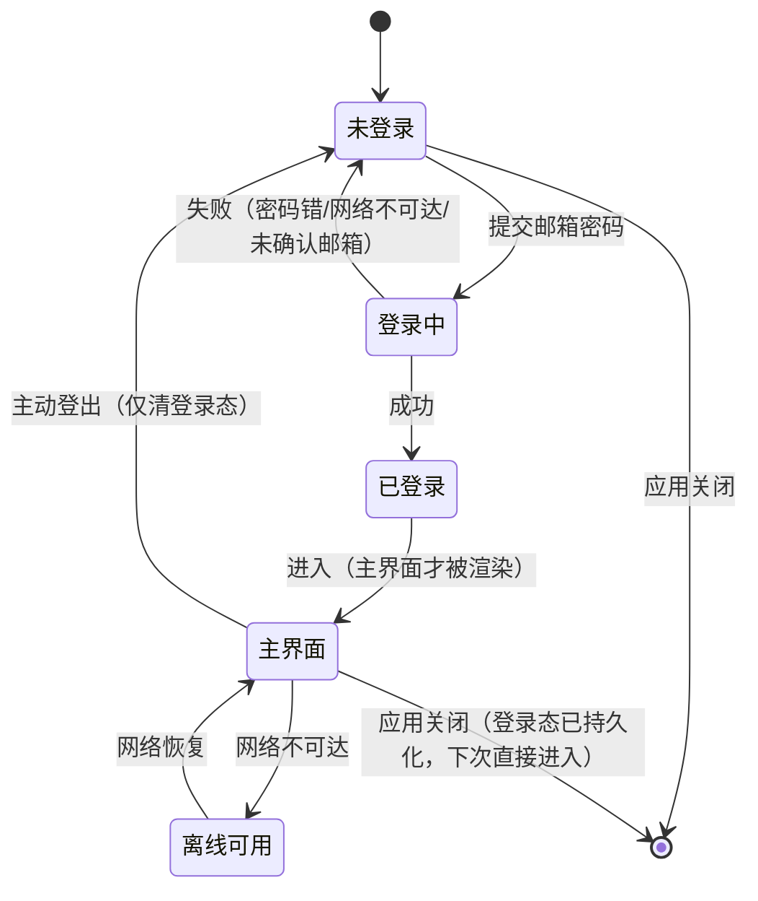

# mini-agent · 增量 PRD：账号体系 + 云端会话同步

> 版本：v1.0 · 编写：许清楚（产品经理） · 下游：高见远（架构师）
> 性质：**增量 PRD**，只描述本次新增/变更的部分，不重写产品整体 PRD。
> 输入：`docs/PROJECT-GUIDE.md`（现状）、主理人三轮澄清结论、用户原话「我建完 supabase 了，接入注册登录功能」。

---

## 0. 前提（已锁死，不再讨论）

| # | 前提 |
|---|---|
| P1 | 目标项目就是 mini-agent 本身，**不新建独立 Web 项目**（本地文件操作 + 工作区沙箱 + 本地 agent loop 在浏览器里做不了） |
| P2 | 后端用 **Supabase**（用户已自建），不引入任何其它云服务 |
| P3 | 登录方式 **仅邮箱 + 密码**，不做 OAuth / 手机号 / 魔法链接 |
| P4 | Supabase 客户端**只能放主进程**（渲染层打包后 CSP `connect-src 'none'`，发不出网络请求），经新增 IPC 通道暴露 |
| P5 | 密钥纪律：只有 `publishable` / anon key 可以进应用；**`service_role` / secret key 绝对不能进桌面端** |
| P6 | 登录态下「登录之后才能使用」。未登录**不能进主界面** |
| P7 | 分两批实施：**批一 · 账号体系** / **批二 · 云端会话同步** |

> 🚫 **项目级硬性禁令**：不得执行任何命令（npm / pnpm / tsc / eslint / 测试），不得启动浏览器或检查 DOM。本文所有验收判据均为**静态核对**或**用户手动运行肉眼确认**。

---

## 1. 产品目标

**一句话**：给 mini-agent 装上身份 —— 用户用邮箱登录后即可使用，会话记录自动同步到云端，换设备登录能看到全部历史。

| # | 目标 | 衡量方式 |
|---|---|---|
| G1 | **有身份**：注册 / 登录 / 登出 / 记住登录态可用，未登录锁在登录页 | 用户手动跑通注册→登出→重登全流程；未登录时看不到主界面 |
| G2 | **能找回**：会话与消息自动上云，换设备登录即可看到 | 用户在另一台机器（或清空本地数据后）登录同一账号，能看到历史会话与消息原文 |
| G3 | **不串号**：同一台电脑换账号登录，看不到前一个账号的任何会话 | 手动：账号 A 产生会话 → 登出 → 登录账号 B → 会话列表为空 |

> 三条目标相互约束：G2 要求上传，G3 要求隔离，两者**不得互相妥协**（不能为了好同步就把数据混在一起放）。

---

## 2. 增量范围界定

### 2.1 本次纳入

| 批 | 内容 |
|---|---|
| 批一 | 邮箱密码注册、登录、登出、记住登录态、未登录全屏锁死、登录态下的本地数据按账号隔离、登录相关错误态 |
| 批二 | 会话与消息上传、登录后拉取、首次登录的本地会话迁移、冲突处理、离线待同步队列、同步范围明示 |

### 2.2 本次不做

| # | 排除项 | 说明 |
|---|---|---|
| 1 | 第三方登录（OAuth / 微信 / GitHub） | 用户明确选定邮箱密码 |
| 2 | 手机号 / 短信验证码 / 魔法链接 | 同上 |
| 3 | 团队 / 组织 / 成员邀请 / 角色权限 | 本次是「个人账号」，不是「团队协作」 |
| 4 | 工作区文件同步 | 见 §4 问题五 —— 会重新定义产品数据边界 |
| 5 | 跨对话记忆、每日笔记、会话 Markdown 镜像的同步 | 同上，它们都绑在工作区本机路径上 |
| 6 | 会话内容的客户端加密 | 见 §4 补充决策 D1 |
| 7 | 消息级冲突合并 / 分支对话树 | 冲突按会话粒度整体取舍，不做逐条合并 |
| 8 | 服务端 agent loop / 服务端持有 Key | 用户自配 Key 的本地模式不变 |
| 9 | 配额、计费、限流、审计面板 | 无商业目标 |
| 10 | 多人实时协同（同一会话同时编辑） | 明确禁止并发编辑，见 §4 问题二 |

---

## 3. 用户故事

| ID | 用户故事 | 批 |
|---|---|---|
| US-1 | 作为一个**新用户**，我希望用邮箱和密码注册一个账号，以便我有一个自己的身份来使用这个工具。 | 一 |
| US-2 | 作为一个**日常用户**，我希望登录一次之后下次打开不用再输密码，以便不被登录流程打断。 | 一 |
| US-3 | 作为一个**在别人电脑上用过的用户**，我希望登出后自己的会话不会留在那台机器上被别人看到，以便我不担心隐私泄露。 | 一 |
| US-4 | 作为一个**换电脑的用户**，我希望登录后立刻看到我原来电脑上的全部历史会话，以便我不用手动导出导入。 | 二 |
| US-5 | 作为一个**已经有几十个会话的老用户**，我希望第一次登录时这些会话自动上云，以便我不用一个个手动处理。 | 二 |
| US-6 | 作为一个**知道这个工具靠本地文件干活的用户**，我希望明确知道哪些数据同步了、哪些没同步，以便我不会误以为换设备后 agent 还记得我的事。 | 一 + 二 |
| US-7 | 作为一个**网络不稳定的用户**，我希望断网时仍能继续用本地能力（本地 Ollama、文件操作），以便离线时这个工具不变成砖头。 | 一 |

---

## 4. 产品决策（架构师可直接引用）

### 问题一：首次登录时，本机已有会话怎么办？

**结论：全部自动上传（一次性批量迁移），但迁移前给一次「同步前告知」弹层。**

| 项 | 内容 |
|---|---|
| 策略 | 首次登录成功后，检测本机已有 N 个会话 → 弹一次告知 → 用户确认后全量上传，**不做逐个选择** |
| 为什么不做「让用户选」 | 用户的诉求是「登录后把会话同步云端」，不是「挑选哪些同步」。选择会增加一次打断、一个界面和一份决策负担，而产品里没有任何「有些会话不想上传」的功能支撑（不存在隐私分级） |
| 为什么不做「不上传只保留本地」 | 直接违背 G2，换设备后什么都看不到 |
| 告知弹层必须写清 3 件事 | ① 将有 N 个会话上传到云端；② **上传内容包括消息正文**（含 agent 曾读到的本地文件内容，这些内容已经存在于对话记录里）；③ 云端为明文存储，靠账号隔离保护 |
| 幂等要求 | 迁移只做一次（成功后在本地打标记）；重复执行必须覆盖而非产生重复会话 |
| 失败处理 | 上传失败**不阻塞使用**，转入待同步队列后台重试；用户可在界面上看到「N 个会话待同步」 |
| 迁移后本地数据 | **不删除**，本地仍是可用副本（离线也能看历史） |

---

### 问题二：同一份会话两边都改过怎么处理？

**结论：会话级「最后写入者胜」（last-write-wins，按 `updatedAt` 比较），整会话覆盖；覆盖前把被覆盖的一方落地成本地备份文件。**

| 项 | 内容 |
|---|---|
| 粒度 | **以会话为最小同步单位**，不做消息级合并 |
| 判定 | 比较本机会话的 `updatedAt` 与云端记录的 `updatedAt`，**新者胜，整会话覆盖旧者** |
| 为什么不弹冲突对话框 | 桌面单机 + 离线编辑场景下冲突是低频事件；为低频事件做一个版本对比 UI 不划算，且用户面对两版长对话往往判断不了哪个更好 |
| 为什么不「不允许两边并发编辑」 | **技术上做不到** —— 离线编辑是桌面应用的必然，你无法阻止用户在 A 机器和 B 机器上各改一遍。写着「不允许」等于把问题藏起来 |
| 必须加的前置约束 | **同一会话同一时刻只允许一个设备生成回复**。agent 生成是长耗时操作，两台机器同时跑同一会话会产生无法收敛的内容。实现上：云端的会话记录带「生成中」锁标记，另一设备进入该会话时提示「该会话正在其它设备生成中，暂时只读」 |
| 止损机制（必须有） | 每次整会话覆盖前，把**将被覆盖的那一版**完整写入本机 `<userData>/sync-backup/<会话id>-<时间戳>.json`，保留最近 5 份。用户如果发现内容被吃掉，至少有一条后悔路 |
| 明示的代价 | LWW 一定会丢改动。这是**接受的代价**，由备份目录兜底，并在同步说明里如实写明「同一会话在两台设备分别修改时，以最近修改的一方为准」 |

---

### 问题三：登出时本机会话数据怎么处理？

**结论：登出只清除「登录态」，不清会话数据；但本地数据改为「按账号分区存放」，使不同账号互相看不见。删除数据的唯一入口是设置里的「清除本账号本地数据」（二次确认）。**

| 项 | 内容 |
|---|---|
| 清什么 | 只清当前登录态（本机保存的会话 token / session），不清任何业务数据 |
| 留什么 | ① 会话与消息（保留在**该账号自己的分区**里）② API Key 与界面偏好（`config.json`） |
| 二次确认 | **登出本身不需要确认**（因为不删数据）；**「清除本账号本地数据」必须二次确认**，且弹层要显示将被删除的会话数量 |
| 为什么不清空 | ① **批一阶段云端还没有任何副本，登出清空 = 真实的数据丢失事故**；② 本机数据本来就是明文 JSON，「登出即删」并不提升实际安全性，只是把泄露风险换成了丢数据风险；③ 分区隔离已经彻底解决「下一个账号看到上一个账号的会话」 |
| 为什么分区而不是删 | 分区同时满足 G3（不串号）、离线可用（US-7）、批一无云副本也能安全登出三个要求。代价是存储层要支持多账号目录 |
| 数据归属迁移 | 现存的本机数据文件（无账号归属）在**第一个登录的账号**登录后归入该账号分区；**不删除原文件**，改名备份 |
| 明确不做 | 登录时「自动清空其他账号分区」—— 那是破坏性操作，永不自动执行 |

---

### 问题四：离线还能不能用？

**结论：允许用本地缓存的登录态继续使用，只有「从未登录过」或「已主动登出」才锁在登录页。**

| 场景 | 行为 |
|---|---|
| 本机有登录态 + 断网 / Supabase 不可达 | **正常进入主界面**，本地能力（本地文件、Ollama、历史会话、记忆）全部可用。顶部显示常驻细提示条「当前离线，云同步已暂停」，并给一个「重试」入口 |
| 登录态已过期 + 断网 | **仍允许进入**并使用本地功能；提示条文案改为「登录已过期，云端同步暂停」。恢复网络后自动尝试续期 |
| 从未登录过（全新安装）+ 断网 | **锁在登录页**。页面必须给出明确文案「无法连接登录服务，请检查网络后重试」，**不能转圈、不能报「密码错误」** |
| 已主动登出 | 锁在登录页（即使有网也必须重新登录） |
| 从未登录过 + 有网 | 正常注册 / 登录 |

| 项 | 内容 |
|---|---|
| 为什么选「离线可用」而不是「一律锁死」 | ① 这是一款 **local-first 桌面 agent**，本地文件操作与本地 Ollama 根本不依赖网络 —— 用登录态锁死它，等于把产品最值钱的部分拿去当抵押；② 用户的真实场景包含「用本地 Ollama 随便测试」，那正是可能没网或不想联网的时刻；③ 断网锁死会让用户认为「软件坏了」，信任损失远大于安全收益；④ 安全上无实质损失 —— token 与数据本来就在本机 |
| 明示的代价 | 应用在断网时仍可被打开。若用户的诉求是「没登录就一定打不开」，那本条需要改成「一律锁死」——**这一条是本次最需要用户复核的取舍** |
| 同步侧配合 | 离线期间产生的改动进入待同步队列，恢复网络后补传（批二） |

---

### 问题五：「记忆 / 工作区不同步」的体验落差要不要在界面上说明？

**结论：选 (a) 在界面上明确告知，但只放在两个固定位置，不做全局横幅、不做每次弹窗。**

**两处告知位置：**

| 位置 | 文案要点 | 触发条件 |
|---|---|---|
| ① 会话头部的可关闭提示条 | 「该会话的工作区绑定在其他设备上，本机不存在，已临时回退到默认工作区」 | 会话的 `workspaceRoot` 在本机不存在（换设备后必然命中） |
| ② 设置页「数据与同步」分组下的一行说明 | 同步范围 = 会话与消息；**不同步** = 工作区文件、跨对话记忆、每日笔记、会话 Markdown 镜像 | 常驻，无触发条件 |

**为什么不做 (b) 只列为已知限制不告知**：换设备登录后，用户看到的是「聊天记录都在，但 agent 不记得任何事、也读不到任何文件」。如果界面上一个字都不说，用户会判定这是 bug，并进而怀疑「是不是我的数据丢了」。这是整个改造中最容易引发信任崩塌的一点，而修复成本只是两处文案 —— 不做才是错的。

**为什么不做 (c) 把记忆纳入同步（及代价说明）**：记忆不是一份独立文件，它是**以工作区本机目录为根**的路径绑定结构（`<工作区>/.agent/memory/MEMORY.md` + 每日笔记 + 会话镜像）。要让记忆跟着账号走，就必须同步工作区本身，于是要连带解决：哪些目录算工作区（用户自己的项目目录，可能几个 GB）、增量与断点续传、双方同时改同一文件的冲突、权限与体积配额、以及「用户的代码被上传到我的云」这件事的合规与信任成本。**这不是「把记忆加进同步列表」的一行配置，而是把产品从「本地文件沙箱」重新定义为「带云盘的 agent」**，与 P1（本地优先）正面冲突。本次不做。

**配套的产品要求**：会话的 `workspaceRoot` 是**本机属性**，不随账号流转；换设备后该字段无效，必须回退默认工作区并给出提示（不得静默）。

---

### 问题六：未登录时界面长什么样？

**结论：全屏登录页，应用主界面完全不渲染。不做「能进去看但不能发消息」的半开状态。**

| 项 | 内容 |
|---|---|
| 结构 | 单张居中卡片：产品名 + 一行副标题「登录后使用」+ 邮箱输入 + 密码输入 + 「登录」主按钮 + 「还没有账号？注册」文字链接 |
| 注册 | **同一张卡片内切换**为注册表单（邮箱 + 密码 + 确认密码），不新开窗口、不新开页面 |
| 记住登录态 | 「记住我」默认勾选；不勾选则关闭应用后需重新登录 |
| 错误态 | 卡片内红字，按原因区分中文文案：邮箱格式不合法 / 密码错误 / **邮箱尚未确认** / 网络不可达 / 操作过于频繁 |
| 加载态 | 主按钮进入 loading 且禁用，输入框禁用 |
| 为什么不做半开状态 | ① 用户诉求是「登录之后才能使用」，半开会让用户以为功能坏了；② 本机数据已按账号分区，未登录时**没有「可以看的」数据**（不存在账号归属），「能进去看」在逻辑上也不成立；③ 只渲染登录页，状态少、组件少，不会漏渲染某个主界面组件而留下隐患 |
| **明示的取舍** | 全新安装 + 无网络 = **完全无法使用**。这是为满足 P6 付出的代价，登录页必须用可读文案承接，不得表现为无响应 |

---

### 问题七：两批的边界

**结论：确认主理人的判断，并补三点修正。**

| 批一完成时的状态 | 说明 |
|---|---|
| ✅ 注册 / 登录 / 登出 / 记住登录态 可用 | 后端全部经主进程与 Supabase 通信 |
| ✅ 未登录全屏锁死 | 主界面不渲染 |
| ✅ 会话数据**仍在本机**，但**已按账号分区** | **修正点①**：不是一份共享的本地数据，而是每个账号看见自己那一份 |
| ✅ 同机换账号登录看不到前一个账号的会话 | G3 达成 |
| ❌ 云端还没有任何会话数据 | 批一**完全不写云**，也不做「首次登录上传」（那是批二） |
| ⚠️ 换设备 = 空白 | 必须在批一交付说明里写清，避免用户以为「登录了就该有云同步」 |

- **修正点②**：批一**必须提前为批二留好数据归属**（按账号分区）。否则批二再做迁移，会遇到「本机一堆无主会话该归给谁」的难题。
- **修正点③**：批一的登出**因为是「不清数据」语义，界面上不得出现「登出将清除本机会话」之类的文案**，否则与产品决策三自相矛盾，会引起用户恐慌。

---

### 补充决策

| ID | 决策 | 理由与代价 |
|---|---|---|
| **D1** | **会话内容不做客户端加密，云端为明文存储**，靠 Supabase RLS 做账号隔离 | 做端到端加密需要一套密钥管理基础设施（密钥从哪来、丢了怎么办、换设备怎么解、多设备怎么同步密钥），只做「用一个固定密钥随便加一层」是**虚假安全感**。代价：云服务商侧可见明文，这一点必须写进 §4 问题一的告知弹层和设置页说明。**如果用户不接受，需要主动提出**（见 §7 待确认） |
| **D2** | 云端只存「会话 + 消息」，**不存**工作区路径、API Key、模型配置 | 工作区路径是另一台机器上无意义的字符串；API Key 是设备级凭据，绝不上云 |
| **D3** | 会话删除采用**软删除**（标记而非物理删除） | 保证「A 设备删除」能正确传播到「B 设备」，且给用户留一次恢复窗口。物理清理策略由架构师定 |
| **D4** | 同步是**后台静默**的，不需要用户点「保存」 | 用户的心智是「我改了就该在云上」，让他手动同步等于把责任推给用户 |
| **D5** | 登录态 token **不得进入渲染层** | 与现有 API Key 纪律一致（渲染层只应知道「已登录 / 未登录」和账号邮箱） |

---

## 5. 需求池

> 优先级：**P0 = 必须有｜P1 = 应该有｜P2 = 锦上添花**。所有验收标准均为静态核对或用户手动运行。

### 批一 · 账号体系

| ID | 需求 | 优先级 | 验收标准 |
|---|---|---|---|
| AU-01 | 邮箱 + 密码**注册** | P0 | 静态：主进程存在注册调用与错误映射。手动：用一个新邮箱完成注册并能登录 |
| AU-02 | 邮箱 + 密码**登录** | P0 | 静态：存在登录调用与登录态落盘。手动：输错密码给出「密码错误」；输对进入主界面 |
| AU-03 | **登出** | P0 | 静态：存在登出调用与登录态清除。手动：登出后回到登录页 |
| AU-04 | **记住登录态**（重启免登录） | P0 | 静态：登录态持久化在本机、启动时读取校验。手动：登录后关闭并重开应用，直接进入主界面 |
| AU-05 | 未登录**全屏锁死** | P0 | 静态：主界面组件在未登录分支下不被渲染。手动：登出状态下只能看到登录页 |
| AU-06 | 登录能力的 **IPC 通道**（Supabase 客户端只在主进程） | P0 | 静态：`shared/ipc-channels.ts` 存在 auth 域通道；渲染层代码中无任何 Supabase / fetch 调用 |
| AU-07 | **离线可用策略**（有登录态即可进入） | P0 | 静态：进入主界面的判据是「本机有登录态」而非「联网校验通过」。手动：断网后重开应用仍能进入并使用本地 Ollama 对话 |
| AU-08 | **本地数据按账号分区** | P0 | 静态：会话存储路径包含账号标识。手动：账号 A 建会话 → 登出 → 登录账号 B → 会话列表为空；再登回 A → 会话完整恢复 |
| AU-09 | 登录相关**错误态文案** | P0 | 手动：分别触发邮箱格式错 / 密码错 / 邮箱未确认 / 断网 / 限流，出现可读中文文案且不白屏 |
| AU-10 | **密钥纪律**：只用 publishable / anon key | P0 | 静态：全仓检索不存在 `service_role` 或 secret key 字样；配置文件中的 key 可被人工确认为公开级 |
| AU-11 | **忘记密码**（邮件重置） | P1 | 静态：存在重置密码调用。手动：填邮箱后收到重置邮件并能完成改密 |
| AU-12 | 主界面显示**当前登录邮箱**与登出入口 | P1 | 手动：在设置或顶栏能看到自己的邮箱，并能从该处登出 |
| AU-13 | 登录页网络不可达的**明确文案**（非转圈） | P1 | 手动：断网点登录，出现「无法连接登录服务」而非「密码错误」或长时间 loading |
| AU-14 | **清除本账号本地数据**（带二次确认） | P2 | 静态：存在删除逻辑与确认弹层。手动：确认后本账号会话被清空，其他账号分区不受影响 |
| AU-15 | **删除账号** | P2 | 静态：存在账号删除调用与确认弹层。手动：删除后无法再用该账号登录 |

### 批二 · 云端会话同步

| ID | 需求 | 优先级 | 验收标准 |
|---|---|---|---|
| SY-01 | 会话与消息**上传** | P0 | 静态：存在上传调用，触发点在会话变更之后。手动：本机发一条消息，云端表中出现对应记录 |
| SY-02 | 登录后**拉取**云端会话 | P0 | 手动：在清空本机数据的状态下登录，能看到云端全部会话与消息原文 |
| SY-03 | **首次登录迁移**（本机已有会话上云） | P0 | 静态：存在一次性迁移标记与批量上传逻辑；存在告知弹层。手动：老用户首次登录看到「N 个会话将被上传」并确认后完成上传 |
| SY-04 | **冲突处理**：会话级 LWW + 覆盖前本地备份 | P0 | 静态：存在 `updatedAt` 比较分支与备份写入。手动：构造两端不同修改，较新的一方胜出，且被覆盖版本出现在同步备份目录 |
| SY-05 | **同会话禁止双端同时生成** | P0 | 静态：存在生成中的锁标记与只读判断。手动：一端生成中，另一端打开该会话提示「正在其它设备生成中」 |
| SY-06 | **离线待同步队列**（恢复网络后补传） | P0 | 静态：存在待同步状态与重试逻辑。手动：断网改一条消息 → 恢复网络 → 云端出现该改动 |
| SY-07 | **同步状态可见** | P0 | 手动：能看到「同步中 / 已同步 / 离线待同步（N）」三种状态之一，且与真实情况一致 |
| SY-08 | **同步范围明示**（设置页说明文字） | P0 | 手动：设置页能读到「只同步会话与消息，不同步工作区与记忆」的说明 |
| SY-09 | **工作区绑定不同步 + 回退提示** | P0 | 静态：上传字段中不含 `workspaceRoot`。手动：换设备打开该会话，出现「工作区在本机不存在，已回退默认工作区」提示条 |
| SY-10 | **删除会话同步**（软删除，跨设备生效） | P0 | 手动：A 设备删除会话，B 设备刷新后该会话不再出现 |
| SY-11 | **云端 RLS 要求**（每行只能被其 owner 读写） | P0 | 静态：建表脚本/迁移文件存在 RLS 策略与 `auth.uid()` 归属校验；**用另一个账号的凭据无法读到本账号数据**（人工核对策略定义） |
| SY-12 | 手动**「立即同步」**入口 | P1 | 手动：点击后同步状态变为同步中，完成后显示已同步时间 |
| SY-13 | **增量拉取**（只拉 `updatedAt` 变动的会话） | P1 | 静态：存在按时间过滤的查询条件。手动：会话多时登录后能较快出现列表 |
| SY-14 | 同步失败**重试与提示** | P1 | 手动：把网络掐断再恢复，任务自动重试且最终一致 |
| SY-15 | 首次迁移的**进度展示** | P2 | 手动：迁移过程中能看到「已上传 N / 共 M」 |
| SY-16 | 消息级冲突合并 / 分支对话树 | P2 | **本期明确暂缓**，仅登记不实现 |

---

## 6. UI 设计稿（文字 + ASCII）

### 6.1 登录页（全屏，未登录时唯一界面）

```
┌─────────────────────────────────────────────────────────────────┐
│                                                                 │
│                                                                 │
│                    ┌───────────────────────────┐                │
│                    │      mini-agent           │                │
│                    │      登录后使用            │                │
│                    │                           │                │
│                    │  邮箱                     │                │
│                    │  ┌─────────────────────┐  │                │
│                    │  └─────────────────────┘  │                │
│                    │  密码                     │                │
│                    │  ┌─────────────────────┐  │                │
│                    │  └─────────────────────┘  │                │
│                    │                           │                │
│                    │  [x] 记住我               │                │
│                    │                           │                │
│                    │  ┌─────────────────────┐  │                │
│                    │  │       登录          │  │  ← 主色实底    │
│                    │  └─────────────────────┘  │                │
│                    │                           │                │
│                    │   还没有账号？注册          │  ← 文字链接    │
│                    │                           │                │
│                    │  ⚠ 错误文案显示在这里      │  ← 红字，无弹窗 │
│                    └───────────────────────────┘                │
│                                                                 │
└─────────────────────────────────────────────────────────────────┘
```

- 卡片宽度固定约 360px，垂直居中；卡片外无装饰、无插画、无渐变（延续「简约、不花里胡哨」红线）。
- 「注册」点击后**同一卡片内**切换为：邮箱 + 密码 + 确认密码 + 「注册」按钮 + 「已有账号？登录」。
- 窗内除卡片之外一律为页面底色，不出现任何主界面元素。

### 6.2 主界面增量（批一）

| 位置 | 新增内容 |
|---|---|
| 顶部栏右侧 | 账号区：「邮箱」文本 + 点击展开菜单（登出 / 设置） |
| 设置弹层 | 新增「账号」分组：当前邮箱、登出按钮、（P2）清除本账号本地数据 |

其余布局、配色、交互全部**保持不变**（沿用 `theme.css` 语义变量与现有组件）。

### 6.3 主界面增量（批二）

| 位置 | 新增内容 |
|---|---|
| 顶部栏 / 设置页 | **同步状态指示器**：`已同步`（次要文字）／`同步中…`（次要文字 + 细进度）／`离线待同步 N`（次要文字 + 可点） |
| 设置弹层 | 新增「数据与同步」分组：同步状态、上次同步时间、（P1）立即同步、**同步范围说明文字** |
| 会话头部 | **工作区缺失提示条**（可关闭）：「该会话的工作区绑定在其他设备上，本机不存在，已临时回退到默认工作区」 |
| 顶部（离线时） | 常驻细提示条：「当前离线，云同步已暂停」+「重试」入口 |
| 会话打开时（另一设备生成中） | 输入区禁用 + 提示「该会话正在其它设备生成中，暂时只读」 |

**视觉约束**：以上全部为**单行次要文字或细提示条**，不引入新的卡片、图标块、插画、动画；颜色只用现有语义变量（`text-muted` / `text-danger` / `border-line`），不新增色值。

### 6.4 关键状态机



> 说明：**未见「未登录 → 主界面」的边**。这是 G1 与产品决策六的硬约束。

---

## 7. 待确认问题

| # | 问题 | 影响 | 我的处理 |
|---|---|---|---|
| **Q1** | 你 Supabase 项目里**邮箱确认（Confirm email）是否已开启**？若开启，注册后必须去邮箱点确认链接才能登录 | 直接决定是否需要「请查收邮件」中间态、以及错误文案里是否要含「邮箱尚未确认」 | 已在 AU-09 与 §6.1 里预留该错误文案；架构师按开启处理更安全 |
| **Q2** | 是否接受 **D1：云端明文存储会话内容**（不做客户端加密）？ | 若不可接受，需要引入一套密钥管理设计，工作量与产品复杂度都会显著上升 | 本期按「明文 + RLS 隔离」设计，并在告知弹层写清 |
| **Q3** | **问题四的取舍**是否认可？即「断网时只要有登录态就能继续用」 | 这是本次对产品信任感影响最大的一条。若你要求「没登录/连不上就一定打不开」，需要改产品决策四 | 本期按「离线可用」实现 |
| **Q4** | 是否同意 **问题三（登出不清数据，改为按账号分区）**？ | 若你坚持「登出即从本机抹掉」，则批一必须有「云端已同步」作为前提，否则会丢数据 | 本期按「分区保留 + 显式清除入口」实现 |
| **Q5** | 除「会话与消息」外，**是否还想同步任何东西**（如某个单一设置项）？ | 每增加一类就要单独定义冲突与体积策略 | 本期只同步会话与消息 |

---

## 8. 给架构师的硬要求（约束复述，避免踩坑）

1. **Supabase 客户端只在主进程**；渲染层通过新增 IPC 通道取结果，通道名必须登记进 `src/shared/ipc-channels.ts`（仓库禁止硬编码通道字符串）。
2. **只有 publishable / anon key 可进应用**；`service_role` 永不出现。
3. **登录态 token 不得进入渲染层**，渲染层只应知道「已登录 / 未登录」与邮箱（与 API Key 的 `hasApiKey` 纪律一致）。
4. **新增配置字段必须同步加进 `normalizeConfig()` 白名单**，否则每次读盘都会静默丢掉用户设置（`PROJECT-GUIDE.md` §8.2 记录过这个坑）。
5. **本地数据分区带来存储路径变化**，需要处理现存无主数据文件的归属迁移，且**不删除原文件**。
6. `src/shared/` 保持零依赖；渲染层 `lib` 锁在 ES2022（不能用 `findLast` / `toSorted` 等）；`noUnusedLocals` 打开。
7. **RLS 是唯一的数据隔离手段**，必须在建表阶段就位，不能留给后续补。
8. 上传体积需有上限意识：会话消息里可能包含 agent 读到的文件正文，单条消息可能很长（`PROJECT-GUIDE.md` §8.3 提到工具结果回灌是完整内容）。
