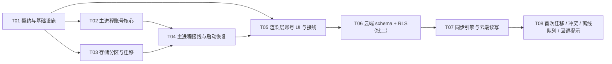

# mini-agent · 任务分解：账号体系 + 云端会话同步

> 版本：v1.0 · 编写：高见远（架构师） · 配套设计：`docs/AUTH-ARCHITECTURE.md`
> 执行者：寇豆码（工程师） · 验收：许清楚（产品）/ 质检
> 🚫 **硬性禁令**：不得执行任何命令（pnpm / tsc / eslint / 测试），不得启动浏览器或检查 DOM。
> 所有验收判据为「**静态核对**」（检索代码/结构）或「**用户手动运行肉眼确认**」。

---

## 0. 依赖包

```
@supabase/supabase-js@^2.117.2   # Supabase 客户端（仅主进程）
```

- **状态**：`package.json` **已声明**该依赖，无需再改 `package.json`。
- 安装（本仓用 **pnpm**）：`pnpm add @supabase/supabase-js`；或（已声明的现状）`pnpm install`。
- 环境变量：`MAIN_VITE_SUPABASE_URL`、`MAIN_VITE_SUPABASE_PUBLISHABLE_KEY`（`.env`，gitignore）。
- 不新增其它依赖；不引入 `@supabase/ssr`。

---

## 1. 任务依赖图



- **批一** = T01–T05；**批二** = T06–T08。
- 批一交付后即可独立验收（注册/登录/登出/锁死/分区/离线），**批一完全不写云**。

---

## 批一 · 账号体系

### T01 · 契约与基础设施
- **优先级**：P0
- **依赖**：无
- **源文件**：
  - `src/shared/types.ts`（改）
  - `src/shared/ipc-channels.ts`（改）
  - `src/main/env.d.ts`（新）
  - `.env.example`（新）
  - `.gitignore`（改）
- **要做什么**：
  1. `shared/types.ts`：新增 `AuthErrorCode` 联合类型 + `AUTH_ERROR_TEXT` 表（文案见设计 §10）。**不动**现有 `ErrorCode` / `ERROR_TEXT`。
  2. `shared/ipc-channels.ts`：在 `CHANNELS` 追加 `AUTH_GET_STATE` / `AUTH_SIGN_UP` / `AUTH_SIGN_IN` / `AUTH_SIGN_OUT` / `AUTH_RESET_PASSWORD` / `AUTH_DELETE_ACCOUNT` / `AUTH_CLEAR_LOCAL_DATA` / `AUTH_CHANGED`；新增类型 `AuthStateKind` / `AuthState` / `SignUpRequest` / `SignInRequest` / `AuthResult` / `SignUpResult` / `ResetPasswordRequest` / `ClearLocalDataRequest` / `ClearLocalDataResult`（签名见设计 §5.1）。
  3. `src/main/env.d.ts`：声明 `ImportMetaEnv` 的两个 `MAIN_VITE_SUPABASE_*` 字段。
  4. `.env.example`：两个变量的占位（含 `sb_publishable_` 注释说明「可公开」）。
  5. `.gitignore`：追加 `.env`（当前未忽略）。
- **验收（静态）**：`shared/ipc-channels.ts` 含全部 8 个 auth 通道且命名符合 `auth:动作`；`AuthState` 无任何 token 字段；`.gitignore` 含 `.env`；全仓检索无 `sb_secret_` / `service_role`。

### T02 · 主进程账号核心
- **优先级**：P0
- **依赖**：T01
- **源文件**：
  - `src/main/auth/client.ts`（新）
  - `src/main/auth/session-store.ts`（新）
  - `src/main/auth/errors.ts`（新）
  - `src/main/auth/service.ts`（新）
- **要做什么**：
  1. `client.ts`：`readSupabaseEnv()` / `isAuthConfigured()` / `getSupabase()` 单例；`createClient(url, key, { auth:{ storage: sessionStorage, storageKey:'mini-agent-auth', persistSession:true, autoRefreshToken:true, detectSessionInUrl:false, flowType:'pkce' } })`（见设计 §5.2）。
  2. `session-store.ts`：实现 supabase `auth.storage` 适配器 `getItem/setItem/removeItem`，落 `<userData>/auth/session.json`，值用 `safeStorage.encryptString` → base64；**不可加密时仅内存 Map，不明文落盘**；`setPersistence(enabled)` 控制「记住我」；写盘用 tmp+rename 原子写。
  3. `errors.ts`：`toAuthErrorCode(error)`，按 `message` 子串 + `status` 映射（表见设计 §10）；不返回英文原文。
  4. `service.ts`：`AuthService`（`restore/getState/signUp/signIn/signOut/resetPassword/deleteAccount`），构造依赖 `onAccountChanged(accountId|null)` 回调（由 T03/T04 注入）；所有返回值**脱敏**；`signIn` 前置 `setPersistence(remember)`；邮箱格式**本地先校验**（不打网络）
- **验收（静态）**：`session-store.ts` 不出现 `writeFile(..., 明文明文)` 的明文 token 路径；不可加密分支仅写 `memoryStore`；`service.ts` 返回类型不含 token；`client.ts` 单例（模块级 `let client` 只赋一次）。

### T03 · 存储分区与老数据迁移
- **优先级**：P0
- **依赖**：T01
- **源文件**：
  - `src/main/storage.ts`（改）
  - `src/main/account-migration.ts`（新）
- **要做什么**：
  1. `storage.ts`：新增模块态 `activeAccountId` 与 `getActiveAccountId()` / `setActiveAccount(id|null)`（切换时清 `conversationsCache`）；`conversationsPath()` 改为 account-aware（`<userData>/accounts/<id>/conversations.json`）；新增 `AccountMeta` 类型 + `readAccountMeta()` / `mutateAccountMeta()`（白名单式 normalize，纪律同 `normalizeConfig`）+ `normalizeAccountMeta()`；`readConversations()` 在无账号时返回 `[]`、`mutateConversations()` 无账号时按空列表处理（不抛错）；新增 `subscribeConversations(listener)` 观察者，在每次成功写入后回调最新列表（供批二 SyncEngine）。**保留** `enqueue` / `atomicWrite` / `readConfig` / `mutateConfig` 不变。
  2. `account-migration.ts`：`migrateLegacyConversations(accountId)` —— 见设计 §7.3（改名备份、幂等、永不删除、顺带迁移 `lastConversationId` 到 meta）。
  3. `handleConfigGet`（在 T04 改）：`PublicConfig.ui.lastConversationId` 改从**当前账号 meta** 读取。批一可先保留读 config 旧值，T04 完成切换。
- **验收（静态）**：会话路径含 `accounts/` 与账号标识；迁移函数含 `rename(` 且**无** `unlink(conversations.json)` / `rm(` 对源文件的删除；`subscribeConversations` 存在；`normalizeAccountMeta` 为新字段的入口。

### T04 · 主进程接线与启动恢复
- **优先级**：P0
- **依赖**：T02、T03
- **源文件**：
  - `src/main/auth/handlers.ts`（新）
  - `src/main/index.ts`（改）
  - `src/main/ipc.ts`（改）
- **要做什么**：
  1. `auth/handlers.ts`：`registerAuthHandlers(emit, deps)` —— 注册 `auth:getState/signUp/signIn/signOut/resetPassword/deleteAccount/clearLocalData`；登录成功调 `migrateLegacyConversations`（首个账号一次性）+ `setActiveAccount`；挂 `supabase.auth.onAuthStateChange` → `emit('auth:changed', AuthState)`；`clearLocalData` 删当前账号目录会话（二次确认由渲染层负责，`confirm` 为真才执行）。
  2. `index.ts`：`bootstrap()` 中在 `createMainWindow()` **之前** `await authService.restore()` 并据结果 `setActiveAccount`；调用 `registerAuthHandlers`。
  3. `ipc.ts`：`register()` 增调 `registerAuthHandlers`；`toPublicConfig` / `handleConfigGet` 的 `lastConversationId` 改为读当前账号 meta。
- **验收（静态）**：`index.ts` 中 `restore()` 在建窗口前 `await`；`auth:*` 全部注册；`onAuthStateChange` → `auth:changed` 存在；无账号时读会话返回空、进主界面拿不到任何会话（手动：未登录看不到主界面）。

### T05 · 渲染层账号 UI 与接线
- **优先级**：P0
- **依赖**：T01、T04
- **源文件**：
  - `src/preload/index.ts`（改）
  - `src/renderer/types/window.d.ts`（改）
  - `src/renderer/lib/api.ts`（改）
  - `src/renderer/store/useAppStore.ts`（改）
  - `src/renderer/main.tsx`（改）
  - `src/renderer/App.tsx`（改）
  - `src/renderer/components/LoginScreen.tsx`（新）
  - `src/renderer/components/TopBar.tsx`（改）
  - `src/renderer/components/SettingsDialog.tsx`（改）
- **要做什么**：
  1. preload 暴露 `getAuthState/signUp/signIn/signOut/resetPassword/deleteAccount/clearLocalData/onAuthChanged`（返回 unsubscribe 的订阅）；`window.d.ts` 补 `MiniAgentApi`；`lib/api.ts` 类型化封装（组件不碰 `window.api`）。
  2. store：`auth` / `authChecked` / `initAuth` / `applyAuthState` / `signIn` / `signUp` / `signOut`（签名见设计 §5.5）；登录成功后 `applyAuthState` → `hydrate()`；登出后清空 `conversations/messages/streams/activeConversationId`。
  3. `main.tsx`：`render()` 前 `await store.initAuth()`（与 `initTheme()` 并列，避免闪主界面）。
  4. `App.tsx`：顶层分支 `authChecked && isAuthed(auth) ? 主界面 : <LoginScreen/>`；订阅 `auth:changed` → `applyAuthState`。
  5. `LoginScreen.tsx`：全屏居中卡片（约 360px），登录/注册**同卡片切换**，邮箱+密码(+确认密码)，记住我默认勾选，主按钮 loading 禁用，错误红字（用 `AUTH_ERROR_TEXT`），含「无法连接登录服务」明确文案；不渲染任何主界面元素。
  6. `TopBar.tsx`：右侧账号区（邮箱 + 展开菜单：登出 / 设置）。
  7. `SettingsDialog.tsx`：新增「账号」分组（当前邮箱 / 登出 / 清除本账号本地数据 P2，二次确认显示会话数）。
- **验收（静态）**：`App.tsx` 有 `isAuthed` 分支且未登录分支**不挂载**主界面组件；`renderer/**` 无 `@supabase` / `fetch`；store 返回值无 token；登出文案不含「清除本机会话」。
- **验收（手动）**：注册→登出→重登全流程；输错密码显示「邮箱或密码错误」；断网点登录显示「无法连接登录服务」（非转圈）；关闭重开免登录；（G3）账号 A 建会话→登出→登录 B→列表为空→登回 A→会话恢复。

---

## 批二 · 云端会话同步

### T06 · 云端 schema + RLS
- **优先级**：P0
- **依赖**：T05（批一稳定后）
- **源文件**：`supabase/migrations/0001_init.sql`（新）
- **要做什么**：落盘设计 §9 的完整 SQL（建表 + 索引 + `enable row level security` + 四策略×两表 + `grant authenticated`，不 grant `anon`）。文件顶部写明「在 Supabase Dashboard → SQL Editor 手动执行」。
- **验收（静态）**：两表都有 RLS 与四条策略；`using`/`with check` 均含 `auth.uid() = owner_id`；`messages` 的 insert/update 含会话归属 `exists` 子查询；无任何 `service_role` 字样。
- **验收（手动，可选）**：在 SQL Editor 执行成功；用另一个账号凭据读不到本账号行（SY-11）。

### T07 · 同步引擎与云端读写
- **优先级**：P0
- **依赖**：T06
- **源文件**：
  - `src/main/sync/repo.ts`（新）
  - `src/main/sync/engine.ts`（新）
  - `src/main/sync/handlers.ts`（新）
  - `src/main/ipc.ts`（改：注册 sync handlers + 生成开始/结束维护 `generating` 锁）
  - `src/shared/ipc-channels.ts`（改：`SYNC_GET_STATUS` / `SYNC_NOW` / `SYNC_STATUS` + `SyncPhase` / `SyncStatus`）
  - `src/preload/index.ts` + `window.d.ts` + `lib/api.ts`（改）
  - `src/renderer/store/useAppStore.ts`（改：`sync` slice）
  - `src/renderer/components/SyncStatusIndicator.tsx`（新）
  - `src/renderer/components/SettingsDialog.tsx`（改：「数据与同步」分组）
- **要做什么**：
  1. `repo.ts`：增量拉取（`updated_at` 过滤）/ 会话与消息 upsert / 软删除 / 生成中锁读写。
  2. `engine.ts`：订阅 `subscribeConversations` → 与上次快照比对 `updatedAt` → 防抖 ~1.5s 批量推送；离线入 pending 队列、恢复网络补传；登录后先增量拉取再推本地待同步；维护 `phase/pendingCount/lastSyncedAt`。
  3. `handlers.ts`：注册 `sync:getStatus` / `sync:now`，推送 `sync:status`。
  4. IPC：应用登录态后启动引擎；登出停止并清 pending。
  5. 渲染层：顶栏/设置页同步状态指示器（已同步 / 同步中… / 离线待同步 N）+「立即同步」+「同步范围说明」文字。
- **验收（静态）**：存在按 `updated_at` 过滤的查询；存在 pending 队列与重试；`sync:status` 事件存在；上传字段**不含** `workspaceRoot`。
- **验收（手动）**：本机发一条消息 → 云端表出现记录（SY-01）；清本地数据后登录能看到云端会话与消息（SY-02）；断网改消息→恢复网络→云端出现（SY-06）；状态指示与真实一致（SY-07）。

### T08 · 首次迁移 / 冲突 / 离线队列 / 回退提示
- **优先级**：P0（其中进度展示、消息级合并为 P2）
- **依赖**：T07
- **源文件**：
  - `src/main/sync/engine.ts`（改：LWW + 覆盖前备份 + 首次全量迁移）
  - `src/main/sync/repo.ts`（改：备份读写）
  - `src/renderer/components/MessageList.tsx`（或会话头组件，改：工作区缺失提示条）
  - `src/renderer/components/MigrationNotice.tsx`（新：首次迁移告知弹层）
- **要做什么**：
  1. 首次登录全量迁移：检测本机 N 个会话 → 弹「同步前告知」（含「将上传 N 个会话，含消息正文；云端明文存储，靠账号隔离」三件事）→ 用户确认后批量上传；成功打标记（`meta.legacyMigrated` / `meta.syncedAt`），**幂等**（重复执行覆盖不重复）。
  2. 冲突：会话级 LWW（比 `updatedAt`），覆盖前把**被覆盖的一版**写 `sync-backup/<id>-<ts>.json`，保留最近 5 份。
  3. 生成中锁：进入会话前读云端 `generating`，为真且新鲜则输入区禁用 + 提示「该会话正在其它设备生成中，暂时只读」。
  4. 工作区回退提示条：会话 `workspaceRoot` 在本机不存在 → 可关闭提示条「该会话的工作区绑定在其他设备上，本机不存在，已临时回退到默认工作区」（**不静默**）。
  5. 设置页「同步范围明示」文案：同步 = 会话与消息；不同步 = 工作区文件、跨对话记忆、每日笔记、会话 Markdown 镜像。
- **验收（静态）**：存在 `updatedAt` 比较分支与 `sync-backup` 写入；存在迁移标记与告知弹层；上传字段无 `workspaceRoot`。
- **验收（手动）**：老用户首次登录看到「N 个会话将被上传」并确认后完成（SY-03），且本地数据仍在；构造两端不同修改→较新者胜且被覆盖版本出现在 `sync-backup`（SY-04）；一端生成中另一端只读（SY-05）；换设备打开会话出现工作区回退提示（SY-09）；A 删除会话→B 刷新后消失（SY-10）。

---

## 2. 共享知识（跨任务约定）

1. **通道唯一来源**：`auth:*` / `sync:*` 全部登记在 `src/shared/ipc-channels.ts`，**禁硬编码通道字符串**。
2. **渲染层零网络**：`src/renderer/**` 无 `@supabase` import / `fetch` / `XMLHttpRequest`；Supabase 只在主进程。
3. **token 不出主进程**：所有 IPC 返回类型（`AuthState` / `AuthResult` / `SignUpResult`）**不得含** `access_token` / `refresh_token` / `session`。
4. **禁词**：全仓不得出现 `service_role` 或 `sb_secret_`；只允许 `sb_publishable_`。
5. **配置白名单**：写 `config.json` 的新字段必须加入 `normalizeConfig()`；`accounts/<id>/meta.json` 用 `normalizeAccountMeta()`。**批一不新增 config 字段**。
6. **存储纪律**：会话文件与 `session.json` 一律 `enqueue` + `atomicWrite`（tmp+rename）。
7. **错误文案**：账号错误只用 `AUTH_ERROR_TEXT`；不在组件里硬写中文错误句。
8. **类型约束**：`src/shared/` 零依赖；渲染层 `lib` 锁 **ES2022**（禁 `findLast` / `toSorted`）；`noUnusedLocals` / `noUnusedParameters` 打开（未用变量会编译失败）。
9. **登出红线**：登出**只清登录态、不清会话数据**；界面不得出现「登出将清除本机会话」文案。
10. **离线优先**：进入主界面的判据是「本机有登录态」（`authenticated` 或 `expired`），**不是**「联网校验通过」；仅 `unauthenticated` 锁在登录页。
11. **账号隔离**：会话与 `lastConversationId` 按 `accountId` 分区存放；`config.json`（providers / API Key / theme / memoryEnabled）保持全局设备级。

---

## 3. 与批一无关但需注意的现有约束（避坑）

- `normalizeConfig()` 是**白名单式重建**：新增字段忘记加入 → 每次重启静默丢设置（`PROJECT-GUIDE.md` §8.2）。本设计批一**故意不新增 config 字段**以规避。
- `mutateConversations` / `mutateConfig` 是**串行队列**：账号切换需在操作间隙进行，避免读到旧缓存。
- 会话消息可能很长（agent 读到的文件正文会整体落进消息，`PROJECT-GUIDE.md` §8.3）→ 批二上传需有体积意识。
- Electron `sandbox:true` + `contextIsolation:true`：preload 只暴露白名单，**不得**向渲染层转发任意通道。
