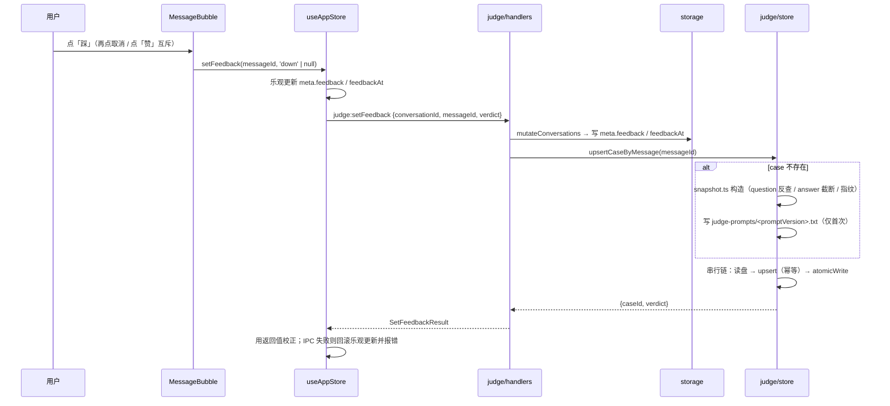
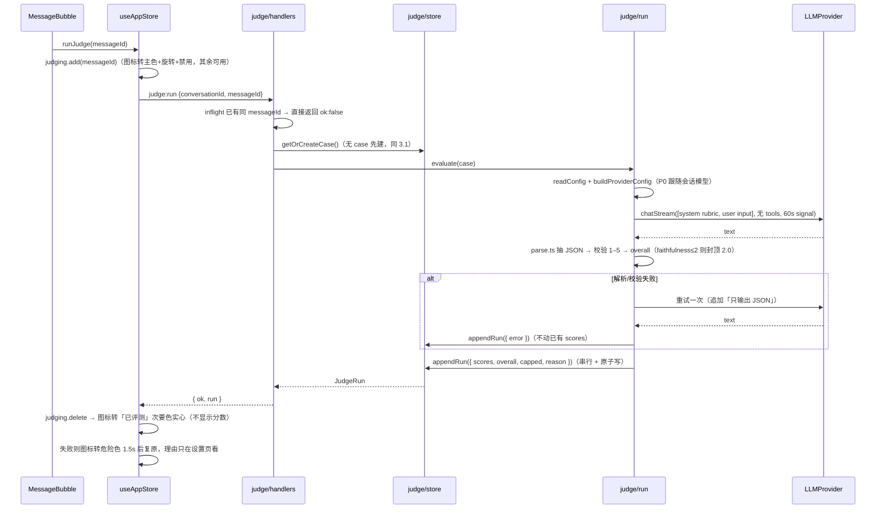

# mini-agent · 系统设计：LLM-as-judge 质量评测

> v1.0 · 高见远（架构师）· 输入：`docs/JUDGE-PRD.md`、现有源码
> **增量设计**，只描述新增/变更，不重写 `ARCHITECTURE.md` / `HARNESS-ARCHITECTURE.md`。
> 禁令：本文不执行任何命令，验收均为静态核对或用户手动确认。

---

## 1. 模块清单

| 路径 | 职责 | 层 |
|---|---|---|
| `src/main/judge/fingerprint.ts` | promptVersion / toolSetHash / questionHash / appVersion（`node:crypto` 前 8 位） | main |
| `src/main/judge/snapshot.ts` | Conversation+Message → JudgeCase（截断、指纹回填、反查 question） | main |
| `src/main/judge/store.ts` | judge-cases.json 读写：串行链 + 原子写 + 500 上限 + summary 聚合 + prompt 快照去重 | main |
| `src/main/judge/prompt.ts` | JUDGE_SYSTEM_PROMPT / RUBRIC_VERSION / buildJudgeInput（含截断与片段声明） | main |
| `src/main/judge/parse.ts` | 防御式 JSON 抽取 + 1–5 校验 + overall 计算（忠实度封顶） | main |
| `src/main/judge/run.ts` | judge 调用编排：readConfig → buildProviderConfig → chatStream（无 tools，60s，重试 1 次） | main |
| `src/main/judge/handlers.ts` | 注册 4 个 `judge:*` 通道（照 `skills/handlers.ts` 风格，永不 reject） | main |
| `src/main/providers/runtime.ts` | `buildProviderConfig` 从 ipc.ts 提取，供 ipc 与 judge 共用 | main |
| `src/main/workspace-memory.ts`、`src/main/skills/catalog.ts` | 导出模板常量（供指纹哈希；构建逻辑不变） | main |
| `src/main/ipc.ts` | finalize 时写入指纹；注册 judge handlers | main |
| `src/shared/types.ts` | MessageMeta 增 4 字段 + JudgeCase 家族 + 常量 | shared |
| `src/shared/ipc-channels.ts` | 4 通道常量 + 请求/响应类型 | shared |
| `src/preload/index.ts`、`src/renderer/types/window.d.ts`、`src/renderer/lib/api.ts` | 桥接三件套 | renderer |
| `src/renderer/store/useAppStore.ts` | feedback 乐观更新、judging/judged 状态、summary | renderer |
| `src/renderer/components/MessageBubble.tsx`、`MessageList.tsx` | 操作行第 2/3/4 位三枚图标 | renderer |
| `src/renderer/components/QualityPanel.tsx`、`SettingsDialog.tsx` | 设置页第 5 分组「质量」 | renderer |

---

## 2. 数据模型定稿

```ts
// shared/types.ts 追加
export type Verdict = 'up' | 'down';

export interface MessageMeta {           // 追加 4 个可选字段
  feedback?: Verdict;                     // J-03
  feedbackAt?: number;
  promptVersion?: string;                 // 生成时指纹（finalize 写入）
  toolSetHash?: string;
}

export interface GenerationFingerprint {
  providerId: ProviderId; model: string;
  promptVersion: string; toolSetHash: string; appVersion: string;
  turns?: number;
}

export interface JudgeScores {
  relevance: number; faithfulness: number; completeness: number; clarity: number; // 1–5 整数
}

export interface JudgeRun {
  runAt: number; judgeProviderId: ProviderId; judgeModel: string; rubricVersion: string;
  scores?: JudgeScores; overall?: number;   // 1 位小数
  capped?: boolean;                         // 忠实度硬否决已触发
  reason?: string; error?: string;
}

export interface JudgeCase {
  id: string; conversationId: string; messageId: string;  // messageId = 幂等键
  createdAt: number; question: string; questionHash: string;
  answer: string; answerTruncated: boolean;
  steps: ToolStep[]; finishReason?: FinishReason; verdict?: Verdict;
  generation: GenerationFingerprint; runs: JudgeRun[];
}

export interface JudgeCaseSummary {        // 列表用，不含 answer/steps（IPC 体积）
  id: string; conversationId: string; messageId: string; createdAt: number;
  question: string;                        // 截断 60 字
  verdict?: Verdict; overall?: number; weakest?: keyof JudgeScores; hasRun: boolean; error?: string;
}

export interface JudgeSummary {
  total: number; evaluated: number; window30d: number; cappedCount: number;
  avgOverall: number | null;
  dims: Record<keyof JudgeScores, number | null>;
  downSamples: JudgeCaseSummary[];
}

export const JUDGE_ANSWER_MAX_CHARS = 8000;   // J-12
export const JUDGE_CASE_LIMIT = 500;
export const JUDGE_RUN_LIMIT = 5;
export const JUDGE_SCORE_MIN = 1;
export const JUDGE_SCORE_MAX = 5;
export const JUDGE_CAP_OVERALL = 2;           // 忠实度 ≤2 时 overall 上限
```

只留 main 侧、**不进** `shared/types.ts`：judge prompt 全文与锚点表（`judge/prompt.ts`）、哈希实现、解析器。

### 设计决定（A–H）

| # | 问题 | 决定 | 理由 |
|---|---|---|---|
| **A** | `promptVersion` 取哪几段 | **只 hash 手写模板常量**：工作区规则文案（根目录替换为 `<root>`）、记忆前缀、技能清单抬头/预算阈值。**排除**技能列表、记忆正文、工作区绝对路径 | 这些是「每轮必变」的变量。全量 hash 会把「昨天装了个技能」算成 prompt 变更，A/B 结论失真。模板文案本身改了才应换版本 |
| A2 | 要不要存 system 全文 | 存，但**按 promptVersion 去重**：`judge-prompts/<promptVersion>.txt`，写前 `access` 判断存在即跳过；内容 == 哈希输入，可逐字节复算 | 只有哈希只能分组不能回溯；每条 case 存一份会让文件爆掉，按版本去重后通常只有几个文件 |
| **B** | 忠实度输入只有 200 字片段 | **接受降级**，不存全文。rubric 里显式写明：「工具结果仅给出前 200 字片段；若仅凭片段无法判断，忠实度按 3 分中性处理，**不得因片段缺失判 1 分**」 | 全文只活在 loop 的 `convo` 里，函数返回即销毁。落盘全文要么塞进 `conversations.json`（每条消息全量重写 → MB 级写放大），要么新增每消息证据文件（+GC/删会话耦合）。而编造的主要形态是「声称读了不存在的文件/数据」，工具名+参数+200 字已可识别大半。P1 钩子：`judge-evidence/<convId>__<msgId>.json`（每步 ≤1500 字、总 ≤8KB），`messageId` 关联，随会话删除 |
| **C** | 硬否决 vs 等权均值 | **封顶**：`overall = min(round1(mean), 2.0)`，同时 `capped = true`，reason 必写最弱维 | 只标记不改分，则「编造」被另外三维的高分抹平，与「唯一硬否决」的产品语义矛盾。封顶比直接 0 分温和：保留 2 分档内的区分度，且 4 维分数原样保留，可回溯 |
| **D** | 8000 截断 vs 完整性 | 保留 8000（P0），case 存 `answerTruncated`，prompt 注入声明：「回答因长度被截断（原文 N 字），**勿因缺少结尾扣完整性**，仅当已给出部分明显缺要点才扣分」 | 提高上限会让 DeepSeek/Ollama 的长回答成本与超时风险线性上升；显式声明即可消除误判，代价为零 |
| **E** | case 快照还是引用 | **快照副本**；`conversationId`/`messageId` 仅作溯源。会话删除后 case **保留**，详情页显示「原会话已删除」 | 评测集不该随会话消失（用户清理历史会毁掉历史 A/B 数据）；且编辑重发会截断原消息，引用会读到错误内容。代价是重复存储，由 §5 的上限兜住 |
| **F** | 存储分片 | **单文件 + 500 条上限**，超出先淘汰「无 run 且无 verdict」的最旧 case，全部有 run 时淘汰最旧 | 分片会让跨片汇总/按 questionHash 分组查询复杂化；500 × ~24KB ≈ 12MB 上限，且写只发生在用户手点（点赞/评测），非循环路径，全量重写可接受。P1 钩子：按年月分片 |
| **G** | 并发与幂等 | `judge/store.ts` 自带串行链（照 `memory.ts` 的 `enqueueMemory`），与 `storage.enqueue` **不同链**（互不等待，无死锁）。写路径：① `setFeedback` → 先 `mutateConversations` 写 meta，再 upsert case；② `judge:run` → `inflight:Set<messageId>` 去重，完成后 append run | 两条链各管一个文件，串行即可；meta 先写保证「反馈不因 case 写失败而丢」，case 缺失时评测会自动补建。重复点赞/改选是同一 upsert，天然幂等 |
| **H** | judge 怎么调 Provider | `judge/run.ts` 走 `readConfig()` + `buildProviderConfig()`（从 ipc.ts 提取到 `providers/runtime.ts`）。messages = `[{system: rubric}, {user: 题+答+轨迹}]`，**不传 tools**；超时 60s（`combineSignals([], JUDGE_TIMEOUT_MS)`）。**不改 provider 层**：不加 `response_format`，纯 prompt 约束 + 防御式解析 | 改 `ChatStreamParams` 会波及 3 个 provider 实现与全部调用点，而 Ollama 不支持 `response_format`，收益只是「少一次重试」。解析器兜住一切：剥 ```json 围栏 → 取首个 `{` 到末个 `}` → parse → 手写 1–5 整数校验 |

---

## 3. 调用流程

### 3.1 点「踩」→ 建 case



### 3.2 点「评测」→ judge → 落 run



---

## 4. IPC 契约

```ts
// CHANNELS 追加
JUDGE_SET_FEEDBACK: 'judge:setFeedback',
JUDGE_RUN: 'judge:run',
JUDGE_LIST: 'judge:list',
JUDGE_SUMMARY: 'judge:summary',

export interface JudgeSetFeedbackRequest {
  conversationId: string; messageId: string; verdict: Verdict | null;  // null = 取消
}
export interface JudgeSetFeedbackResult {
  ok: boolean; verdict?: Verdict; caseId?: string; error?: string;
}
export interface JudgeRunRequest { conversationId: string; messageId: string; }
export interface JudgeRunResult { ok: boolean; run?: JudgeRun; error?: string; }
export interface JudgeListRequest { conversationId?: string; limit?: number; }
export type JudgeListResult = JudgeCaseSummary[];
export interface JudgeSummaryRequest { days?: number; }        // 缺省 30
export type JudgeSummaryResult = JudgeSummary;
```

纪律：四个 handler 一律 try/catch，异常返回 `{ok:false, error}`，**绝不 reject**（渲染层永不卡在「评测中」）。无账号时 `mutateConversations` 与 judge store 均静默忽略（不落盘、不抛）。

---

## 5. 存储设计

| 项 | 方案 |
|---|---|
| case 文件 | `<userData>/accounts/<id>/judge-cases.json`（账号分区，与 `conversations.json` 同级） |
| prompt 快照 | `<userData>/accounts/<id>/judge-prompts/<promptVersion>.txt`，存在即跳过 |
| 写入 | 复用 `storage.atomicWrite`（`.tmp` + rename）；串行用 `judge/store.ts` 自己的 promise 链（照 `enqueueMemory`） |
| 接入点 | 仅两处：`setFeedback` 的 case upsert、`judge:run` 的 `appendRun`。列表/汇总为纯读（内存缓存，首次读盘） |
| 上限 | 500 条；单条 ≈ answer 8000 + steps 200×N + 元数据；淘汰顺序见 §2-F |
| run 上限 | 每 case 保留最近 5 次（含失败），超出丢最旧 |
| 删除策略 | 会话删除**不**连带删 case（§2-E）；P1 再提供「清空评测集」 |

`MessageMeta.promptVersion/toolSetHash` 在 `finalizeAssistantMessage` 时写入（`handleChatSend` 已持有 `config` 与 `toolContext`，`harnessToolsFor(toolContext)` 取工具名排序哈希），**不在 case 创建时算**——否则「生成后装了技能」会让指纹漂移。

---

## 6. 任务分解

> 本项目为既有工程增量，无「脚手架」阶段；T1 即本次的共享契约地基。上限 4 个任务。

### T1 共享契约 + 指纹基建（P0）
- 文件：`src/shared/types.ts`、`src/shared/ipc-channels.ts`、`src/main/judge/fingerprint.ts`、`src/main/providers/runtime.ts`、`src/main/workspace-memory.ts`、`src/main/skills/catalog.ts`、`src/main/ipc.ts`
- 依赖：无
- 判据：`buildProviderConfig` 只剩 runtime.ts 一份实现，ipc.ts 改为 import；消息 meta 落盘含 `promptVersion`/`toolSetHash`；**改工作区规则文案 → promptVersion 变；装卸技能 / 改记忆 → 不变**（手动核对）；`tsc` 无 `noUnusedLocals` 报错。

### T2 主进程评测内核（P0）
- 文件：`src/main/judge/prompt.ts`、`parse.ts`、`snapshot.ts`、`store.ts`、`run.ts`、`handlers.ts`
- 依赖：T1
- 判据：4 通道注册成功且不 reject；点赞即出现 case（`runs` 为空）；case 重复点赞不产生第二条；judge 失败记 `error` 且不清空已有 `scores`；`faithfulness=2` 时 `overall=2` 且 `capped=true`；第 501 条淘汰最旧；answer 超 8000 截断并置 `answerTruncated`。

### T3 渲染层交互（P0，可与 T2 并行）
- 文件：`src/preload/index.ts`、`src/renderer/types/window.d.ts`、`src/renderer/lib/api.ts`、`src/renderer/store/useAppStore.ts`、`src/renderer/components/MessageBubble.tsx`、`src/renderer/components/MessageList.tsx`
- 依赖：T1（通道类型）；端到端联调需 T2
- 判据：hover 出四枚图标（复制/赞/踩/评测）；赞踩互斥可取消且重启保持；评测中仅该图标禁用；已评测次要色实心、**无分数无 tooltip**；失败危险色 1.5s 复原；全组件无硬编码色值。

### T4 设置页「质量」分组 + 集成自检（P0）
- 文件：`src/renderer/components/QualityPanel.tsx`（新）、`src/renderer/components/SettingsDialog.tsx`、`src/renderer/store/useAppStore.ts`、`src/renderer/lib/api.ts`
- 依赖：T2、T3
- 判据：第 5 分组排在「账号」后；四块内容（平均分/维度均值/近 30 天条数/踩样本清单）可见且空态有文案；数字只取每条 case 最新成功 run；`cappedCount` 有展示；分组切换不丢其他分组状态。

---

## 7. 依赖包

**零新增。** 哈希用 `node:crypto`（`createHash('sha256')`），JSON 解析手写，UI 复用现有 HeroUI + 语义类，无 zod / 无评测框架 / 无 Python 桥。

---

## 8. 共享知识

- **judge prompt 常量只放 `src/main/judge/prompt.ts`**（渲染层永不展示 prompt，不进 shared）。
- **分数**：4 维为 1–5 整数；`overall = Math.round(mean * 10) / 10`，封顶后可能为 `2`；禁止出现 0 分或小数维度分。
- **时间**：落盘一律 `Date.now()` 毫秒数；展示用本地时间（复用 `formatLocalTime` 语义），禁止 `toISOString`。
- **哈希**：统一 `createHash('sha256').update(text, 'utf8').digest('hex').slice(0, 8)`。
- **通道名**只从 `CHANNELS` 取；渲染层禁止硬编码字符串。
- **状态色**：选中/评测中用主色语义类（`text-accent`，主题无此类时用 `text-fg`），失败 `text-danger`，默认 `text-muted`；**不得写任何色值**。
- **ES2022**：可用 `at`；禁用 `findLast` / `toSorted` / `Object.hasOwn`。`strict` 但无 `exactOptionalPropertyTypes`。
- **新配置字段**（P1 的 `judge.providerId/model` 覆盖）必须同步 `normalizeConfig()` 白名单 + `PublicConfig` + `ConfigSaveInput`，否则读盘静默丢失。
- 块注释内不得出现连写的「双星号 + 斜杠」。

---

## 9. 待明确事项

1. **忠实度封顶会显著拉低平均分**（凡出现编造即 overall ≤2）。若期望「只标记不改分」，只需把 `JUDGE_CAP_OVERALL` 逻辑改为仅置 `capped`——请拍板取哪一种。
2. **case 无删除入口**（只有 500 条自动淘汰）。是否需要「删除单条 case / 清空评测集」按钮？
3. **judge 模型 P0 跟随会话模型**（自评偏差已知）。是否本次就把「judge 模型可单独指定」提到 P0？提到 P0 需增加配置字段与设置页下拉（+1 处白名单）。
