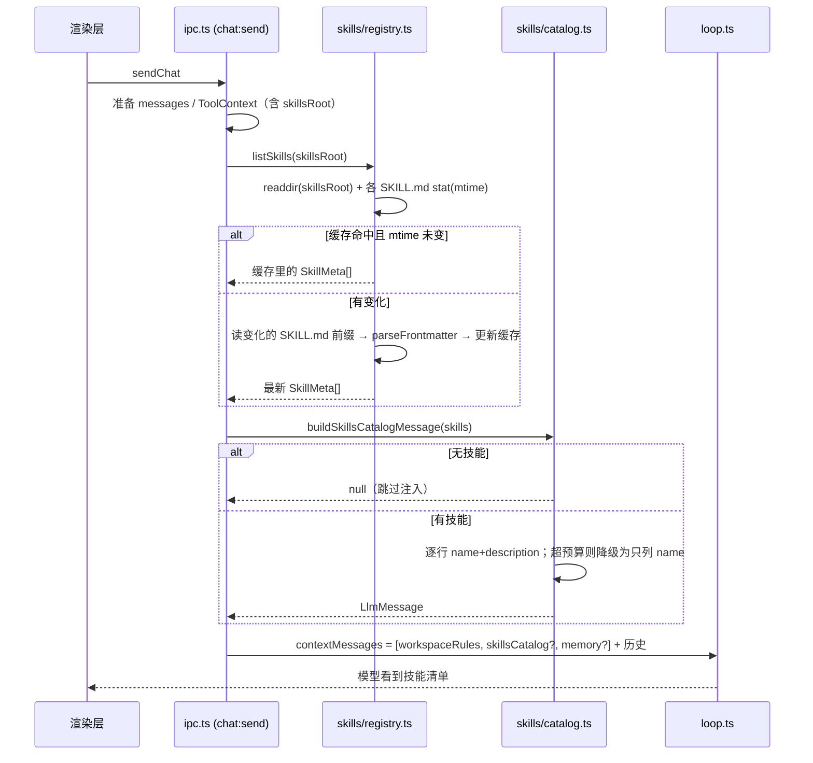
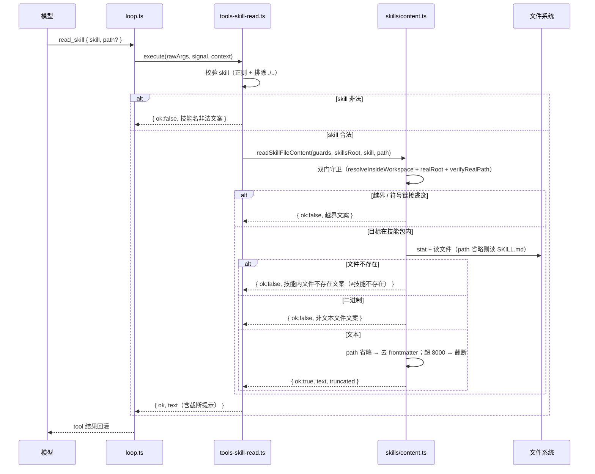
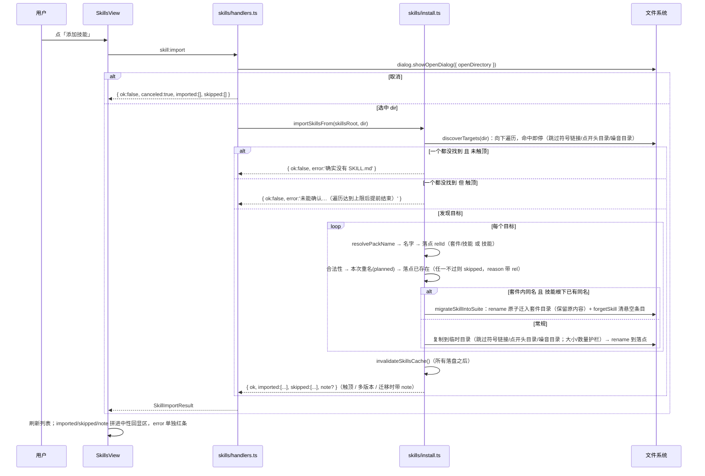

# mini-agent · 增量设计：技能加载（registry + 一级注入 + `read_skill`）+ 技能导入（IPC + UI）

> 版本：v1.5（**技能目录物理嵌套**：套件 = 目录层级，归属**路径优先 + 清单回退**；改动逐条见 §14「勘误记录」，本章新增见 §16） · 编写：高见远（架构师） · 类型：**增量设计**（承接 `docs/SKILL-RUNTIME-DESIGN.md`，不重写它）
> 输入：主理人齐活林派发任务 + `src/main/{ipc.ts, skills/paths.ts, workspace-memory.ts, index.ts}`、`src/main/harness/{types,tools,tools-skill-run,index}.ts`、`src/main/auth/handlers.ts`、`src/shared/ipc-channels.ts`、`src/preload/index.ts`、`src/renderer/{types/window.d.ts, lib/api.ts, store/useAppStore.ts, components/{SettingsDialog,ConfirmDialog}.tsx}` 现状取证
> 下游：寇豆码（工程师）实现 · 技能格式标准：Agent Skills（`agentskills.io`，Anthropic 发起）
> 🚫 硬约束：本轮**只出设计、不改任何文件**（只新建本文档）；不得执行任何命令（含只读的 `git status` / `grep` / `ls` / `wc`）；不得启动浏览器 / 查 DOM。查资料用 WebSearch / WebFetch。
> 📌 承接关系：`run_skill_script`（`tools-skill-run.ts`）已于真机实测通过。本批补上「上半场」——让模型**自己发现技能、自己读说明书**，让用户**有入口把技能包放进来**。

---

## 0. 结论速览

| 项 | 结论 |
|---|---|
| 本批范围 | **技能加载**（目录扫描 → 一级清单注入 → `read_skill` 读二级/三级）+ **技能导入**（主进程 IPC + 独立页 UI） |
| 技能发现 | 扫**两层**：`<skillsRoot>/<D>/SKILL.md`（根下技能）与 `<skillsRoot>/<套件>/<技能>/SKILL.md`（套件内技能）——**最多两层、绝不递归**；**手写极简 frontmatter 解析**（**零新依赖**，只认 `name:` / `description:`） |
| 技能的「主键」 | **技能标识符 = 相对技能根的 1~2 段路径**（`find-skills` 或 `finance-data/westock-data`；不是 frontmatter 的 `name`）——与 `run_skill_script` 的 `skill` 参数语义对齐 |
| 解析降级 | 无 `SKILL.md` 的目录**不算技能**（标准要求）；`name` 缺失→用目录名兜底；`description` 缺失→标「（无描述）」；单个技能解析失败**只跳过它**，不影响其余 |
| 缓存 | **进程内缓存 + mtime 校验 + 显式 `invalidate`**（导入/删除后主动失效）；不是「每轮全量重扫」也不是「永不失效」 |
| 一级注入 | 走 `ipc.ts` 的 `systemMessages`（与 workspace 约定 / 记忆同一条路）；**无技能时不注入**；**name 全列、description 可截断** |
| 二级/三级读取 | **一个工具** `read_skill(skill, path?)`——`path` 省略=读 `SKILL.md` 正文（**去掉 frontmatter**），给定=读包内文件（`references/**` 等） |
| `read_skill` 围栏 | 复用 `tools.ts` 注入的**双门守卫**（工厂 `createSkillReadTools(guards)`，根 = `skillsRoot`）；**不反向 import `tools.ts`** |
| 输出上限 | **8000 字符**（沿用 `list_dir` / `search_text` / `run_skill_script` 的统一纪律） |
| 导入语义 | **向下递归发现**：从选中目录起遍历，凡「目录根下**直接有** `SKILL.md`」的目录各算一个技能包（🔴 **命中即停**，不再深入其内部）；跳过**点开头目录**与 `.git`/`node_modules`/`__pycache__`；三项上限（深度 6 / 目录 2000 / 包 100）触顶必须回灌「结果可能不完整」。一个都没找到 → 报「未找到」，但**若遍历触顶则不得断言「没有技能包」**；**同一插件并存多个版本目录时只导入最高版本**（其余版本不导入，见 §2.6「多版本合并」） |
| 导入落点 | 技能名 = 优先 **frontmatter 的 `name`**（通过 `isSafeSkillDirName` 才用），否则退回目录 basename（`插件名/版本/SKILL.md` 布局下 basename 是版本号，读不懂）；**落点标识符** = 推得出套件名就落 `套件名/技能名`（二级），否则落技能根下（一级）。**「主键 = 技能标识符」不变**——本规则只决定导入时这个目录**叫什么、落在哪一层** |
| 冲突策略 | 落点目标（`<技能根>/<标识符>`）**已存在 → 拒绝**（不静默覆盖，脚本可执行风险太大）；**例外「同名则迁移」**——套件内同名且技能根下已有同名 ⇒ 把根下那份 `rename` **原子迁入**套件目录（保留原内容）、**不重复安装**（§16） |
| 导入安全 | **跳过符号链接**、跳过**点开头目录**与 `.git` / `node_modules` / `__pycache__`（**发现与复制两处都跳**）、总大小 / 文件数双上限；UI **必须**告知「导入技能 = 允许其脚本在你机器上运行」 |
| 套件归属 | **路径优先 + 清单回退**：套件内技能靠**物理目录层级**表达（`<套件>/<技能>` ⇒ 套件 = 一级目录名）；留在技能根下的一级技能回退查 **`.suites.json`**（点开头 ⇒ 不是技能、不进模型上下文）。清单**只读 + 清理**：导入**不再写入**（`recordImport` 已移除）、`forgetSkill` 仍用于删除 / 迁移后清悬空条目。技能页按套件**聚合成一张卡、点进去看该套件下的详细技能卡**（§2.7 / §16） |
| UI 形态 | **左侧栏新增「技能」入口 → 右侧主区独立页 `SkillsView`**（`src/renderer/components/SkillsView.tsx`；顶部常驻安全告知）。**一级列表按套件聚合成「套件卡」**，点套件进**二级视图**看其成员技能卡（二级页不做搜索、不显示安全告知；**套件层不做整包删除**）。T-L09 已从设置页搬迁；v1.1 曾计划的「`SettingsDialog` 新分组」已作废 |
| `run_skill_script` 描述 | 同步改写：「无法枚举」→「可用技能见系统消息清单，先用 `read_skill` 读说明书」 |
| 新依赖 | **无**（纯 Node 内置 + 既有 `guards`） |

---

## 1. 背景与目标

### 1.1 现状缺口

`run_skill_script` 能跑了，但它自己的 description 里写着（`tools-skill-run.ts` L245-246）：

> `🔴 技能包由用户导入，本工具无法枚举它们。不确定 skill / script 时请直接向用户确认，不要凭猜测填写。`

也就是说——**模型完全不知道有哪些技能**，全靠用户口头报技能名和脚本路径。技能系统等于只有「下半场」：

- 用户**手工**把技能包丢进 `skillsRoot`；
- 用户**自己记住**有哪些技能、脚本叫什么；
- 用户**手打** skill / script 喂给模型。

### 1.2 本批目标

让 agent **自己发现技能、自己决定何时读技能说明书**（三级渐进披露的 ①→②→③），并让用户有**应用内入口**把技能包放进来的。

### 1.3 明确不在本批（见 §11）

审批门、技能脚本依赖安装、脚本结构化回传、技能市场 / 在线下载、技能的版本管理 / 更新、`SKILL.md` 正文的语义检索。

---

## 2. 实现方案

### 2.1 分层与模块

```
src/shared/skills.ts ──────── 技能相关的**跨进程契约**（SkillSummary 等），三方共用
src/main/skills/
  ├─ paths.ts       （已有）   skillsRoot() / ensureSkillsRoot()
  ├─ names.ts       （新）     SKILL_NAME_PATTERN + isSafeSkillDirName()（单段目录名）+ SKILL_REF_PATTERN + isSafeSkillRef()（1~2 段技能标识符）  ← 单一事实来源
  ├─ frontmatter.ts （新）     手写极简 YAML frontmatter 解析（只认 name/description）
  ├─ registry.ts    （新）     扫**两层**（根下技能 + `套件/技能`）→ SkillMeta[] + 缓存/失效；套件归属 = 路径优先 + 清单回退
  ├─ catalog.ts     （新）     SkillMeta[] → 一级注入用的 system 消息（含 token 预算）
  ├─ content.ts     （新）     读技能包内文件（SKILL.md 正文 / references/**），去 frontmatter + 截断
  ├─ install.ts     （新）     从用户选中目录复制技能包进 skillsRoot（符号链接/大小/冲突防护）+ 套件名推导 + 落点 relId + 同名迁移 + 删除后清理套件归属
  ├─ suites.ts      （新）     套件清单 .suites.json（**只读 + 清理**：readSuites / writeSuites / forgetSkill；recordImport 已移除）；纯逻辑、零 electron
  └─ handlers.ts    （新）     注册 skill:* IPC（list / openDir / import / delete）

src/main/harness/tools-skill-read.ts （新）   read_skill 工具（工厂注入 guards）
src/main/harness/tools.ts            （改）   注册 read_skill + 更新 skillRunTools 文案引用
src/main/harness/tools-skill-run.ts  （改）   description 改写（§2.9）
src/main/ipc.ts                      （改）   systemMessages 注入技能清单 + 注册 skill handlers
src/shared/ipc-channels.ts           （改）   新增 skill:* 通道与负载类型
src/preload/index.ts                 （改）   暴露 skill 相关 invoke
src/renderer/types/window.d.ts       （改）   MiniAgentApi 补 skill 方法
src/renderer/lib/api.ts              （改）   类型化封装
src/renderer/store/useAppStore.ts    （改）   技能列表状态 + 拉取 / 导入 / 删除 action
src/renderer/components/SkillsView.tsx       （新） 技能独立页（安全告知 + 列表 + 导入 + 删除）
src/renderer/components/SettingsDialog.tsx   （改） 移除原「技能」分组（T-L09 搬迁）
src/renderer/App.tsx                         （改） 右侧主区二选一：会话视图 / SkillsView
```

**为什么这么拆**：`tools.ts` 已 695 行、有「整文件重写丢代码」前科——`read_skill` **必须**独立成模块；`registry / frontmatter / content / install` 四件事彼此独立（扫描、解析、读取、安装），拆开后各自可测、可换。`skills/` 目录已存在（`paths.ts`），新文件归入同目录，语义内聚。

**与既有工具的差异**：`read_skill` 是**第一个「根不是 workspaceRoot」的读工具**——它的根是 `skillsRoot`。这正是它必须独立成模块、且**复用注入守卫**（守卫语义是「任意根 + 相对路径」）的原因。

### 2.2 复用既有资产（不另造一套）

| 资产 | 位置 | 复用方式 |
|---|---|---|
| 双门路径守卫 | `tools.ts` 私有 `resolveInsideWorkspace` / `resolveWorkspaceRealRoot` / `verifyRealPath`（L55/L92/L114） | 经**工厂注入**（`createSkillReadTools(guards)`），与 `createSearchTools` / `createSkillRunTools` **同一模式** |
| 技能根 | `skills/paths.ts` `skillsRoot()` / `ensureSkillsRoot()` | 直接复用；`bootstrap()` 已启动即建根（`index.ts` L134），紧接 `cleanupStaleImports(skillsDir)`（L136）清理残留的导入临时目录 |
| 技能名正则 | 改前在 `tools-skill-run.ts`（现已**上移**到 `skills/names.ts` L15） | 作为单一事实来源；`run_skill_script`（`tools-skill-run.ts` L31）与 `read_skill`（`tools-skill-read.ts` L18）均从 `skills/names.ts` import（消除多处漂移） |
| system 消息注入点 | `ipc.ts` L680-689 `systemMessages` | 技能清单走**同一条路**（§2.4） |
| system 消息构造范式 | `workspace-memory.ts` `buildWorkspaceRulesMessage` / `buildMemorySystemMessage` | 技能清单构造照抄该范式（返回 `LlmMessage`） |
| 二进制嗅探 | `tools-search.ts` `isProbablyBinary` | `content.ts` 复用，拒读二进制 |
| 目录选择对话框 | `ipc.ts` `handleWorkspacePick`（`dialog.showOpenDialog`，L824） | 导入选目录**复用该模式**（`properties: ['openDirectory']`） |
| IPC handler 范式 | `auth/handlers.ts` `registerAuthHandlers(emit)` + 本地 `handle()`（先 `removeHandler` 再 `handle`） | `skills/handlers.ts` 照抄，**每个 handler try/catch 包裹、绝不 reject** |
| 二次确认弹窗 | `renderer/components/ConfirmDialog.tsx` | 删除技能复用 |
| 独立主区视图机制 | `App.tsx` 右侧主区「会话视图 / 技能视图」二选一（+ 左侧栏入口） | 技能独立页 `SkillsView` 照此挂载 |

### 2.3 技能发现（registry）

#### 2.3.1 扫描规则（v1.5：两级，支持物理嵌套套件）

- 用 `fs.readdir(skillsRoot, { withFileTypes: true })` 取**一级**目录 `D`：
  - 若 `D/SKILL.md` 是文件 ⇒ `D` 本身是一个「**根下技能**」（一级技能，套件为 undefined）；
  - 否则把 `D` 当作「**套件容器**」，再看它的子目录 `S`：若 `S/SKILL.md` 是文件 ⇒ `D/S` 是「**套件内技能**」（二级技能，套件 = `D`）。
- 一个**目录**若其根下有 `SKILL.md`（且 `SKILL.md` 是文件）→ 视为技能包；`D` 已是技能时**不再往下看**（技能包内部结构不扫）。
- **符号链接目录**（`dirent.isSymbolicLink()`）**跳过**（防「技能根内一个软链指到 C:\Windows」被当成技能包）——一级与二级都跳过。
- 非目录条目（散落文件）忽略。
- 套件目录名与技能目录名都必须过 `isSafeSkillDirName`（非法名跳过并记 warning）。

> 🔴 **不使用 `readdir(..., { recursive: true })`** —— 与 `tools-search.ts` 既有纪律一致（大目录递归不可控）；此处**最多两层**（标识符最多两段，见 §4.2 的 `SKILL_REF_PATTERN`）。

#### 2.3.2 frontmatter 手写解析（零新依赖）

`SKILL.md` 结构（标准）：

```
---
name: pdf-tools
description: 当你需要读取或生成 PDF 时使用，支持表单、合并、拆分。
---

# PDF 工具

正文说明……
```

**解析算法（`frontmatter.ts`）**：

1. 只读文件**前 `FRONTMATTER_MAX_BYTES = 8192` 字节**（frontmatter 必在文件最前，读前缀即可，避免为「取两个字段」读整份大文件）。
2. 若首行（去 BOM 后）不是 `---` → **无 frontmatter**：`name`/`description` 均缺失，正文=全文。
3. 找到**下一个单独成行的 `---`** 作为结束行；两者之间即 frontmatter 文本。
4. 逐行提取（**只认 `name:` 与 `description:`，且必须在行首、无缩进**）：
   - `key: value`：取 `value` 并 `trim`；
   - 值为被**成对单/双引号**包裹 → 去掉外层引号；
   - **多行块标量（`|` / `>`）支持**（`readScalar` 的降级实现）：值以 `|`/`>` 开头时，向下拼接「比 key 行更缩进」的后续行，`|` 用换行连接、`>` 用空格连接，遇非缩进行停止，结果 `trim`。理由：`description: |` 的内容在**下一行**，若只取第一行会得到空串、描述就丢了。⚠️ 块标量会带换行——一级清单（`catalog.ts` 的 `describeSkill`）会再把空白**压平成单行**，避免破坏「一条技能占一行」的格式。
5. 正文 `body` = 结束 `---` 之后的全部内容（`trim` 前后空白）。

**解析失败 / 缺失的降级策略**（🔴 核心：**绝不让单个坏技能拖垮整份清单**）：

| 情况 | 处理 |
|---|---|
| 无 frontmatter（首行非 `---`） | 视为**合法但无元数据**：`name` 缺失→用**目录名**兜底；`description` 缺失→空串（注入时标「（无描述）」） |
| 首行是 `---` 但**找不到结束的 `---`** | 视为**不合法**，同样退回「无 frontmatter」（`hasFrontmatter:false`，`body` 为原文） |
| 有 frontmatter 但 `name` / `description` 缺失 | 同上，逐项兜底 |
| `SKILL.md` 读失败 / 不是文件 | **跳过该目录**，记入 warning（不抛） |
| 目录名不符合 `SKILL_NAME_PATTERN`（含点开头的目录，如导入临时目录 `.importing-*`） | **跳过该目录**（它无法被 `run_skill_script` 的 `skill` 参数寻址，列出来只会误导模型），记 warning |

#### 2.3.3 关键决策：技能的「主键」= 技能标识符（相对技能根的 1~2 段路径）

**决策：`skill` 参数与 registry 的主键都是「技能标识符」（`dirName`，相对技能根的 1~2 段路径），不是 frontmatter 的 `name`。**

理由：
1. `run_skill_script` 的 `skill` 参数语义是「技能标识符」——根下技能 = 目录名、套件内技能 = `套件名/技能名`（`tools-skill-run.ts` / `tools-skill-read.ts` 均过 `isSafeSkillRef`）；与 registry 的主键对齐；
2. 标识符由**物理目录层级**天然唯一且可作路径段（受守卫与 `isSafeSkillRef` 约束）；frontmatter 的 `name` 是**展示名**，可能重复、可能含空格；
3. 二者解耦后：`name` 冲突**不影响寻址**。

**重名处理**：两个技能声明同一个 `name`——只要**标识符**不同（不同目录 / 不同套件目录）两份都保留；注入时用**标识符**区分并加一条提醒。若 `name` 与标识符最后一段不同，注入时显示为 `标识符（name）`。

#### 2.3.4 缓存与失效策略

**决策：进程内缓存 + mtime 校验 + 显式失效。**

- 缓存对象：`{ root: string; entries: SkillMeta[]; dirMtime: Map<string, number>; }`（以 `skillsRoot` 为 key）。技能根是**设备级**的（`userData/skills`，与账号无关），故可安全地放模块级、只读共享（**不是**会话级状态，不存在「并发会话互相覆盖」问题——这是 `ToolContext` 那条纪律的例外，需在注释里写明理由）。
- 每次 `listSkills(skillsRoot)`（技能根由调用方显式传入）：
  1. `readdir` 取一级目录列表（便宜）；
  2. 对每个目录 `stat(SKILL.md)` 取 `mtimeMs`，与缓存比对；
  3. **全部命中且 mtime 未变** → 直接返回缓存（常规路径只做 `readdir` + N 次 `stat`）；
  4. 有新增 / 删除 / mtime 变化 → 只重读**变化的那几个**的 frontmatter，更新缓存。
- **显式失效**：`invalidateSkillsCache()` 由**导入 / 删除技能**后调用（用户操作后立即生效，不等 mtime）。
- 为什么不是「每轮全量重扫」：清单**每轮都注入**，全量重扫会重复读盘（虽小但纯浪费）；为什么不是「永不失效」：用户会在应用内导入/删除，且用户也可能在应用外改文件系统——mtime 校验兜住后者。

**扫描规模**：`SKILLS_MAX_COUNT = 50`。超过时**只取前 50 个**（按 **`(套件名, 标识符)` 元组**排序保证确定性：同套件相邻、未分组在前；见 §16）。清单在技能数**达到上限**（`>= 50`）时会附一句**截断声明**（`catalog.ts` 的 `buildTruncationNote`），要求模型**不得据此断言「没有某技能」或「某技能不存在」**——因为「只列出的这些」并不等于全集（这正是本项目最忌讳的「把不确定性讲成确定性」）。

### 2.4 一级注入（技能清单走 systemMessages）

#### 2.4.1 注入点

`ipc.ts` L680-689 的 `systemMessages` 数组，**插入技能清单**（与记忆同层，均为「运行时读盘的 system 消息」）：

```ts
const systemMessages: LlmMessage[] = [
  buildWorkspaceRulesMessage(workspaceRoot, config.memoryEnabled),
];
// 新增：技能清单（有技能才注入；listSkills 内部有缓存，常规路径很轻）
const skills = await listSkills(prepared.toolContext.skillsRoot);
const catalog = buildSkillsCatalogMessage(skills);
if (catalog) {
  systemMessages.push(catalog);
}
if (config.memoryEnabled) {
  const memory = await readWorkspaceMemory(workspaceRoot);
  if (memory.length > 0) {
    systemMessages.push(buildMemorySystemMessage(memory));
  }
}
```

**顺序理由**：`workspace 约定 → 技能清单 → 记忆`。技能是「我能做什么」（能力），记忆是「发生过什么」（历史）——能力在前。

#### 2.4.2 无技能时是否注入

**决策：不注入**（`buildSkillsCatalogMessage` 在 `skills.length === 0` 时返回 `null`）。

理由：空清单只会白占 token，且「【可用技能】（无）」这种表述可能让模型误以为「技能系统坏了」。技能系统存在与否，`run_skill_script` 的 description 已经讲了。

#### 2.4.3 Token 预算（⚠️ 每轮常驻，须控量）

这是**每轮都带**的常驻消息——对小上下文模型（本地 Ollama）尤其敏感。策略：

- 每条技能一行：`- <dirName>[（<name>）]：<description>`。
- 两档降级：
  - **完整档**：每条 description 截断到 `CATALOG_DESC_CHARS = 80` 字符。
  - **紧凑档**：若所有行拼接后超过 `CATALOG_MAX_CHARS = 2000` 字符，则**降级为只列 `dirName`**（每行一个名字），并附一句「技能较多，此处只列名称；需要时用 read_skill 读取说明书」。
- 🔴 **name 永远全列、description 可截断**：`read_skill` / `run_skill_script` 靠 **dirName** 寻址，dirName 不在清单里模型就**根本不知道有这个技能** —— 所以宁可砍 description，不能砍 dirName。

#### 2.4.4 清单措辞（实际文本）

```
【可用技能】
下面这些技能已安装，都是可选能力。当任务与某个技能相关时，先用 read_skill 读取它的 SKILL.md
说明书（里面写了适用场景、用法、以及有哪些脚本），再决定是否用 run_skill_script 运行其中的脚本。
不要仅凭技能名猜测用法。skill 参数一律填**目录名**（即下面每行开头的标识）。

- pdf-tools：当你需要读取或生成 PDF 时使用，支持表单、合并、拆分。
- my-skill（My Skill）：演示用技能。
```

### 2.5 二级 / 三级：`read_skill` 工具

#### 2.5.1 一个工具还是两个工具

**决策：一个工具 `read_skill(skill, path?)`。** 不拆成 `read_skill_md` + `read_skill_file`。

理由：
- 每个工具的 **schema 都是每轮常驻的 token 成本**——两个工具 = 两份 `name/description/parameters` 常驻；合成一个只写一份；
- 语义本就统一：「读技能包内的某个文件」，`path` 省略只是「读默认那个（SKILL.md 正文）」的便捷写法；
- 与既有 `read_text_file(path)` 的心智一致（都是「给路径读内容」），只是根不同。

代价：模型需要知道「`path` 省略 = SKILL.md 正文」这条约定——由 description 说清即可。

#### 2.5.2 契约与校验

- `path` 省略 → 读 `<skillsRoot>/<skill>/SKILL.md`，返回**去掉 frontmatter 后的正文**（frontmatter 是元数据、不是说明书——已由一级清单消费，正文再重复一遍纯浪费）。
- `path` 给定 → 读 `<skillsRoot>/<skill>/<path>`（如 `references/api.md`）。
- 校验顺序：`skill` 过 `isSafeSkillRef`（1~2 段路径校验，见 §4.2）→ `path` 非空校验 → **双门守卫**（`resolveInsideWorkspace(skillsRoot, `${skill}/${path}`)` + `resolveWorkspaceRealRoot` + `verifyRealPath`，防 `../../..` 与符号链接逃逸）。
- 只读文本：命中文件后做**二进制嗅探**（复用 `isProbablyBinary`），是二进制则拒绝。
- 输出上限：`READ_SKILL_LIMIT_CHARS = 8000`；超限截断 + 显式「结果不完整」语义（§2.10）。

#### 2.5.3 工具声明（`define` 文本）

```ts
description:
  `读取某个技能包内的文本文件（只读）。技能根目录为 ${skillsRoot}。` +
  `skill 填**技能标识符**：根下技能写目录名（如 my-skill），套件内技能写 套件名/技能名（如 finance-data/westock-data）；可用技能见系统消息里的「可用技能」清单。` +
  `省略 path 时读取该技能的 SKILL.md 正文（说明书，已去掉元数据），` +
  `给了 path 时读取技能包内的相对文件（如 references/api.md）。` +
  `技能目录之外、工作区之外的路径一律拒绝。返回内容有 ${READ_SKILL_LIMIT_CHARS} 字符上限，超出会被截断。` +
  `在运行技能脚本前，通常应先读它的 SKILL.md 了解用法。`
parameters: { skill: string(必填), path: string(可选) }
```

### 2.6 技能导入：主进程 IPC 契约

新增通道（`shared/ipc-channels.ts`，命名 `skill:<动作>`，复用既有 `CHANNELS` 惯例）：

| 通道 | 方向 | 请求 | 返回 |
|---|---|---|---|
| `skill:list` | 渲染→主 | — | `SkillSummary[]` |
| `skill:openDir` | 渲染→主 | — | `SkillOpenDirResult`（`{ ok, reason? }`；`shell.openPath(skillsRoot)`，供用户手动放） |
| `skill:import` | 渲染→主 | — | `SkillImportResult`（内部弹目录框） |
| `skill:delete` | 渲染→主 | `{ dirName, confirm }` | `SkillDeleteResult` |

**导入语义（递归发现）**——`importSkillsFrom(skillsRoot, dir)` 内部调 `discoverTargets(dir)`：

1. 从 `dir` 起**向下遍历**，凡「目录根下**直接有** `SKILL.md`」的目录各算一个技能包；
2. 🔴 **命中即停**：某目录一旦自己是技能包，就**不再深入它的子目录**——包内的 `scripts/` / `references/` / `assets/` 是它的资源，不是独立技能（这是 Agent Skills 规范的定义）；
3. 不跟随符号链接；跳过**点开头**目录（点开头 = 应用内部产物，如 `.codebuddy-plugin` / `.in_use/<pid>`）与 `.git` / `node_modules` / `__pycache__`；
4. 三项上限：`DISCOVER_MAX_DEPTH = 6`（层数）/ `DISCOVER_MAX_DIRS = 2000`（访问目录数）/ `DISCOVER_MAX_PACKS = 100`（识别到的技能包数），触顶即提前结束并置 `truncated`；
5. 返回 `{ targets, truncated, versionChoices }`。**一个都没找到**：`truncated` 为假 → 报「确实没有 SKILL.md」；🔴 `truncated` 为真 → **不得说「没有技能包」**，只能说「未能确认…请改选更靠近技能包的那一层目录再试」。

**多版本合并**：真实插件缓存里**同一插件会并存多个版本目录**（实测 `C:\Users\Administrator\.workbuddy\plugins\cache\cb_teams_marketplace\finance-data` 下并存 `1.5.0` / `1.6.0` / `1.7.0`）。若照常递归走遍所有版本，各版本 `skills/` 下的**同名技能会互相撞名**，按目录名字典序「先到先得」会**导入了最旧的版本**（实测 `finance-data` 撞名后导入了 `1.5.0`）——这是缺陷。

处理：某目录下若**并存 ≥2 个版本目录**（目录名匹配 `VERSION_DIR_PATTERN = /^v?\d+(\.\d+)*$/`，如 `1` / `1.5` / `1.5.0` / `v2.0.1`；由 `isVersionDirName` 判定），**只保留最高版本那一支**，其余版本目录从下探列表剔除（用 `compareVersionNames` 按 `.` 分段**逐段数值比较**，短者补 0）；**非版本目录照常下探**。该决策是**确定性的**，**不置** `truncated`，但会把「跳过了哪些较低版本」记入 `versionChoices`，并在成功结果里以 `note` 显式告知「只导了哪个版本」（见 §7 #18）。**绝不静默丢弃版本。**

**导入目录名**：对每个目标调 `resolvePackName` —— 读其 `SKILL.md` 头部（复用 `frontmatter.ts` 的 `readSkillMdHead` + `parseFrontmatter`），frontmatter 的 `name` 通过 `isSafeSkillDirName` 就用它，否则退回目录 basename。理由：`插件名/版本/SKILL.md` 布局下 basename 是**版本号**（如 `1.3.0`），当技能名人和模型都读不懂；`name` 才是规范的正式标识。**这不动摇「技能主键 = 技能标识符」** —— 主键仍是标识符，本函数只决定导入时这个目录**叫什么**（是标识符的最后一段）。

> **为什么必须递归**：真实宿主插件布局**深度不一致**（用户实测）——
> ```
> 所选目录/
> ├── agent-browser/1.3.0/SKILL.md                       ← 深 2 层
> ├── find-skills/1.0.0/skills/find-skills/SKILL.md      ← 深 4 层
> └── playwright-cli/0.1.0/skills/playwright-cli/SKILL.md
> ```
> v1.1 的「单包 / 容器（仅一级子目录）」判定**不支持**这种布局，是用户报「所选文件夹里没有找到 SKILL.md」的**文档根源**。

**冲突**：落点 `<技能根>/<标识符>`（如 `<技能根>/finance-data/westock-data`）已存在 → **拒绝该技能**（记入 `skipped`），**不覆盖**。理由：技能包脚本会被 `run_skill_script` 执行，静默覆盖用户已装技能风险太大；让用户先显式删除。**例外「同名则迁移」**：若落点是二级、且技能根下恰有同名一级技能，则改为把根下那份 `rename` 迁入套件目录（见 §16）。

**容器内同名**：逐个目标按需解析名字，用 `planned: Set<string>` 记账；若某目标解析出的名字与**本次已计划 / 已导入**的技能重名 → 记 `skipped`（reason 里带该目标的 `rel` 说明来源），**绝不静默只导一个**。典型场景：一个插件目录同时含 `1.0.0` 与 `2.0.0` 两版，两版 frontmatter 的 `name` 相同。

**复制防护**（手写递归复制，不用 `fs.cp`，以便逐条加护栏）：

| 防护 | 规则 |
|---|---|
| 符号链接 | **跳过**（`lstat` 判定 `isSymbolicLink()`），记 warning —— 防止复制出一个指向技能根外的链接 |
| 噪音目录 | 跳过 `.git` / `node_modules` / `__pycache__` |
| 点开头目录 | **发现与复制两处都跳过**（`dirent.name.startsWith('.')`），记 warning —— 本仓约定「点开头 = 应用内部产物」（同 `SKILL_NAME_PATTERN`）；顺带避开 `.in_use/<pid>`（被占用，复制可能直接失败）。🔴 **只过滤点开头目录、不过滤点开头文件**（`.gitignore` 之类仍是技能内容） |
| 大小上限 | 单技能总字节 ≤ `IMPORT_MAX_BYTES = 10 MB`，超限**中止并回滚**（删掉半成品目标目录） |
| 文件数上限 | ≤ `IMPORT_MAX_FILES = 1000`，超限同上 |
| 目标名合法性 | `resolvePackName` 得到的名字必须过 `isSafeSkillDirName()`（须以字母/数字开头），否则拒绝 |
| 原子性 | 先复制到 `<skillsRoot>/.importing-<base36 时间戳>-<6 位随机>` 临时目录，成功后 `rename` 到目标名；失败/冲突则删除临时目录 → **绝不留半成品技能** |

**导入后**：`invalidateSkillsCache()`，返回 `{ ok, canceled, imported: string[], skipped: { name, reason }[], error?, note? }`。`truncated` 为真时带 `note`（error / note 分工见 §4.1）。

**删除**：`deleteSkill(skillsRoot, dirName, confirm)`——`confirm` 为假一律拒绝（对齐 `auth:clearLocalData` 的语义）；`dirName` 过 `isSafeSkillRef()`（1~2 段）；目标解析后必须**恰好是技能根下 1~2 层**（按 `path.relative` 段数复核，防目录穿越）；**符号链接拒绝删除**（给专属文案）；删二级技能后用 **`rmdir`**（只删空目录）回收空套件目录，**绝不用递归删除**（会连兄弟技能一起删）；删除后 `invalidateSkillsCache()`。

**临时目录命名与残留清理**：临时目录名固定为 `<skillsRoot>/.importing-<base36 时间戳>-<6 位随机>`。它**以点开头**，而 `SKILL_NAME_PATTERN` 要求目录名**以字母/数字开头** ⇒ 即便临时目录残留，`registry` 扫描时也会把它当「非法目录名」跳过，**不可能被当成技能注入给模型**。为免垃圾堆积，`bootstrap()` 在建根后调用 `cleanupStaleImports(skillsRoot)`（`install.ts`）：扫出技能根下所有 `.importing-*` 目录并 `rm`。为什么需要它：导入是「先复制到临时目录、再 `rename` 落位」，正常路径下临时目录要么已 `rename` 成技能、要么已回滚删除；但**复制途中应用被强杀**时回滚根本不会执行，临时目录会永久残留。该函数幂等、**绝不抛异常**（失败只记 warning，绝不影响启动）。

### 2.7 套件归属（v1.5：物理嵌套，路径优先 + 清单回退）

**要解决的问题（v1.5 已演进）**：早期（v1.4）导入是**逐个技能扁平复制**到技能根下（`插件/<版本>/skills/<技能名>/SKILL.md` ⇒ `skills/<技能名>`），「同属一个套件」的事实落盘后即**丢了** ⇒ 曾用清单补记。**v1.5 起套件改为物理嵌套**（`<技能根>/<套件>/<技能>/SKILL.md`），归属由**目录路径**直接表达；技能页据此按套件聚合。清单（`.suites.json`）**降级为「留在技能根下的一级技能」的归属回退来源**。

**决策（路径优先 + 清单回退）**：套件内技能（二级）的归属**由目录路径表达**（套件 = 一级目录名），**不查清单**；留在技能根下的一级技能**回退查**技能根下的 `.suites.json`（`src/main/skills/suites.ts`）。清单**只读 + 清理**：导入**不再写入**（`recordImport` 已移除）、`forgetSkill` 仍用于删除 / 迁移后清悬空条目。

- **位置**：`<skillsRoot>/.suites.json`。**点开头** ⇒ 按 `names.ts` 的「必须以字母/数字开头」规则它**不是技能**；`registry` 扫描时天然跳过、**不进模型上下文**。技能目录本身保持**纯 Agent Skills 规范**，不塞任何自定义文件。
- **磁盘格式**：`{ version: 1, suites: [ { name: string, dirs: string[] } ] }`。
- **导出**：`SUITES_FILE`（`'.suites.json'`）、`SuiteEntry`、`suitesFilePath`、`readSuites`、`writeSuites`、`forgetSkill`（`recordImport` **已删除** v1.5）；内部 `SuitesFile`（interface）、`isUsableSuiteName`。**纯逻辑**：只 import `node:fs` / `node:path`，零 electron、零本目录其它模块（避免与 `install.ts ⇄ registry.ts` 成环）。
- **读语义（绝不抛）**：文件不存在 / JSON 坏 / 格式不符 ⇒ 返回 `[]`（一律当未分组）；逐条白名单校验（`suites` 必须数组、`name` 过 `isUsableSuiteName`、`dirs` 过滤成非空字符串并去重后长度 > 0），**坏条目跳过而非整份放弃**。
- **写语义（绝不抛）**：临时文件 + `rename` 原子替换；失败删临时文件并返回 `false`，**绝不让导入 / 删除因清单写不进去而失败**。
- **`recordImport`（已删除，v1.5）**：早期用于「导入时按套件分组写清单」。**v1.5 起导入不再写清单**（二级技能落进套件目录即由路径表达归属；一级技能落技能根下即未分组）——该导出已从 `suites.ts` 移除。
- **`forgetSkill(root, dirName)`**：把 `dirName`（**裸目录名**）从所有套件摘掉，摘空的整条移除；**无变化直接返回 `true` 不写盘**（两级短路：`changed` 标志 + `JSON.stringify` 前后比对）。v1.5 起用于**删除技能**与**同名迁移**后清悬空条目（迁移时清掉「已迁入二级」技能在清单里的裸名记录）。

**套件名怎么推导**（`install.ts` 的 `deriveSuiteNames`，**纯字符串运算、不读盘**）：宿主套件把多个技能放在 `插件/<版本>/skills/<技能名>/SKILL.md` 下，这些技能天然同属一套件（如 `finance-data`）。规则（**保守——推不出就不分组，绝不瞎猜**）：
1. 技能包的父目录必须叫 `skills`（套件布局的固定一层；其它布局一律不分组）；
2. 若 `skills` 的父目录名形如版本号（`isVersionDirName`，如 `1.7.0`），再往上取一层 ⇒ 得到 `finance-data`；
3. 同一个 `skills` 目录下必须发现 **≥2 个**技能包才起套件名（只有一个技能时聚成套件只是白白多一次点击）；
4. 🔴 推导出的名字必须过 **`isSafeSkillDirName`**（空 / `.` / `..` / 点开头 / 含非法字符 ⇒ 该组不分组）。这条在 v1.5 **更关键**：套件名会成为**落点的目录名**，若放行 `finance data` 这类含非法字符的名字，目录会被建出来、但 `registry` 会因名字非法而拒收 ⇒ **技能导入「成功」却在列表里消失**。

**写入与清理时机（v1.5）**：导入**不再写清单**。`importSkillsFrom` 走完所有复制（`copySkillTree` 的 `rename`）与迁移（`migrateSkillIntoSuite` 的 `rename`，含其后 `forgetSkill` 清悬空条目）后，**才** `invalidateSkillsCache()`（缓存失效**晚于**所有写盘）；`deleteSkill` 删除成功后 `await forgetSkill(root, dirName)`。**缓存失效由写入方负责**（install.ts 调用），`scanSkills` 内**不重复调用**。

**🔴 导入侧顺序不可颠倒（先全部落盘、后失效缓存）**：`invalidateSkillsCache()` 与「`copySkillTree` / `migrateSkillIntoSuite` 的 `rename`、`forgetSkill` 写清单」之间存在窗口 —— 期间若有 `listSkills`（**聊天每轮构建 system 提示都会调**，见 `ipc.ts` 的 `systemMessages` 注入点）⇒ `scanSkills` 以**中间态**（落点 / 归属尚未就位）把元数据写进缓存；而新技能 `SKILL.md` 的 `mtime` 此后**不再变** ⇒ `registry` 的「mtime 未变则复用缓存」会让这些技能的**落点 / 归属长期显示错误**，直到下次失效或重启。「先失效、后写盘」正是踩这个窗口（手测「导入完立刻看技能页」通常碰不到 —— 窗口很短）。

**删除侧为何无碍（无需对称）**：`deleteSkill` 里技能目录在 `invalidateSkillsCache()` **之前**已被 `rm`，窗口内扫出的结果本就不含该技能；之后即便复用该缓存也不会多出任何东西（清单里的残留**裸名**只对**实际扫到的一级目录**注入 `suite`；二级技能一律走路径）。故删除侧「先失效、后清清单」无碍。

**失败语义（绝不静默）**：
- `forgetSkill` 清悬空条目**写失败不影响导入 / 删除的结果**（技能已复制 / 已删除是既成事实）；
- 但必须**显式提示**：删除侧只 `console.warn`（删除结果不变）；导入侧的**同名迁移**会在返回值的 `note` 里显式声明「哪些技能被迁入（保留原有内容、未重复安装）」。见 §4.1 与 §7。

**已知限制**（如实记录）：
- **手动往技能根丢技能**（不经导入）⇒ 永远**未分组**（清单里没被记过、也没有套件目录层级）；
- 清单里可能**残留历史裸名**（已删除 / 已迁移的一级技能，未走 `forgetSkill` 或被手动改动）——对 UI **不可见**（registry 只对**实际扫到的一级目录**注入 `suite`；二级技能一律走路径）。唯一理论边角：日后若在**技能根下**新建一个与残留裸名**完全同名**的一级技能，可能被旧记录误归组（概率极低，属预期，不做清理逻辑）。

**为什么是「技能根写清单」，而非「多一层套件目录」或「每个技能放标记文件」**：这是**早期（v1.4）**的取舍——当时用户选了**技能根写清单**（影响面最小、不污染技能目录）。**v1.5 用户改为「物理嵌套」**：套件由目录层级表达（`<套件>/<技能>`），清单降级为一级技能的**归属回退来源**。两者并存的好处：新技能由路径天然分组，**存量一级技能仍能靠清单显示原套件分组**（用户决定不做存量搬迁）。

### 2.8 技能导入：UI 形态

**决策：左侧栏新增「技能」入口 → 右侧主区独立页 `SkillsView`**（`src/renderer/components/SkillsView.tsx`）。（T-L09 已把技能从设置页搬迁至此；v1.1 曾计划的「`SettingsDialog` 新分组」已作废。）

理由：
- 技能是「装了哪些、能不能跑」的**运行期**信息，独立页比塞进设置弹层更易发现、更易扩展（列表 + 导入 + 删除 + 后续「运行记录」）；
- 入口放左侧栏、与「会话」同级，导航直达。

**页面内容**（实际结构）：

```
[页头]
  技能   已安装 <N>    [搜索技能]    [打开技能目录]  [添加技能]
  （「添加技能」→ skill:import；「打开技能目录」→ skill:openDir）

[安全告知]（顶部常驻，Alert status="warning"，硬要求）
  导入前请确认来源可信
  导入技能会把它复制到本机技能目录，其中的脚本可由模型调用并在你的电脑上运行。
  只导入你信任的来源。

[回显区]
  error（这次没成功）→ Alert status="danger" 红条
  notice（imported / skipped / note 拼成一句）→ 中性条
  🔴 note 必须原样透出，绝不能让「结果可能不完整」看起来像「就这么多」

[技能列表]（skill:list，进入页面时拉取；本地按 query 过滤）
  卡片网格：<displayName>  <dirName>  [含脚本?]  <description>   [删除]
  空态：还没有导入任何技能。点右上「添加技能」从文件夹导入，或「打开技能目录」手动放置。

[删除] → ConfirmDialog 二次确认 → skill:delete
```

**安全告知是硬要求**：文案必须让用户明白「导入 = 允许其脚本在本机运行」（主理人明确要求）。

### 2.9 `run_skill_script` description 同步更新

L245-246 那句「无法枚举」现在是**假话**，必须改写。**改后的实际文本**（替换原 `🔴 技能包由用户导入，本工具无法枚举它们。…` 那一句）：

```ts
description:
  `运行某个技能包里的脚本（在工作区目录下执行）。当前技能根目录为 ${skillsRoot}。` +
  `skill 填技能标识符（技能根下的相对路径：一级技能为「目录名」，套件内技能为「套件目录名/技能目录名」）；哪些技能可用，见系统消息里的「可用技能」清单——` +
  `若目标技能不在清单里，说明它尚未安装，请告知用户导入，不要凭猜测填写。` +
  `运行脚本前，通常应先用 read_skill 读取该技能的 SKILL.md，了解它的用法与有哪些脚本。` +
  `script 填相对**该技能目录**的脚本路径（如 scripts/main.py）。` +
  `支持的类型：${SUPPORTED_EXTENSIONS.join(' / ')}。` +
  `脚本的 stdout / stderr 会被回传（有 ${OUTPUT_LIMIT_CHARS} 字符上限，超出会被截断）。` +
  `技能根目录之外、工作区之外的路径一律拒绝。`
```

> `parameters` 与执行逻辑**不变**（已实测通过，不动）。

### 2.10 失败语义（延续项目纪律）

🔴 本项目的**最高频缺陷**：把「部分成功 / 超时 / 截断」讲成「不存在 / 失败」，让模型据此向用户**断言错误结论**。本批新增文案**首句两两不同、相互声明排除**（详见 §7）。

---

## 3. 文件列表（新增 + 修改，含预估行数）

### 新增

| 文件（相对仓库根） | 预估行数 | 职责 |
|---|---|---|
| `src/shared/skills.ts` | ~40 | 跨进程技能契约：`SkillSummary` / `SkillImportResult` / `SkillDeleteRequest` / `SkillDeleteResult` |
| `src/main/skills/names.ts` | ~45 | `SKILL_NAME_PATTERN` + `isSafeSkillDirName()`（**单段目录名**）+ `SKILL_REF_PATTERN` + `isSafeSkillRef()`（**1~2 段技能标识符**）；单一事实来源 |
| `src/main/skills/frontmatter.ts` | ~110 | 手写极简 frontmatter 解析（name/description + body） |
| `src/main/skills/registry.ts` | ~245 | 扫**两层**（根下技能 + `套件/技能`）→ `SkillMeta[]` + 缓存/mtime/invalidate；套件归属 = 路径优先 + 清单回退（`readSuites` → `SkillMeta.suite`）；`(套件名, 标识符)` 元组排序 |
| `src/main/skills/catalog.ts` | ~90 | `SkillMeta[]` → 一级注入的 system 消息（含预算降级） |
| `src/main/skills/content.ts` | ~120 | 读技能包内文本文件；去 frontmatter；二进制嗅探；8000 截断 |
| `src/main/skills/suites.ts` | ~140 | 套件清单 `.suites.json`（**只读 + 清理**：`readSuites` / `writeSuites` / `forgetSkill`；`recordImport` **已移除**）；**纯逻辑**：只 `node:fs` / `node:path`，零 electron、零本目录依赖（避免 `install.ts ⇄ registry.ts` 成环） |
| `src/main/skills/install.ts` | ~660 | 递归发现（`discoverTargets` + `DISCOVER_MAX_*` 三项上限）/ 目录名解析（`resolvePackName`）/ 套件名推导（`deriveSuiteNames`，含 `isSafeSkillDirName` 闸门）/ `importSkillsFrom(skillsRoot, sourceDir)`（落点 `relId`、**同名迁移** `migrateSkillIntoSuite`）/ `deleteSkill(skillsRoot, dirName, confirm)`（支持 1~2 层 + `rmdir` 回收空套件）/ `cleanupStaleImports(skillsRoot)`（符号链接 / **点开头目录** / 大小 / **重名** / 原子性 / 启动清理）；删除 / 迁移后 `forgetSkill` |
| `src/main/skills/handlers.ts` | ~120 | 注册 `skill:list` / `skill:openDir` / `skill:import` / `skill:delete` |
| `src/main/harness/tools-skill-read.ts` | ~180 | `read_skill` 工具（`createSkillReadTools(guards)`） |
| `docs/SKILL-LOADING-DESIGN.md` | — | 本文档 |

### 修改

| 文件 | 改动 | 预估 |
|---|---|---|
| `src/main/harness/types.ts` | **无需改**（`skillsRoot` 已存在） | 0 行 |
| `src/main/harness/tools.ts` | ① import `createSkillReadTools` ② 构造 `skillReadTools` ③ `HARNESS_TOOLS` 展开（10→11） | ~4 行 |
| `src/main/harness/tools-skill-run.ts` | ① `SKILL_NAME_PATTERN` 改为从 `skills/names.ts` import ② description 改写（§2.9） | ~4 行 |
| `src/main/ipc.ts` | ① import `listSkills` / `buildSkillsCatalogMessage` / `registerSkillHandlers` ② `systemMessages` 注入技能清单 ③ `register()` 里 `registerSkillHandlers({ emit, getMainWindow })` | ~8 行 |
| `src/main/index.ts` | `bootstrap()` 里 import 并 `await cleanupStaleImports(skillsDir)` 清理残留导入临时目录（T-L07 追加；`ensureSkillsRoot` 本就已在此） | ~2 行 |
| `src/shared/ipc-channels.ts` | 4 个新通道常量 + 从 `shared/skills.ts` re-export 类型 | ~8 行 |
| `src/preload/index.ts` | 4 个新 invoke 封装 | ~12 行 |
| `src/renderer/types/window.d.ts` | `MiniAgentApi` 补 4 个方法 | ~6 行 |
| `src/renderer/lib/api.ts` | 4 个类型化封装 | ~20 行 |
| `src/renderer/store/useAppStore.ts` | `skills` 状态 + `refreshSkills` / `importSkills` / `deleteSkill` / `openSkillsDir` action | ~55 行 |
| `src/renderer/components/SkillsView.tsx` | 技能独立页：安全告知 + 列表（按套件聚合为套件卡 + 二级视图 + 搜索平铺）+ 导入 / 打开目录 / 删除 + 二次确认 | ~432 行 |
| `src/renderer/components/SettingsDialog.tsx` | 移除原「技能」分组（T-L09 搬迁；净减） | 负 |
| `src/renderer/App.tsx` | 右侧主区二选一挂载 `SkillsView`（T-L09） | ~4 行 |

> **不改**：`harness/loop.ts`、`harness/index.ts`（barrel 已 `export { HARNESS_TOOLS }`）、`harness/tools-search.ts`、`skills/paths.ts`、`skill-runtime/*`、`providers/*`、`renderer/components/{ConfirmDialog,TopBar,MessageBubble}.tsx`。

---

## 4. 数据结构与接口定义

### 4.1 `src/shared/skills.ts`（跨进程契约）

```ts
/** 一个已安装技能的渲染层可见形态（不含内容，只有元数据） */
export interface SkillSummary {
  /** 技能标识符（相对技能根，1~2 段）—— read_skill / run_skill_script 的 skill 参数用它。根下技能 = 目录名（`find-skills`），套件内技能 = `套件名/技能名`（`finance-data/westock-data`） */
  dirName: string;
  /** frontmatter 里的展示名；缺失时等于 dirName */
  displayName: string;
  description: string;
  /** 是否含 scripts/ 目录（纯展示提示；实际可运行性由扩展名决定） */
  hasScripts: boolean;
  /**
   * 所属套件名；未分组时为 undefined。来源两处（**路径优先**）：二级技能取自一级目录名；一级技能回退查 `.suites.json`。
   * 可选 ⇒ preload / IPC 是整对象透传，无需改动契约层。
   */
  suite?: string;
}

/** 导入一个技能时被跳过的原因 */
export interface SkillImportSkip {
  name: string;
  reason: string;
}

/** 从文件夹导入的结果（canceled=true 表示用户取消了目录选择） */
export interface SkillImportResult {
  ok: boolean;
  canceled: boolean;
  imported: string[];
  skipped: SkillImportSkip[];
  /** ok=false 时的整体失败原因（如「确实没有 SKILL.md」）——语义是「这次没成功」 */
  error?: string;
  /**
   * 成功但有前提时，给出「结论的限定」——与 error 语义分工明确：
   * error = 这次**没成功**；note = 成功了，但结论只在某前提下成立。
   * 三种用途（均形如「…」）：① 遍历因触顶提前结束；② 并存多个版本，已只导入最高版本；
   * ③ 同名技能由技能根**迁入**套件目录（保留原有内容，未重复安装）。
   * 三者**可同时出现**——实现用**数组拼接、空格连接**。
   */
  note?: string;
}

/** 删除技能的请求（confirm 必须为真才执行） */
export interface SkillDeleteRequest {
  dirName: string;
  confirm: boolean;
}

export interface SkillDeleteResult {
  ok: boolean;
  /** ok=false 且未识别为「不存在」时的原因文案 */
  error?: string;
}

/** 打开技能根目录（SKILL_OPEN_DIR）的返回；ok=false 时 reason 给出原因（shell.openPath 可能失败） */
export interface SkillOpenDirResult {
  ok: boolean;
  reason?: string;
}
```

> 🔴 **`error` vs `note` 的分工**（本仓纪律）：`error` = 这次导入**没成功**（UI 红条）；`note` = 导入**成功了、但结论有前提**（UI 中性回显区，**不与 error 混**）。`note` 有三种来源：①「查找在达到上限后提前结束，结果可能不完整 —— 还有未遍历到的技能包」；②「已只导入最高版本 `<kept>` 的技能（其余版本未导入）」；③「同名技能由技能根**迁入**套件目录（保留原有内容，未重复安装）」。

### 4.2 `src/main/skills/names.ts`

```ts
/**
 * 技能目录名 / 技能名允许的字符集（**单段**：套件名、导入落点 basename、导入发现到的目录名都用它）。
 * 🔴 必须**以字母或数字开头**：点开头的一律不是技能，而是应用内部产物
 * （如导入时的临时目录 `.importing-<rand>`，见 `install.ts`）。若放行点开头，
 * 临时目录一旦残留就会被 registry 当成正常技能注入给模型。
 */
export const SKILL_NAME_PATTERN = /^[A-Za-z0-9][A-Za-z0-9._-]*$/;

/**
 * 是否为安全的一级技能目录名：匹配正则即可——新正则要求首字符为字母 / 数字，
 * 故 "." 与 ".." 天然不匹配；这里仍显式排除一次作双保险。
 */
export function isSafeSkillDirName(name: string): boolean;

/**
 * 技能**标识符**（相对技能根，**1~2 段**）：`read_skill` / `run_skill_script` 的 `skill` 参数
 * 与 `deleteSkill` 的 `dirName` 都用它校验。一次封死：段数 > 2 / 空段 / `.`、`..` /
 * 绝对路径 / **反斜杠**（Windows 上 `path.join` 把 `\` 当分隔符）/ 点开头段。
 */
export const SKILL_REF_PATTERN =
  /^[A-Za-z0-9][A-Za-z0-9._-]*(?:\/[A-Za-z0-9][A-Za-z0-9._-]*)?$/;

/** 是否为安全的技能标识符（1~2 段路径）；额外兜一次 `\0`。 */
export function isSafeSkillRef(ref: string): boolean;
```

### 4.3 `src/main/skills/frontmatter.ts`

```ts
export interface ParsedFrontmatter {
  /** 是否检测到 frontmatter 块（首行为 ---） */
  hasFrontmatter: boolean;
  /** frontmatter 里的 name（无则 undefined） */
  name?: string;
  /** frontmatter 里的 description（无则 undefined） */
  description?: string;
  /** 去掉 frontmatter 后的正文（trim 前后空白）；无 frontmatter 时为传入的原文 */
  body: string;
}

/**
 * 解析 SKILL.md 文本的 frontmatter。**纯函数、不读盘、不抛异常**：
 * 传入的内容不符合 frontmatter 约定时，返回 { hasFrontmatter:false, body: 原文 }。
 * 只识别行首、无缩进的 `name:` 与 `description:`，值为单行标量（可被成对引号包裹）；
 * 值以 `|` / `>` 开头的**块标量**按降级实现拼接后续缩进行（见 §2.3.2 第 4 条）。
 */
export function parseFrontmatter(raw: string): ParsedFrontmatter;

/** 只取文件前 FRONTMATTER_MAX_BYTES 字节用于解析（读盘辅助，IO 与解析分离） */
export async function readSkillMdHead(skillMdPath: string): Promise<string>;
```

### 4.4 `src/main/skills/registry.ts`

```ts
/** 一个已安装技能的内部形态（含路径，供工具层使用） */
export interface SkillMeta {
  /** 技能标识符（相对技能根，1~2 段）：根下技能 = 目录名；套件内技能 = `套件名/技能名` */
  dirName: string;
  displayName: string;
  description: string;
  /** SKILL.md 绝对路径 */
  skillMdPath: string;
  /** 技能目录绝对路径 */
  dirPath: string;
  hasScripts: boolean;
  /** 所属套件名；未分组时为 undefined（二级技能 = 一级目录名；一级技能 = `.suites.json` 回退） */
  suite?: string;
}

/** 扫描 / 列出的最多技能数；超出按 `(套件名, 标识符)` 元组排序取前 N，保证结果确定 */
export const SKILLS_MAX_COUNT = 50;

/** 扫描并返回全部技能（带缓存 + mtime 校验）。技能根由调用方显式传入。绝不抛异常，失败返回 []。 */
export function listSkills(skillsRoot: string): Promise<SkillMeta[]>;

/** 清空缓存（导入 / 删除技能后调用，使变更立即生效） */
export function invalidateSkillsCache(): void;
```

### 4.5 `src/main/skills/catalog.ts`

```ts
import type { LlmMessage } from '../providers/types';

/**
 * 把技能清单包装成一条注入用的 system 消息。
 * - 无技能时返回 null（调用方据此跳过注入）；
 * - 超预算时降级为「只列 dirName」（dirName 永不截断，description 可截断）。
 */
export function buildSkillsCatalogMessage(skills: SkillMeta[]): LlmMessage | null;
```

### 4.6 `src/main/skills/content.ts`

```ts
export type ReadSkillResult =
  | { ok: true; text: string; truncated: boolean }
  | { ok: false; text: string };

/**
 * 读取技能包内文本文件。
 * - path 省略 → 读 SKILL.md 并返回**去掉 frontmatter 的正文**；
 * - path 给定 → 读 <skill>/<path>（原始文本，不去 frontmatter）。
 * 校验：skill 过 `isSafeSkillRef`（1~2 段，见 §4.2）+ 双门守卫 + 二进制嗅探 + READ_SKILL_LIMIT_CHARS 截断。
 */
export function readSkillFileContent(
  guards: WorkspacePathGuards,
  skillsRoot: string,
  skill: string,
  relPath: string | undefined,
): Promise<ReadSkillResult>;
```

### 4.7 `src/main/skills/install.ts`

```ts
/**
 * 一个待导入目标。
 * 这里**只记源路径**：导入后落在技能根下的目录名由 `resolvePackName()` 另行解析
 * （优先取 frontmatter 的 `name`），不在此处预先定名 —— 否则会出现两个「目标名」的事实来源。
 */
interface ImportTarget {
  src: string;
  /** 相对所选目录的路径（`/` 分隔；所选目录自身记为 `.`），仅用于提示文案 */
  rel: string;
  /** 推导出的套件名；无法确定时 undefined（宁可不分组，也不瞎猜） */
  suite?: string;
}

/**
 * 推导「套件名」（内部函数，在 `discoverTargets` 里 `walk` 之后调用一次）。规则见 §2.7：
 * 父目录须叫 `skills`、`skills` 的父目录若是版本号再往上一层、同一 `skills` 下 ≥2 个技能才起名、
 * 推不出 / 未过 `isSafeSkillDirName` 则不分组（套件名会成为**落点目录名**，非法名会被 registry 拒收）。
 * **纯字符串运算（`path.dirname` / `basename`）、不读盘。**
 */
function deriveSuiteNames(targets: ImportTarget[]): void;

/** 递归发现的结果：目标列表 + 是否因触顶（三项上限）提前结束 + 多版本合并决策 */
interface DiscoveryOutcome {
  targets: ImportTarget[];
  truncated: boolean;
  /** 因并存多版本而只保留最高版本的决策记录；空数组表示没遇到这种情况 */
  versionChoices: VersionChoice[];
}

/** 一次「多版本合并」决策：某目录下并存多个版本，只保留了其中最新的一个 */
interface VersionChoice {
  /** 发生并存的那个目录（相对所选目录的路径，'/' 分隔；所选目录自身记为 '.'） */
  parent: string;
  /** 被保留的最高版本目录名 */
  kept: string;
  /** 被跳过的较低版本目录名（升序） */
  skipped: string[];
}

/** 版本目录名：形如 `1`、`1.5`、`1.5.0`、`v2.0.1`（置于 `relativeLabel()` 之后） */
const VERSION_DIR_PATTERN = /^v?\d+(\.\d+)*$/;

/** 是否为版本目录名 */
function isVersionDirName(name: string): boolean;

/** 按 `.` 分段逐段数值比较，短者补 0；>0 表示 a 更新 */
function compareVersionNames(a: string, b: string): number;

/**
 * 向下递归发现技能包（内部函数）：命中即停；跳过符号链接 / 点开头目录 / SKIP_DIR_NAMES；
 * 受 DISCOVER_MAX_DEPTH / DISCOVER_MAX_DIRS / DISCOVER_MAX_PACKS 三项上限约束。
 * **多版本合并**：某目录下并存 ≥2 个版本目录时，只保留最高版本那一支（`compareVersionNames` 逐段数值比较，
 * 确定性决策、**不置** `truncated`），其余版本目录从下探列表剔除；非版本目录照常下探。决策记入 `versionChoices`。
 */
async function discoverTargets(source: string): Promise<DiscoveryOutcome>;

/** 解析一个技能包的导入目录名（内部函数）：frontmatter 的 name（过 isSafeSkillDirName）优先，否则 basename。 */
async function resolvePackName(dir: string): Promise<string>;

/** 从用户选中的文件夹导入技能（**递归发现** + 落点 `relId`、**同名则迁移**，见 §2.6 / §16）。技能根由调用方显式传入。绝不抛异常。 */
export function importSkillsFrom(skillsRoot: string, sourceDir: string): Promise<SkillImportResult>;

/**
 * 把一个技能根下的同名技能**原子地迁入**套件目录（`<root>/<name>` → `<root>/<suite>/<name>`）：
 * `rename` 原子移动、保留原内容、不读字节（不受导入 10MB / 1000 文件上限约束）；失败时源保持原位。
 */
async function migrateSkillIntoSuite(root: string, name: string, suite: string): Promise<void>;

/** 删除一个技能目录（技能根下 1~2 层：根下技能或 `套件/技能`）。confirm 为真才执行。绝不抛异常。 */
export function deleteSkill(skillsRoot: string, dirName: string, confirm: boolean): Promise<SkillDeleteResult>;

/** 清理技能根下残留的导入临时目录（`.importing-*`，复制途中被强杀会残留）。幂等、绝不抛异常。 */
export function cleanupStaleImports(skillsRoot: string): Promise<void>;
```

> **目标名不在这里预先定名**：`discoverTargets` 只负责「找出源路径 + 相对路径」，每个包最终落在技能根下的目录名由 `importSkillsFrom` 逐个调 `resolvePackName` 解析。这样读者不会误以为发现阶段就定了名字，也避免了第二个「目标名」事实来源。

### 4.8 `src/main/skills/handlers.ts`

```ts
/** 事件推送函数：由 ipc.ts 注入（本批暂未用到事件，保留以便将来推「技能列表已变化」） */
export type SkillEmit = (channel: ChannelName, payload: unknown) => void;

/** registerSkillHandlers 的依赖 */
export interface SkillHandlerDeps {
  /** 事件推送（保留参数，本批不使用） */
  emit: SkillEmit;
  /** 主窗口访问器，用作目录选择框的父窗口（与 ipc.ts 的 IpcRouterDeps.getMainWindow 同源） */
  getMainWindow: () => BrowserWindow | null;
}

/** 注册全部 `skill:*` handler。每个 handler 自行 try/catch，绝不 reject。 */
export function registerSkillHandlers(deps: SkillHandlerDeps): void;
```

### 4.9 `src/main/harness/tools-skill-read.ts`

```ts
import type { WorkspacePathGuards } from './tools-search';

/**
 * 用注入的守卫构造 `read_skill` 工具。
 * 守卫的「根」是 skillsRoot（不是 workspaceRoot）——守卫语义是「任意根 + 相对路径」，直接复用。
 * 本模块**不 import electron**、**不反向 import tools.ts**。
 */
export function createSkillReadTools(guards: WorkspacePathGuards): HarnessTool[];
```

### 4.10 `read_skill` 的 JSON Schema（`define(context).parameters`）

```json
{
  "type": "object",
  "properties": {
    "skill": {
      "type": "string",
      "description": "技能标识符：根下技能填目录名（如 pdf-tools），套件内技能填 套件名/技能名（如 finance-data/westock-data）"
    },
    "path": {
      "type": "string",
      "description": "相对该技能目录的文件路径，例如 references/api.md；省略时读取 SKILL.md 正文"
    }
  },
  "required": ["skill"]
}
```

---

## 5. 限流与常量

```ts
// skills/frontmatter.ts
const FRONTMATTER_MAX_BYTES = 8_192;   // 只读文件前缀解析 frontmatter

// skills/registry.ts
const SKILL_DESC_MAX_CHARS = 1_024;    // 单个 description 解析后的硬上限
const SKILLS_MAX_COUNT = 50;           // 扫描/列出的最多技能数（export，catalog 据此声明截断）

// skills/catalog.ts
const CATALOG_MAX_CHARS = 2_000;       // 一级清单总字符预算
const CATALOG_DESC_CHARS = 80;         // 完整档下每条 description 的截断长度

// skills/content.ts
const READ_SKILL_LIMIT_CHARS = 8_000;   // 输出字符上限，沿用全项目统一纪律
const READ_SKILL_MAX_BYTES = 65_536;    // 前缀读字节上限（64KB UTF-8 ≥ 约16000 字符，足以触发 8000 上限判定而不失真）

// skills/install.ts
const IMPORT_MAX_BYTES = 10 * 1024 * 1024;  // 单技能总大小上限
const IMPORT_MAX_FILES = 1_000;             // 单技能文件数上限
const DISCOVER_MAX_DEPTH = 6;               // 递归发现的最大层数（相对所选目录）
const DISCOVER_MAX_DIRS = 2_000;            // 递归发现访问的最多目录数
const DISCOVER_MAX_PACKS = 100;             // 递归发现识别到的最多技能包数
```

**取值依据**：

- `READ_SKILL_LIMIT_CHARS = 8000`：与 `list_dir` / `search_text` / `run_skill_script` **同口径**。统一的价值在于——模型对「一次工具结果多大」只需建立**一个**直觉；且 8000 ≈ `read_text_file` 单文件上限（20000）的 40%，让「内容太长就拆更细的文件读」成为自然选择。
- `READ_SKILL_MAX_BYTES = 65536`：**为什么要两段（字节前缀 → 字符截断）而不是只读 8KB**——8KB 的多字节文本可能只解出约 2700 字符，会把「其实还很长」误报成「内容完整」（截断必须声明，误报即违约）；64KB 前缀对任意 UTF-8 至少解出约 16000 字符，足以触发 8000 上限，判定不会失真。
- `CATALOG_MAX_CHARS = 2000`：技能清单是**每轮常驻**的消息，必须小。2000 字符 ≈ 完整档下可容纳约 **15~20 个技能**（每行 name+80 字符描述）；超出即降级为「只列 name」（每行 ~20 字符，2000 字符可容纳 ~100 个名字）。这个量级对小上下文本地模型也友好。
- `CATALOG_DESC_CHARS = 80`：Agent Skills 建议 description ~100 词，但**一级清单只需「够让模型判断相不相关」**——80 字符（约一句中文）足够触发「这技能可能相关 → 我去 `read_skill` 读全文」。完整说明在二级（正文）里，不进常驻。
- `FRONTMATTER_MAX_BYTES = 8192`：frontmatter 必在文件最前，8KB 足以覆盖元数据；避免为取两个字段读整份大 `SKILL.md`。
- `SKILL_DESC_MAX_CHARS = 1024`：解析期的硬闸，防某技能写了 10KB 的 description 撑爆内存/日志；一级清单会再截到 80。
- `IMPORT_MAX_BYTES = 10 MB` / `IMPORT_MAX_FILES = 1000`：技能包应以 md + 小脚本为主；这两个上限足以容纳正常技能，又能拦住「误选了一个含 node_modules 的大目录」。
- `DISCOVER_MAX_DEPTH = 6` / `DISCOVER_MAX_DIRS = 2000` / `DISCOVER_MAX_PACKS = 100`：真实宿主插件布局最深 3 层，取 6 留余量；同时挡住「误选盘符根」这类长遍历。🔴 触顶**不是失败**，是「结果可能有前提」——必须回灌 `note`（见 §4.1），无目标时对应文案还**不得**讲成「没有技能包」（见 §7）。

---

## 6. 关键流程

### 6.1 每轮注入：技能清单



### 6.2 `read_skill` 主流程



### 6.3 `read_skill` 的 `execute` 伪代码

```text
execute(rawArgs, signal, context):
  try:
      if signal.aborted: return { ok:false, text:'已停止：读取技能被用户中止' }
      { skill, path } = parseArgs(rawArgs)

      # ① skill 形状
      if typeof skill !== 'string' || skill.trim().length === 0: return 参数错误（缺 skill）
      if !isSafeSkillDirName(skill): return 拒绝（技能名非法）
      relPath = (typeof path === 'string' && path.trim().length > 0) ? path.trim() : undefined

      # ② 读（守卫 + 嗅探 + 截断都在 content.ts 里）
      result = await readSkillFileContent(guards, context.skillsRoot, skill, relPath)
      return { ok: result.ok, text: result.text }

  catch error:
      return { ok:false, text: `工具内部错误：${messageOf(error)}` }   # 自吞异常
```

### 6.4 导入流程



**步骤**：① `discoverTargets`（递归、**命中即停**、跳过符号链接 / 点开头目录 / 噪音目录，受三项上限约束）→ ② 逐个 `resolvePackName` 解析技能名 → ③ `isSafeSkillDirName` 合法性 → ④ 落点 `relId`（`套件/技能` 或 `技能`）→ ⑤ 本次重名（`planned`）→ ⑥ 落点已存在 → ⑦ **同名则迁移**（套件内同名且技能根下有同名 ⇒ `migrateSkillIntoSuite` 原子迁入、**不重复安装**、随后 `forgetSkill` 清悬空条目）**否则**原子复制（**点开头目录不复制** + 符号链接 / 大小 / 数量护栏）→ ⑧ `invalidateSkillsCache`（**所有落盘之后**）。

---

## 7. 🔴 失败语义（新增文案，首句两两不同）

> 延续项目纪律：**五类不得互相混淆**；「部分成功 / 截断 / 未安装」**不得**讲成「不存在 / 失败 / 坏了」。

| # | 情形 | 触发 | 回灌文案（要点） | `ok` |
|---|---|---|---|---|
| 1 | **技能根不存在** | `stat(skillsRoot)` 失败 | `技能根目录不存在：<skillsRoot>。注意：这**不是**工作区的问题——技能根与工作区是两个不同的目录，本次失败与工作区无关。应用正常启动时会自动创建它，当前缺失可能是被删除或权限不足。本工具无法代为创建——请告知用户手动创建该目录，不要重试、也不要凭猜测改路径。` | false |
| 2 | **技能根不是目录** | 技能根被同名文件占用 | `技能根路径不是目录：<skillsRoot>（被一个同名文件占用了）。请告知用户处理，不要重试、也不要凭猜测改路径。` | false |
| 3 | **技能不存在**（read_skill） | 守卫通过但 `<skill>` 目录不存在 | `技能不存在：<skill>（技能根目录：<skillsRoot>）。已确认不是文件读取失败——是技能目录本身就不在。可用技能见系统消息里的「可用技能」清单；不在清单里的技能说明尚未安装。` | false |
| 4 | **技能内文件不存在** | `<skill>` 存在，但 `path` 指向的文件不存在 | `技能内文件不存在：<skill>/<path>。技能本身是存在的（已确认不是「技能未安装」）——请核对相对路径，或省略 path 先读 SKILL.md 看它引用了哪些文件。` | false |
| 5 | **目标不是文件（是目录）** | `path` 命中一个目录 | `目标不是文件：<skill>/<path>（它可能是一个目录）。技能本身是存在的——请核对相对路径，或省略 path 先读 SKILL.md。` | false |
| 6 | **读取失败** | 文件存在但 open/read 抛错（权限 / 已被删） | `读取失败：<skill>/<path>（文件存在但无法读取，可能是权限问题或已被删除）。` | false |
| 7 | **目标不是文本文件** | 二进制嗅探命中 | `不是文本文件：<skill>/<path>（疑似二进制）。本工具只读文本；如需运行它，请改用 run_skill_script。` | false |
| 8 | **读取被截断** | 内容 > 8000 字符 | `⚠ 内容超过 8000 字符上限，已截断。**上面的内容不完整**。提示：改用 path 读取更小的子文件（如 references/ 下的具体文件）。` | **true**（截断不判失败） |
| 9 | **越界** | 双门守卫拒绝 | 守卫原样文案（`拒绝访问：路径不在工作区内…`） | false |
| 10 | **导入：确实没有 SKILL.md** | `discoverTargets` 一个都没发现**且未触顶** | `error`：`所选文件夹里没有找到 SKILL.md（技能包根目录下必须有一个 SKILL.md）。` | false |
| 11 | **导入：遍历触顶、未能确认** | 一个都没发现**但 `truncated`** | 🔴 `error` **不得说「没有技能包」**：`未能确认所选文件夹里有没有技能包 —— 向下查找达到上限后提前结束。请改选更靠近技能包的那一层目录再试。` | false |
| 12 | **导入：容器内同名技能包** | 两个目标解析出同一名字（如插件 `1.0.0` / `2.0.0` 同名） | `skipped` 项，reason 带该目标 `rel`（如 `已跳过（与 <rel> 同名）`）——**绝不静默只导一个** | —（记入 `skipped`） |
| 13 | **导入：技能名不合法** | 名字未过 `isSafeSkillDirName` | `skipped`：`技能名不合法：「<name>」（只能包含字母、数字、点、下划线、连字符，且必须以字母或数字开头）` | —（记入 `skipped`） |
| 14 | **导入：落点已存在未覆盖** | 落点 `<技能根>/<标识符>` 已存在 | `skipped`：`技能「<标识符>」已存在，未覆盖。请先删除旧技能再导入。`（`<标识符>` 现可为 `套件名/技能名`） | —（记入 `skipped`） |
| 15 | **导入：复制失败** | 复制 / 超限 / IO 失败 | `skipped`：`复制失败：<原因>` | —（记入 `skipped`） |
| 16 | **导入结果汇总（部分成功 / 触顶）** | — | `ok = imported.length > 0`：至少导入一个 → `ok:true`；**全部被跳过 → `ok:false`**（`skipped` 仍有明细、`error` 为空）；若 `truncated` ⇒ 另带 `note`（`查找在达到上限后提前结束，结果可能不完整 —— 还有未遍历到的技能包`） | 部分成功 `ok:true` |
| 17 | **删除：未确认** | `confirm !== true` | `SkillDeleteResult { ok:false, error:'未确认，已取消删除' }` | false |
| 18 | **导入：并存多版本 → 只导最高版本** | 某目录并存 ≥2 个版本目录，只保留最高版本 | `note`：`注意：<where>下并存多个版本（<skipped...、kept>），已只导入最高版本 <kept> 的技能（其余版本未导入）。`（`where` = 该并存目录的相对路径；**所选目录自身**显示为「所选目录」） | 部分成功 `ok:true` |
| 19 | **导入：无目标且因多版本只搜了最高版** | `targets.length === 0` 且存在 `versionChoices` | `error`（在 #10 文案尾部**追加**）：`…（注意：该目录下并存多个版本，已只查找最高版本 <kept...>；若这是误判，请直接选中某个版本目录再导入。）` | false |
| 20 | **导入：同名则迁移**（v1.5） | 落点是二级、落点不存在、且技能根下已有同名一级技能 | `note`：`注意：其中 N 个技能（<relId...>）在技能根下已有同名技能，已把它们**迁入**套件目录（**保留原有内容**，本次导入的副本未落盘）。若要换成本次导入的版本，请先在技能页删除它，再重新导入。` | 成功 `ok:true` |

**强制措辞规则**：
1. 「技能不存在」与「技能内文件不存在」必须**首句不同**，且相互声明排除（「已确认不是文件读取失败」/「技能本身是存在的」）。
2. 「技能根不存在」**不得**讲成「工作区目录不存在」——技能根（`<userData>/skills`）在工作区之外，写工具绑的是工作区；把根缺失说成工作区问题会让模型去「创建工作区」，而它做不到。故文案显式声明「这不是工作区的问题」。
3. 「截断」**不判失败**（`ok:true`），但必须显式声明「内容不完整」+ 给出可行的下一步。
4. 🔴 **不得把「遍历被截断」讲成「没有技能包」**：未发现目标时，`truncated` 为真 ⇒ 只能说「未能确认」并给「改选更靠近技能包的那层目录」的下一步；`truncated` 为假 ⇒ 才可说「确实没有 SKILL.md」。有导入结果但触顶 ⇒ 用 `note` 声明「结果可能不完整」。
5. 导入的**部分成功**（有的成功、有的被跳过）**不得**整份报失败——`ok:true` + `skipped[]` 明细。
6. 凡涉及「未找到 / 不完整」的结论，文案要说明**覆盖范围**（如「仅覆盖已读取的部分」）。
7. 🔴 **「已只导入最高版本」属于必须显式回灌的「结论有前提」，不得静默**：并存多版本时，成功结果**必须**带 `note` 声明「只导了最高版本 <kept>、其余版本未导入」；无目标时**必须**在 `error` 里追加「已只查找最高版本 <kept>」。**绝不静默丢弃较低版本。**
8. 🔴 **同名迁移不得静默**（v1.5）：套件内同名且技能根下已有同名时，成功结果**必须**带 `note` 明说「这些技能已从技能根**迁入**套件目录（保留原有内容、未重复安装）」；且**「推不出套件名就不分组」仍是有意为之**——**不得**用「已归入某某套件」这类**确定性措辞**去猜（宁可不分组）。

---

## 8. 有序任务列表（分批派单）

**关键路径**：`T-L01 →（T-L02 ∥ T-L03）→ T-L04`（**批一：技能加载**）；`T-L05 → T-L06`（**批二：技能导入**，依赖批一的 `names.ts` / `registry.ts`）；`T-L07 → T-L08`（**批三：修复**）；`T-L09 → T-L10`（**批四：UI 搬迁 + 导入重做**，落地后追加）。

### 批一：技能加载（T-L01 ~ T-L04）

| ID | 任务 | 涉及文件 | 依赖 | 优先级 | 验收（静态） |
|---|---|---|---|---|---|
| **T-L01** | **契约与 registry 基础层**：`shared/skills.ts`；`skills/names.ts`（`SKILL_NAME_PATTERN` + `isSafeSkillDirName`）；`skills/frontmatter.ts`（手写解析）；`skills/registry.ts`（扫描 + 缓存/mtime/invalidate）；`tools-skill-run.ts` 改为从 `names.ts` import | `src/shared/skills.ts`(新)、`src/main/skills/{names,frontmatter,registry}.ts`(新)、`src/main/harness/tools-skill-run.ts` | — | P0 | 解析器是纯函数、不抛；只认 `name:`/`description:`；无 frontmatter→降级不报错；registry 用 `withFileTypes`、**不用 `readdir({recursive:true})`**、跳过符号链接；缓存有 mtime 校验 + `invalidateSkillsCache()` |
| **T-L02** | **一级注入**：`skills/catalog.ts`（`buildSkillsCatalogMessage`，含预算降级）+ `ipc.ts` 的 `systemMessages` 注入 | `src/main/skills/catalog.ts`(新)、`src/main/ipc.ts` | T-L01 | P0 | 无技能返回 `null`（不注入）；**dirName 全列、description 可截断**；超 `CATALOG_MAX_CHARS` 降级为只列 name；清单措辞含「先用 read_skill 读说明书」 |
| **T-L03** | **`read_skill` 工具**：`skills/content.ts`（读 + 去 frontmatter + 嗅探 + 截断）+ `harness/tools-skill-read.ts`（工厂注入 guards）+ `tools.ts` 注册（`HARNESS_TOOLS` 10→11）+ `shared/ipc-channels.ts` 不需要（本任务不含 IPC） | `src/main/skills/content.ts`(新)、`src/main/harness/tools-skill-read.ts`(新)、`src/main/harness/tools.ts` | T-L01 | P0 | 复用注入 `guards`（不另造校验）；`path` 省略=SKILL.md 正文**去 frontmatter**；二进制嗅探；8000 截断 + 「不完整」提示；`execute` 全程 try/catch；工具名 `read_skill` |
| **T-L04** | **`run_skill_script` 描述更新 + 批一收尾**：改 description 那句「无法枚举」（§2.9）；静态自查逐条核对 §13 | `src/main/harness/tools-skill-run.ts`、无代码改动（自检） | T-L02、T-L03 | P0 | 「无法枚举」句已删；新句指明「可用技能见系统消息清单 + 先用 read_skill」；`parameters` 未动；自查清单每条给出「文件+行」证据 |

### 批二：技能导入（T-L05 ~ T-L06）

| ID | 任务 | 涉及文件 | 依赖 | 优先级 | 验收（静态） |
|---|---|---|---|---|---|
| **T-L05** | **技能导入 IPC**：`skills/install.ts`（单包/容器判断 + 复制护栏 + 原子 rename + delete）+ `skills/handlers.ts`（`skill:*` 注册）+ `shared/ipc-channels.ts` 加通道 + `preload/index.ts` + `renderer/types/window.d.ts` | `src/main/skills/{install,handlers}.ts`(新)、`src/shared/ipc-channels.ts`、`src/preload/index.ts`、`src/renderer/types/window.d.ts` | T-L01 | P0 | 每个 handler try/catch、**绝不 reject**；导入**跳过符号链接**、跳过 `.git`/`node_modules`/`__pycache__`；大小/数量双上限；**目标已存在→拒绝不覆盖**；复制走「临时目录 + rename」原子化；`deleteSkill` 需 `confirm` |
| **T-L06** | **技能导入 UI**：`renderer/lib/api.ts` 封装 + `store/useAppStore.ts` 状态与 action + `SettingsDialog.tsx` 新增「技能」分组（列表 / 打开目录 / 导入 / 删除 + 安全告知 + 二次确认） | `src/renderer/lib/api.ts`、`src/renderer/store/useAppStore.ts`、`src/renderer/components/SettingsDialog.tsx` | T-L05 | P0 | 分组在 `SETTINGS_SECTIONS` 内、与「记忆/账号」同构；**顶部有「导入=允许脚本在本机运行」安全告知**；删除走 `ConfirmDialog` 二次确认；导入后刷新列表并回显 `imported`/`skipped` |

### 批三：修复（T-L07 ~ T-L08，落地后追加）

| ID | 任务 | 涉及文件 | 依赖 | 优先级 | 验收（静态） |
|---|---|---|---|---|---|
| **T-L07** | **修 P1「幽灵技能」+ 两处小修 + 启动清残留**：`SKILL_NAME_PATTERN` 收紧为 `/^[A-Za-z0-9][A-Za-z0-9._-]*$/`（必须以字母/数字开头）；`install.ts` 新增 `cleanupStaleImports(skillsRoot)`；`index.ts` 的 `bootstrap()` 调用它 | `src/main/skills/names.ts`、`src/main/skills/install.ts`、`src/main/index.ts` | T-L05 | P0 | 点开头的残留 `.importing-*` 目录**不再**被 registry 当成技能（P1 幽灵技能修复）；启动即清理残留临时目录；清理失败不影响启动 |
| **T-L08** | **修正因正则收紧而失真的三处字符集文案**：三处「技能名非法」文案均补「必须以字母或数字开头」 | `src/main/harness/tools-skill-run.ts`、`src/main/harness/tools-skill-read.ts`、`src/main/skills/install.ts` | T-L07 | P0 | 三处文案与实际正则一致（均声明「须以字母/数字开头」） |

### 批四：UI 搬迁 + 导入重做（T-L09 ~ T-L10，落地后追加）

| ID | 任务 | 涉及文件 | 依赖 | 优先级 | 验收（静态） |
|---|---|---|---|---|---|
| **T-L09** | **技能从设置页搬到左侧栏入口 → 右侧主区独立页 `SkillsView`** | `src/renderer/components/SkillsView.tsx`(新)、`src/renderer/components/SettingsDialog.tsx`（移除 skills 分组）、`src/renderer/App.tsx`（右侧主区二选一挂载） | T-L06 | P1 | 左侧栏有「技能」入口；独立页含安全告知 + 列表 + 导入 + 删除；`SettingsSectionId` 不再含 `'skills'` |
| **T-L10** | **技能包递归发现 + 导入目录名取 frontmatter**：`discoverTargets`（命中即停 + 三项上限）、`resolvePackName`、`SkillImportResult.note`、复制跳过点开头目录 | `src/main/skills/install.ts`、`src/shared/skills.ts`、`src/renderer/components/SkillsView.tsx` | T-L09 | P0 | 深达 6 层的真实插件布局可导入；命中即停；触顶回灌 `note`；目录名取 `name`（退回 basename）；容器内重名记 `skipped`（带 `rel`）；复制跳过点开头目录 |

---

## 9. 依赖与资源清单

### 9.1 npm 依赖

```
（无新增）
```

全部基于 Node 内置：`node:fs` / `node:path`。**不引入**任何 YAML 解析库、目录遍历库、复制库。

### 9.2 既有复用（不新增资源）

| 复用项 | 来源 |
|---|---|
| 路径守卫 | `tools.ts` 三函数（注入） |
| 二进制嗅探 | `tools-search.ts` `isProbablyBinary` |
| 目录选择对话框 | Electron `dialog.showOpenDialog`（同 `handleWorkspacePick`） |
| 打开目录 | Electron `shell.openPath`（注意与既有 `shell.openExternal` 的**协议白名单**不同：`openPath` 只传本地路径，不传 URL） |
| 二次确认弹窗 | `renderer/components/ConfirmDialog.tsx` |

---

## 10. 共享知识（跨文件约定）

1. **技能的「主键」是技能标识符（`dirName`，相对技能根的 1~2 段路径）**，不是 frontmatter 的 `name`。`read_skill` / `run_skill_script` 的 `skill` 参数、registry 的主键、注入清单里的标识**全部用 dirName**。根下技能 = 目录名，套件内技能 = `套件名/技能名`。
2. **命名正则只有一处**（`skills/names.ts`）：`SKILL_NAME_PATTERN` / `isSafeSkillDirName`（**单段**：套件名、导入落点 basename、发现到的目录名）与 `SKILL_REF_PATTERN` / `isSafeSkillRef`（**1~2 段**：`read_skill` / `run_skill_script` 的 `skill`、`deleteSkill` 的 `dirName`）**都从这里 import**，禁止各自复制。均要求**以字母/数字开头**（点开头的目录一律不是技能）。
3. **frontmatter 解析是纯函数、绝不抛异常**：坏 `SKILL.md` **只跳过它自己**，不影响其余技能与整轮对话。
4. **一级清单是每轮常驻消息**：预算写死（`CATALOG_MAX_CHARS`），**dirName 永不截断、description 可截断**。
5. **`read_skill` 只读技能包内**：根 = `skillsRoot`，经**注入守卫**校验；**不反向 import `tools.ts`**（沿用工厂注入，避免 import 环）。
6. **输出量纪律统一为 8000 字符**：与 `list_dir` / `search_text` / `run_skill_script` 同口径。
7. **截断不判失败**（`ok:true`），但必须显式声明「内容不完整」+ 给下一步。
8. **导入是「复制外部文件 + 其脚本可被执行」**：UI 必须告知用户「导入=允许其脚本在本机运行」；**发现**要**递归 + 命中即停**、**复制**要跳过符号链接与**点开头目录**、设大小/数量上限、原子化（临时目录 + rename）。
9. **导入冲突默认拒绝、不静默覆盖**（落点 `<技能根>/<标识符>` 已存在 ⇒ 跳过；**例外「同名则迁移」**：套件内同名且技能根下有同名 ⇒ `rename` 原子迁入、不重复安装）；删除需显式 `confirm`。
10. **导入 / 删除后必须 `invalidateSkillsCache()`**，否则清单要等 mtime 才更新。
11. **`skills/*` 模块不得 import electron**（除 `paths.ts` 既有 `app` 用法，以及 `handlers.ts` 的 `dialog`/`ipcMain`/`shell`）。`registry` / `frontmatter` / `catalog` / `content` / `install` 都是**纯逻辑**：它们**不拥有**技能根——`skillsRoot` 一律由调用方**显式传参**（`paths.ts` 的 `skillsRoot()` 只在 app 层解出），故 `listSkills(skillsRoot)` / `readSkillFileContent(guards, skillsRoot, …)` / `importSkillsFrom(skillsRoot, …)` / `deleteSkill(skillsRoot, …)` / `cleanupStaleImports(skillsRoot)` 都带这个参数。**IPC handler 与 `dialog`/`shell` 只在 `handlers.ts`**。
12. **实施纪律**：`tools.ts` 已 695 行、有「整文件重写丢代码」前科——改动**只用 Edit 定点改**（本批 `tools.ts` 3 处：import / 构造 / 展开），**禁止 Write 整文件重写**。`SkillsView.tsx` / `SettingsDialog.tsx` 同理（用 Edit 定点改）。
13. **ES2022 合规**：`tsconfig.node.json` 锁 `target/lib = ES2022` + `noUnusedLocals` + `noUnusedParameters` —— 禁用 ES2023+ 方法（如 `Array.prototype.findLast`，用 `.filter(...).at(-1)` 等价替代），不留未使用变量/参数。
14. **导入临时目录以 `.importing-` 开头**（`<base36 时间戳>-<6 位随机>`）：因 `SKILL_NAME_PATTERN` 要求字母/数字开头，它**不会**被 registry 当成技能；`bootstrap()` 用 `cleanupStaleImports()` 清理「强杀」残留。
15. **导入的「遍历触顶」必须显式声明**：递归发现受三项上限（`DISCOVER_MAX_*`）约束；触顶**不是失败**、是「结论有前提」——无目标时**不得**讲成「没有技能包」，有结果时用 `note`（见 §4.1 / §7）。这条与「截断必须声明」同源，都是本仓「不把不确定性讲成确定性」的纪律。

---

## 11. 本期不做（明确排除）

| 排除项 | 归属 |
|---|---|
| **审批门**（脚本执行前用户批准） | 后续批次（`SKILL-RUNTIME-DESIGN.md` §2.14 已留挂点） |
| 技能脚本依赖安装（`pip install` / `npm install`） | 不在本批 |
| 脚本向模型回传结构化数据（JSON 契约） | 后续；本批 `read_skill` 只回传文本 |
| 技能市场 / 在线下载 / 一键安装远程技能 | 不在本批（本批仅「从本地文件夹导入」） |
| 技能版本管理 / 更新 / 依赖声明 | 不在本批 |
| `SKILL.md` 正文的语义检索（按内容找技能） | 不在本批（一级清单靠 description 触发） |
| 技能内的 `assets/`（产出用文件，不进上下文）特殊处理 | 不在本批；`read_skill` 可读其中文本文件，其余按普通文件对待 |
| 导入时的病毒扫描 / 内容审查 | 不在本批（靠用户信任 + 明确告知） |

---

## 12. 待用户拍板项（6 条，各附推荐）

| # | 事项 | 我的推荐 | 理由 |
|---|---|---|---|
| **Q1** | `read_skill` 用**一个**工具（`path` 可选）还是拆**两个**（读正文 / 读文件）？ | ✅ **一个** | 每个工具 schema 每轮常驻；合一个省 token；语义统一（都是「读技能包内文件」） |
| **Q2** | 无技能时**是否注入**技能清单？ | ✅ **不注入** | 空清单白占 token，「（无）」还可能误导模型 |
| **Q3** | 导入遇到**同名已存在**技能：拒绝还是覆盖？ | ✅ **拒绝** | 技能脚本可执行，静默覆盖风险大；让用户先显式删旧 |
| **Q4** | 本批**是否包含「删除技能」**？ | ✅ **包含** | 否则误导入只能手动去文件系统删；删除需二次确认 + 只允许删 skillsRoot 内一级目录 |
| **Q5** | registry 用**缓存+mtime** 还是**每轮全量重扫**？ | ✅ **缓存+mtime** | 清单每轮注入，全量重扫纯浪费；mtime 兜住「应用外改文件系统」；导入/删除再显式 invalidate |
| **Q6** | 技能 UI 放 **SettingsDialog 新分组**还是**独立对话框**？ | ✅ **新分组** | 与「记忆/账号」同构、成本最低；技能属「配置」类信息，放设置语义自洽 |

> 其余决策（主键=目录名、无 SKILL.md 不算技能、8000 输出上限、导入跳过符号链接、原子复制）已按既有项目纪律 + Agent Skills 标准确定，无需拍板。

> ⚠️ **Q6 已被后续决策取代**：技能 UI 最终定为**左侧栏「技能」入口 → 右侧主区独立页 `SkillsView`**（T-L09；见 §2.8 / §14），非「`SettingsDialog` 新分组」。

---

## 13. 风险与静态自查清单

| 风险 | 规避 |
|---|---|
| **坏 `SKILL.md` 拖垮整轮** | 解析是纯函数、单目录失败只跳过它；registry 绝不抛异常（失败返回 `[]`） |
| **frontmatter 解析实现分歧** | 只认行首无缩进的 `name:`/`description:`；单行标量与 `|`/`>` 块标量均支持（块标量拼接后续缩进行）；清单侧再把空白压平成单行 |
| **残留导入临时目录被当成技能（P1 幽灵技能）** | `SKILL_NAME_PATTERN` 要求字母/数字开头 ⇒ 点开头的 `.importing-*` 天然不被 registry 收取；`bootstrap()` 再 `cleanupStaleImports()` 清理强杀残留 |
| **技能根缺失被误报成「工作区目录不存在」** | `content.ts` / `tools-skill-run.ts` 在守卫之前先自判技能根存在性，文案显式声明「这不是工作区的问题」（技能根在工作区之外） |
| **技能清单撑爆上下文（尤其本地小模型）** | `CATALOG_MAX_CHARS=2000` + 两档降级；**dirName 永不截断** |
| **技能标识符注入（`../../` / `a/b/c` / 反斜杠）** | `isSafeSkillRef`（1~2 段路径正则）+ 双门守卫 + realpath 复核 |
| **符号链接逃逸（读取/导入）** | 读取：`verifyRealPath`；导入：跳过符号链接条目 |
| **导入把大目录 / node_modules 复制进来** | 大小（10MB）/数量（1000）双上限 + 跳过 `.git`/`node_modules`/`__pycache__` |
| **真实插件布局深度不一致（所选目录非技能包根）** | 导入改为**递归发现 + 命中即停**，不再假设「单包 / 一级容器」（真实布局深 2~4 层） |
| **误选盘符根 → 超长遍历** | 三项上限（深度 6 / 目录 2000 / 包 100），触顶提前结束并回灌 |
| **遍历被截断被讲成「没有技能包」** | 未发现目标时按 `truncated` 分两种文案（§7 #10/#11）；有结果但触顶时带 `note` |
| **同一插件并存多版本 → 导入了最旧版本** | 同一目录下版本目录 **≥2** 时**只保留最高版本那一支**（`compareVersionNames` 逐段数值比较）；成功回灌 `note`、无目标时在 `error` 追加说明（§7 #18/#19） |
| **`.suites.json` 被用户手动改坏** | `readSuites` 逐条白名单校验；文件不存在 / JSON 坏 / 格式不符 ⇒ 返回 `[]`（全部当未分组），**绝不崩、绝不抛**（坏条目跳过而非整份放弃） |
| **清单里残留已删除的目录名** | registry **只对实际扫到的一级目录**注入 `suite`（二级技能一律走路径）⇒ 残留裸名对 UI **不可见**；`deleteSkill` / 迁移成功后再 `forgetSkill` 清理 |
| **同名迁移** | 套件内同名且技能根下有同名 ⇒ `rename` 原子迁入（保留原内容、**不重复安装**），随后 `forgetSkill` 清悬空条目；结果以 `note` 显式声明（§4.1 / §7 规则 8） |
| **二级页停在「空套件」** | `SkillsView` 用 `useEffect` 监听「当前套件成员数 === 0」⇒ 自动退回一级（删空最后一个成员后不留空白页） |
| **复制进运行期 / 内部目录（`.in_use/<pid>`、`.codebuddy-plugin`）** | **发现与复制两处都跳过点开头目录**（只跳目录、不跳点开头文件） |
| **导入中途失败留半成品** | 临时目录 + `rename` 原子化；失败删临时目录 |
| **静默覆盖用户已装技能** | 冲突默认拒绝 |
| **技能清单不刷新** | 每次 `listSkills` 有 mtime 校验 + 导入/删除后 `invalidateSkillsCache()` |
| **重复实现路径校验** | 只用注入的 `guards.*`；`read_skill` 走工厂注入，不反向 import |
| **命名正则多处漂移** | 上移到 `skills/names.ts` 单一事实来源（单段 `SKILL_NAME_PATTERN` + 1~2 段 `SKILL_REF_PATTERN`；均要求字母/数字开头） |
| **`read_skill` 误读二进制当文本** | 复用 `isProbablyBinary` 嗅探 |
| **失败语义混淆（最高频缺陷）** | §7 首句两两不同 + 强制措辞规则 |
| **整文件重写 `tools.ts`/`SettingsDialog` 丢代码** | 只用 Edit 定点改（§10.12） |

### 静态自查清单（逐条核对）

- [ ] `skills/frontmatter.ts` 的解析是**纯函数**，不读盘、不抛异常；无 frontmatter 时返回 `hasFrontmatter:false` 且 `body` 为原文。
- [ ] `skills/registry.ts` 用 `fs.readdir(..., { withFileTypes: true })`，**未**出现 `recursive: true`；跳过符号链接目录；失败返回 `[]` 不抛。
- [ ] `registry.listSkills` 有 mtime 校验；`invalidateSkillsCache` 已导出。
- [ ] `skills/catalog.ts` 在无技能时返回 `null`；`dirName` 全列；超预算降级为只列 name。
- [ ] `skills/names.ts` 导出 `SKILL_NAME_PATTERN` / `isSafeSkillDirName`（**单段**）与 `SKILL_REF_PATTERN` / `isSafeSkillRef`（**1~2 段**）；`tools-skill-run.ts` / `tools-skill-read.ts` / `install.deleteSkill` 从此 import（全仓无第二份正则）。
- [ ] `read_skill` 的 `define().name === 'read_skill'`；`path` 省略时**去 frontmatter**。
- [ ] `tools-skill-read.ts` **自身不 import electron**，只经注入 `guards` 取路径；不反向 import `tools.ts`。
- [ ] `read_skill` 输出上限为 8000，且截断时 `ok:true` + 明确「内容不完整」文案。
- [ ] `HARNESS_TOOLS` 现为 **11** 元素；`harness/index.ts` 无需改。
- [ ] `run_skill_script` 的 description 已删「无法枚举」句、改为「见系统消息清单 + 先用 read_skill」；`parameters` 未动。
- [ ] `skills/install.ts` 跳过符号链接与 `.git`/`node_modules`/`__pycache__`；有大小/数量上限；目标已存在**拒绝**；复制经「临时目录 + rename」。
- [ ] `skills/handlers.ts` 每个 handler try/catch，**绝不 reject**；`deleteSkill` 需 `confirm`。
- [ ] `shared/ipc-channels.ts` 新增 4 个 `skill:*` 通道；`preload` / `window.d.ts` / `api.ts` 三处齐平。
- [ ] `SkillsView` 顶部**有安全告知**（`Alert status="warning"`）；删除走 `ConfirmDialog`；`error` 红条与 `notice`（含 `note`）中性条**分开**。
- [ ] `skills/*`（除 `paths.ts`）不含 electron import；IPC/dialog 只在 `handlers.ts`/`ipc.ts`。
- [ ] `tools.ts` 改动**仅 3 处**（import `createSkillReadTools` / 构造 `skillReadTools` / `HARNESS_TOOLS` 展开 `...skillReadTools`）；`tools-search.ts`、`loop.ts`、`skill-runtime/*`、`providers/*`、`shared/types.ts` 未改。
- [ ] 无 ES2023+ 方法；无未使用变量/参数。
- [ ] `skills/names.ts` 的 `SKILL_NAME_PATTERN` 为 `/^[A-Za-z0-9][A-Za-z0-9._-]*$/`（**必须以字母/数字开头**）；`isSafeSkillDirName` 另显式排除 `.` / `..`；`SKILL_REF_PATTERN` 为 `/^[A-Za-z0-9][A-Za-z0-9._-]*(?:\/[A-Za-z0-9][A-Za-z0-9._-]*)?$/`，`isSafeSkillRef` 另兜 `\0`。
- [ ] `skills/install.ts` 导出 `cleanupStaleImports(skillsRoot)`；`index.ts` 的 `bootstrap()` 有 `await cleanupStaleImports(skillsDir)`（失败不影响启动）。
- [ ] `listSkills(skillsRoot)` / `readSkillFileContent(guards, skillsRoot, …)` / `importSkillsFrom(skillsRoot, sourceDir)` / `deleteSkill(skillsRoot, dirName, confirm)` / `cleanupStaleImports(skillsRoot)` 均**显式接收** `skillsRoot`（无模块级技能根）。
- [ ] `skills/handlers.ts` 导出 `SkillHandlerDeps { emit; getMainWindow }`，`registerSkillHandlers(deps)` 用它；`skill:openDir` 返回 `SkillOpenDirResult`。
- [ ] `shared/skills.ts` 含 `SkillOpenDirResult`；`ipc-channels.ts` 已 re-export 全部 `Skill*` 类型。
- [ ] `skills/frontmatter.ts` 的 `readScalar` 支持 `|`/`>` 块标量（非「只取第一行」）；`catalog.ts` 的 `describeSkill` 把空白压平成单行。
- [ ] `readSkillFileContent` 有「技能根不存在 / 不是目录」两种前置文案，措辞含「这不是工作区的问题」。
- [ ] `install.ts` 的发现逻辑**递归**且**命中即停**（目录自身是技能包时不再深入其子目录）；不跟随符号链接；跳过点开头目录与 `.git`/`node_modules`/`__pycache__`。
- [ ] 发现受三项上限约束（`DISCOVER_MAX_DEPTH=6` / `DISCOVER_MAX_DIRS=2000` / `DISCOVER_MAX_PACKS=100`）；触顶置 `truncated` 且**必须**回灌（无目标 → 不得说「没有技能包」；有目标 → 带 `note`）。
- [ ] `copyDirRecursive` 的目录分支跳过**点开头目录**（`name.startsWith('.')`），但**不过滤点开头文件**；发现与复制两处一致。
- [ ] 导入技能名取 frontmatter 的 `name`（过 `isSafeSkillDirName`），否则退回 basename；落点 `relId = 套件 ? \`套件/技能\` : 技能`；容器内重名记 `skipped` 且 reason 带 `rel`，**不静默只导一个**；套件内同名且技能根下有同名 ⇒ `migrateSkillIntoSuite`（`rename`）迁移、不重复安装。
- [ ] `shared/skills.ts` 的 `SkillImportResult` 含 `note?: string`；`SkillsView.handleImport` 把 `note` 拼进中性回显区（与 `error` 红条分开）。
- [ ] `install.ts` 顶部只有**一处** `VERSION_DIR_PATTERN = /^v?\d+(\.\d+)*$/` 定义；仅用于**版本目录识别**，未混入技能名合法性校验（技能名仍只由 `isSafeSkillDirName` / `SKILL_NAME_PATTERN` 把关）。
- [ ] 版本合并仅在「同一目录下版本目录 **≥2** 个」时触发；保留 `compareVersionNames` 比较出的**最高**版本，其余版本目录从下探列表剔除并记入 `versionChoices`；**非版本目录照常下探**。
- [ ] 版本合并是**确定性**决策，**不置** `truncated`（`truncated` 仍只由三项上限触发）。
- [ ] 成功结果的 `note` 为**数组拼接**：`truncated` 的既有 note、多版本 note 与**同名迁移** note **可同时出现**（空格连接）；`SkillImportResult.note` 未新增字段（仍是单个 `string`，是否迁移由文本描述）。
- [ ] `src/main/skills/suites.ts` 只 import `node:fs` / `node:path`，**零 electron**、不 import 本目录其它模块；导出 `SUITES_FILE` / `SuiteEntry` / `suitesFilePath` / `readSuites` / `writeSuites` / `forgetSkill`（`recordImport` **已移除**）。
- [ ] `readSuites` 坏文件 / 坏条目 ⇒ 返回 `[]`（坏条目跳过而非整份放弃）；`writeSuites` 走「临时文件 + rename」、失败返回 `false`，二者**均不抛**。
- [ ] 导入**不再写清单**（`recordImport` 已移除）；`forgetSkill` 无变化时不写盘，用于删除 / 迁移后清悬空裸名条目。
- [ ] `install.ts` 的 `deriveSuiteNames` 只在「父目录名 = `skills` 且该目录下 ≥2 个技能包」时起名，且名字非空、非 `.`/`..`、不以点开头；否则该组**不分组**。
- [ ] 导入侧**不写清单**（归属由**路径**决定，见 §16）；`deleteSkill` 删除成功后与 `migrateSkillIntoSuite` 迁移成功后调用 `forgetSkill` 清悬空裸名条目；清单清理失败**不改变**导入 / 删除的 `ok`，只并入 `note`（删除侧只 `console.warn`）。
- [ ] 导入侧 `invalidateSkillsCache()` 必须晚于**全部**目录写盘（复制 / 迁移落盘，见 §16）；二级技能的套件归属取自**路径**、一级技能取自**清单回退**，顺序颠倒会使新技能**长期显示未分组**（见 §2.7）；删除侧**无需对称**（技能目录先被 `rm`，窗口内扫不到它）。
- [ ] `registry.SkillMeta` 与 `SkillSummary` 均含**可选** `suite?: string`；注入用**条件展开**（`...(suite !== undefined ? { suite } : {})`），未分组时键不存在。
- [ ] `scanSkills` 注释写明「套件归属来自**路径（二级）+ 清单回退（一级）**两处，变更由写入方失效缓存」，其内**不重复** `invalidateSkillsCache()`。
- [ ] `SkillsView.tsx` 一级页按套件聚合（套件按名字升序）；搜索态**平铺命中技能**（不套套件卡）；二级页**不搜索、不显示安全告知**；二级页删空自动退回一级；套件层**无整包删除**。
- [ ] 无新增 npm 依赖（`package.json` 未变）。

---

## 14. 勘误记录（v1.0 → v1.5：回写对齐实现）

初稿（v1.0）写于实现之前。批一/批二（T-L01~T-L06）落地、追加批三（T-L07/T-L08），再经 T-L09（UI 搬迁）与 T-L10（递归发现导入），再经 T-L13（同一插件并存多版本 ⇒ 只导入最高版本，v1.3）、T-N2 / T-N3（套件归属清单 + 技能页二级视图，v1.4），最后经**技能目录物理嵌套批**（v1.5）后，按下述条目**仅回写文档**（未改动任何 `src/` 代码），使文档与实际实现逐条一致。逐条「改前 → 改后」：

| 章节 | 改前 | 改后 |
|---|---|---|
| 头部 | 版本 v1.0 | v1.1（指向本节） |
| §2.1 / §2.2 | 未提正则收紧；`index.ts` L133 只提 `ensureSkillsRoot`；正则行 L36 | `names.ts` 标注「目录名须字母/数字开头」；补 `cleanupStaleImports`（L136）；正则行改为「上移到 `names.ts` L15，`run_skill_script`/`read_skill` 从 `names.ts` import」 |
| §2.3.2 | 「多行块标量（`\|`/`>`）**不支持**，只取第一行」 | 实为**支持**：`readScalar` 拼接后续缩进行；`catalog.describeSkill` 再压平空白 |
| §2.3.2 降级表 | 无「首行 `---` 但无结束 `---`」行 | 补一行（同退回「无 frontmatter」） |
| §2.3.4 | `listSkills()`；仅说「说明已截断」 | `listSkills(skillsRoot)`；补「≥50 时附截断声明、禁止断言『不存在』」 |
| §2.4.1 | `await listSkills()` | `await listSkills(prepared.toolContext.skillsRoot)` |
| §2.6 | `skill:openDir → OkResult` | `SkillOpenDirResult`（`{ ok, reason? }`） |
| §2.6 | `importSkillsFrom(dir)` / `deleteSkill({dirName,confirm})` | `importSkillsFrom(skillsRoot, dir)` / `deleteSkill(skillsRoot, dirName, confirm)` |
| §2.6 | 临时目录 `.importing-<rand>` | `.importing-<base36 时间戳>-<6 位随机>`；新增「临时目录命名与残留清理」段 |
| §3 | `install.ts` ~180 行；`index.ts` 在「不改」清单 | `install.ts` ~285 行；`index.ts` 入「修改」表；从「不改」清单移除 `main/index.ts` |
| §4.1 | 无 `SkillOpenDirResult` | 补该 interface |
| §4.2 | `/^[A-Za-z0-9._-]+$/` | `/^[A-Za-z0-9][A-Za-z0-9._-]*$/`（**须字母/数字开头**） |
| §4.3 | 注释未提块标量 | 补「块标量按降级实现拼接后续缩进行」 |
| §4.4 | `listSkills(): Promise<SkillMeta[]>` | `listSkills(skillsRoot: string): …`；补导出 `SKILLS_MAX_COUNT` |
| §4.6 | `readSkillContent(...)` | `readSkillFileContent(...)` |
| §4.7 | `importSkillsFrom(sourceDir)` / `deleteSkill(dirName, confirm)` | 均补 `skillsRoot` 首参；新增 `cleanupStaleImports(skillsRoot)` |
| §4.8 | `registerSkillHandlers(emit)` | `registerSkillHandlers(deps: SkillHandlerDeps)` + `SkillEmit` / `SkillHandlerDeps` |
| §5 | content.ts 仅 `READ_SKILL_LIMIT_CHARS` | 补 `READ_SKILL_MAX_BYTES = 65_536` 及取值依据 |
| §6.1~§6.4 | 时序图用旧名/无参 | 全部改为实际签名（`listSkills(skillsRoot)`、`readSkillFileContent(...)`、`importSkillsFrom(skillsRoot, dir)`） |
| §2.4.4 | 清单抬头末尾「skill 参数一律填**目录名**。」 | 补「（即下面每行开头的标识）」，与 `catalog.ts` `buildIntro` 完全一致 |
| §7 | 5 类失败 | 扩为 12 行：补「技能根不存在 / 不是目录 / 目标不是文件 / 读取失败」；「技能根不存在」文案改为**实际文案**；措辞规则加「不得把技能根缺失讲成工作区问题」；行 11 的 `ok` 语义写明 `ok = imported.length > 0`（全跳过 → `ok:false`） |
| §8 | 仅批一/批二（T-L01~T-L06） | 补**批三**（T-L07 正则收紧 + 启动清残留、T-L08 文案修正） |
| §10.11 | 「通过参数拿 `skillsRoot`」笼统 | 明确五个函数**显式接收** `skillsRoot`；electron 例外补 `handlers.ts`（`dialog`/`ipcMain`/`shell`） |
| §13 | 「多行块标量不支持」 | 改为「支持」；补 2 条风险（残留临时目录、技能根误报）；自查项「`tools.ts` 改动仅 4 处」改「仅 3 处」（本批为 import/构造/展开三处） |
| §13 自查清单 | — | 补 7 条（正则收紧、`cleanupStaleImports`、五个函数显式收根、`SkillHandlerDeps`、`SkillOpenDirResult`、块标量、技能根前置文案） |
| `SKILL-RUNTIME-DESIGN.md` §4.3 第 1 条 / §5 常量块 | 旧正则 `/^[A-Za-z0-9._-]+$/`（**两处**：五步校验第 1 条、`tools-skill-run.ts` 常量块） | 前者改 `/^[A-Za-z0-9][A-Za-z0-9._-]*$/`（须字母/数字开头）并补「收紧理由（`.importing-*` 幽灵技能）+ 正则已上移到 `skills/names.ts`、`tools-skill-run.ts:31` / `tools-skill-read.ts:18` 从这里 import」；后者改 `const SKILL_NAME_PATTERN = /^[A-Za-z0-9][A-Za-z0-9._-]*$/;` + 注明「已上移到 `skills/names.ts`（唯一事实来源），两个工具从这里 import」 |
| `PROJECT-GUIDE.md` 附「关键文件索引」 | — | 新增一行指针：**技能加载 / 导入 / 技能作者注意事项** → `docs/SKILL-LOADING-DESIGN.md`（**§15**）、`docs/SKILL-RUNTIME-DESIGN.md`（本次新增，非勘误） |
| `SKILL-RUNTIME-DESIGN.md` §5 常量块（再修） | `SKILL_NAME_PATTERN` 一度挂在 `// tools-skill-run.ts` 块头下——自相矛盾（块头列出了它自己声称「无本地副本」的常量） | 把该常量**挪出**到单独的 `// skills/names.ts` 块头下（它确实定义在那里），`tools-skill-run.ts` 块头只留 `ARGS_MAX_COUNT` / `ARG_MAX_CHARS` |
| §0 / §2.6 / §3 / §4.7 / §5 / §6.4 / §7 / §13（v1.2） | 导入目标判定 = **「单包 / 容器（仅一级子目录）」**；`resolveTargets`；`ImportTarget` 无 `rel`；`SkillImportResult` 无 `note` | 改为**递归发现**：`discoverTargets` + `DiscoveryOutcome`（命中即停 + `DISCOVER_MAX_*` 三项上限）、`ImportTarget.rel`、`resolvePackName`（frontmatter `name` 优先）、`SkillImportResult.note`（error / note 分工）、复制时跳过点开头目录；§7 导入行扩为 #10~#17 |
| §0 / §2.8 / §13（v1.2，**顺带**） | UI = **`SettingsDialog` 新增「技能」分组** | UI = **左侧栏「技能」入口 → 右侧主区独立页 `SkillsView`**（T-L09 已搬迁；本项为顺带对齐，非 T-L11 本体，因 §6.4 / §7 需引用实际 UI 才自洽） |
| §0 / §2.6 / §4.1 / §4.7 / §7 / §13（v1.3） | 递归发现会走遍**所有版本目录** ⇒ 各版本 `skills/` 下同名技能撞名、按目录名字典序**导入了最旧版本**（实测 `finance-data` 导入 `1.5.0`） | 新增**多版本合并**：`VERSION_DIR_PATTERN` + `isVersionDirName` + `compareVersionNames`、`VersionChoice`、`DiscoveryOutcome.versionChoices`；同一目录下版本目录 **≥2** 时只保留最高版本（确定性、**不置** `truncated`），成功以 `note` 告知、无目标在 `error` 追加说明（§7 #18/#19）；`SkillImportResult.note` 注释扩为「遍历触顶 / 并存多版本」两用途 |
| §0 / §2.1 / §2.7 / §3 / §4.1 / §4.4 / §4.7 / §7 / §13（v1.4） | 导入后「同属一个套件」的事实丢失 ⇒ 技能页只能平铺一长串卡片（无套件概念） | 新增**套件归属清单** `.suites.json`（`src/main/skills/suites.ts`）+ `deriveSuiteNames` 推导 + 导入 `recordImport` / 删除 `forgetSkill` + 契约 `SkillSummary.suite?` / `SkillMeta.suite?`（可选 ⇒ 整对象透传）；技能页**按套件聚合成套件卡 + 二级视图**（详见 §2.7） |
| §0 / §2.1 / §2.3 / §2.5 / §2.6 / §2.7 / §3 / §4.1 / §4.2 / §4.4 / §4.6 / §4.7 / §4.10 / §6.4 / §7 / §10 / §13（v1.5） | 套件归属 = **扁平复制 + `.suites.json` 记归属**；`skill` 参数 = 「技能根下的一级目录名」；`names.ts` 仅**单段** `SKILL_NAME_PATTERN`；`deleteSkill` **只删一级目录**；导入后 `recordImport` 写清单 | 套件改为**物理嵌套**（`<套件>/<技能>`，**路径优先**）+ 清单**只读回退**（一级技能；`recordImport` 删除、`forgetSkill` 保留）；`scanSkills` 改**两级**扫描 + `(套件名, 标识符)` 元组排序；新增 **`SKILL_REF_PATTERN` / `isSafeSkillRef`**（1~2 段，封死反斜杠 / 越级 / 绝对路径）；导入落点 `relId`、**同名则迁移**（`migrateSkillIntoSuite` 用 `rename`）；`deleteSkill` 支持 1~2 层 + `rmdir` 回收空套件；新增 **§16** |

> **v1.4 定稿前经 QA 独立审阅（0 P0 / 0 P1 / 3 P2 / 4 P3）修正三处**（均为**同一批内的收紧与订正**、非新能力，故**不升版**、仍为 v1.4）：① 导入侧**缓存失效顺序**（`install.ts`：`invalidateSkillsCache()` 移到全部 `recordImport` 之后，见 §2.7「导入侧顺序不可颠倒」）；② `SkillsView` 套件排序注释措辞（与实现一致化）；③ 新建会话闸门**由布尔改为 Promise**（`useAppStore.createConversation` 改「合并重入」——消除 `Composer` 发送链路一次静默吞发送，见 `docs/ARCHITECTURE.md` §7.3）。

> 📌 **归入别处的一项（非本文档范围）**：本轮同批还改了**「新建会话」的幂等 + 合并重入**语义（渲染层 `useAppStore.createConversation`：当前已是空会话则直接返回；已有一次新建在飞时**合并重入**——后来者等它完成、不再发第二次；`mainView` 的切换仍只写在 `Sidebar.tsx` 点击处，action 内绝不碰）。它属**会话生命周期 / store**，不在本文档范围内——**该改动已落盘**（`src/renderer/store/useAppStore.ts` L133-139 接口注释 / L286-291 合并重入闸门 / L409-449 实现），实现细节记于 **`docs/ARCHITECTURE.md` §7.3「新建会话的幂等与合并重入」**。

> **v1.1 的缺陷根源**：§2.6 曾把导入目标判定写成「单包 / 容器（容器 = **一级**子目录）」，而真实宿主插件布局**深度达 2~4 层**（`插件名/版本/SKILL.md`、`插件名/版本/skills/技能名/SKILL.md`）。实现照此只查源根与一级子目录 ⇒ 用户报「所选文件夹里没有找到 SKILL.md」。v1.2 改为**递归发现 + 命中即停**，并从根上收紧「**遍历触顶必须显式声明**（`note`）」这条纪律。

**一处实现与文档的核对结论**：`install.ts`（顶部注释、`cleanupStaleImports` 注释）声称「残留 `.importing-*` 不可能被当成技能——见 `names.ts` 的『必须以字母/数字开头』规则」。经核对，`names.ts` L15 的正则**确已收紧**为 `/^[A-Za-z0-9][A-Za-z0-9._-]*$/`，与注释一致——此项**无缺陷**，文档据此更新即可。

> 本次回写**未发现「文档对、实现错」的遗留项**：`names.ts` 正则、`content.ts` 五类失败文案、`install.ts` 护栏、`handlers.ts` 依赖注入均与设计意图一致。唯一「初稿判断失误」是块标量（初稿说「不支持」，实现按更稳健的降级实现做了**支持**）——已按实现回写。

---

## 15. 技能作者注意事项（写技能包前必读）

> 下面三条是**本套实现推出来的真实坑**，不是泛泛的通用建议——它们直接决定技能包能否跑对。

### 15.1 不要在技能包里放与 Python 标准库同名的模块

解释器以 **`-B`** 启动（**不是 `-I`**），脚本**所在目录会进入 `sys.path`**。因此若技能包里放了 `json.py`（或 `random.py` / `typing.py` / `logging.py` 等与标准库同名的文件），它会**静默遮蔽标准库**——脚本行为会变得莫名其妙且极难排查（例如脚本里 `import json` 拿到的其实是你的 `json.py`，而不是标准库）。

**这是本轮实现里被明确裁决过的设计后果**：`-I`（isolated）曾被考虑，但最终**否决**——因为它隐含 `-E`（清空 `PYTHON*` 环境变量），会让 `PYTHONUTF8` 失效、**中文输出在 Windows 上必然乱码**；且隐含 `-P`（脚本目录不进 `sys.path`），会让同目录 `import utils` 这类正常写法失败。取舍结果是保 `-B`、弃 `-I`，代价就是技能作者需自行避免与标准库重名。

### 15.2 脚本的工作目录（`cwd`）是「当前工作区」，不是技能包目录

`run-process.ts` 用 `context.workspaceRoot` 作为子进程的 `cwd`（好让脚本能直接读写工作区文件）。因此**读技能包内的随附资源（模板、数据文件等）不能用相对路径**——相对路径会相对工作区解析，而技能包在工作区之外，必然读不到。必须用 `__file__` 定位：

```python
# Python：相对脚本自身定位包内资源
import pathlib
DATA = pathlib.Path(__file__).resolve().parent / 'assets' / 'template.txt'
```

```js
// Node（ESM，即 .mjs / type:module 下的 .js）：用 import.meta.url 定位
import { fileURLToPath } from 'node:url';
import path from 'node:path';
const here = path.dirname(fileURLToPath(import.meta.url));
// 若写 .cjs（CommonJS），直接用 __dirname 即可
```

**这两条也适用于模型**：`SKILL.md` 的正文会被模型读到，建议技能作者在 `SKILL.md` 里也把「包内资源用 `__file__` / `import.meta.url` 定位」写进用法说明——因为这两条会直接影响技能能否跑对。

### 15.3 跨技能共用的程序放技能根的 `.bin/`，用 `@/` 引用

若某个技能需要「先用安装脚本装一个 CLI、再用那个 CLI 查数据」，请让安装脚本把可执行文件装进**技能根内** —— 本应用只允许运行**技能根内**的文件，装到用户主目录（如 `~/.local/bin`）的程序**一律越界、跑不了**。

- **单个技能自用**：装进该技能目录，如 `<技能目录>/bin/westock.exe`，运行时 `script` 填 `bin/westock.exe`。
- **多个技能共用**（如 `westock-data` 与 `westock-screener` 共用一个 CLI）：装进技能根下的共享目录 `.bin/`，运行时 `script` 填 `@/.bin/westock.exe`。
  `@/` 表示「相对技能根」，**与技能嵌套深度无关** —— 不要写 `../../.bin/x` 这种退层路径，层数会随技能位置变化而算错，而算错的后果是「脚本不存在」这种无从自纠的报错。

参照物：`finance-data/westock-data` 的 `scripts/setup.cjs` 支持 `-d <目录>` 指定安装目录，可直接装到共享位置：

```
node scripts/setup.cjs -d <技能根>/.bin
```

> `.bin/` 以点开头，属**应用内部产物**，不会被当成技能包（技能包的判据是目录内有 `SKILL.md`，`.bin/` 没有）。

---

## 16. 技能目录物理嵌套（v1.5 落地）

> 本节记录 v1.5 的**结构性变更**：套件从「扁平复制 + 清单记归属」改为**物理嵌套**（套件 = 目录层级）。凡与 §2.x / §4.x 的旧表述冲突，以本节为准（§14 已列出逐条勘误）。

### 16.1 布局与判定规则

- **布局**：`<技能根>/<套件名>/<技能名>/SKILL.md`（套件内技能）；**未分组技能留在技能根下**：`<技能根>/<技能名>/SKILL.md`。
- ⇒ 允许**混合深度**；**最多两层、绝不递归**。
- **判定规则**（`registry.scanSkills`）——对技能根下每个一级目录 `D`：
  1. 若 `D/SKILL.md` 是文件 ⇒ `D` **本身**就是一个「根下技能」（一级；套件 undefined），**不再往下看**（技能包内不会有子技能包）；
  2. 否则把 `D` 当作「**套件容器**」，遍历其子目录 `S`：若 `S/SKILL.md` 是文件 ⇒ `D/S` 是「**套件内技能**」（二级；套件 = `D`）；
  3. 其余情况忽略。
- 一级目录名与二级目录名都必须过 `isSafeSkillDirName`（非法名跳过并 warning）；符号链接目录跳过（一级、二级都跳）。

### 16.2 技能标识符

- **定义**：**相对技能根的 1~2 段路径**。它是下列几处的**同一个值**：`read_skill` / `run_skill_script` 的 `skill` 参数、`SkillSummary.dirName`、`SkillMeta.dirName`、`SkillDeleteRequest.dirName`。
  - 根下技能 = `find-skills`；套件内技能 = `finance-data/westock-data`。
  - ⚠️ **`SkillDeleteRequest.dirName` 字段名没有改**，只是**语义扩了**（现在可为 `套件名/技能名`）。
- **新正则**（`skills/names.ts`）：`SKILL_REF_PATTERN = /^[A-Za-z0-9][A-Za-z0-9._-]*(?:\/[A-Za-z0-9][A-Za-z0-9._-]*)?$/` + `isSafeSkillRef`（额外兜 `\0`）。一次封死：**段数 > 2**（`a/b/c`）/ **空段**（`a//b`）/ `.`、`..` 段 / **绝对路径**（`/abs`）/ **反斜杠**（`a\b`——Windows 上 `path.join` 把 `\` 当分隔符，不排除等于给路径穿越留口子）/ **点开头段**。
- **`SKILL_NAME_PATTERN` 与 `isSafeSkillDirName` 一字未改**，仍用于「**单段**目录名」的场合：套件名、导入落点 basename、导入发现到的目录名。

### 16.3 套件归属：两来源，**路径优先 + 清单回退**

- **二级技能** ⇒ `suite = 一级目录名`（**路径优先**，**不查清单**）；
- **一级技能** ⇒ 回退查技能根下的 `.suites.json`（用**裸目录名**匹配），命中 ⇒ 归属；否则未分组。
- 排序键 = `(套件名 ?? '', dirName)` **元组**（同套件相邻、未分组集中在前、确定性最强）；`SKILLS_MAX_COUNT = 50` 口径不变（计条数，与深度无关）。

### 16.4 `.suites.json` 保留但降级为「只读 + 清理」

- 它现在**只承载「留在技能根下的一级技能」的套件归属**（兼容来源）。
- **导入不再写清单**：`recordImport` 已从 `suites.ts` **移除**；`forgetSkill` 仍保留，用于**删除 / 迁移后清悬空条目**。
- 存量 6 个一级技能（`neodata-financial-search` / `westock-data` / `westock-screener` / `pdf` / `pdfkit-py` / `find-skills`）**不做搬迁**，靠清单回退**仍显示原套件分组**。

### 16.5 导入落点与「同名则迁移」

- **落点**：`relId = 套件 !== undefined ? \`${suite}/${name}\` : name`；`copySkillTree(src, root, relId)` 复制到 `<root>/<relId>`。
- **`deriveSuiteNames` 四条规则**（同 §2.7）：① 技能包父目录须叫 `skills`；② 若 `skills` 的父目录名形如版本号再往上一层；③ 同一 `skills` 下**必须 ≥2 个**技能包才成组；④ 名称**必须过 `isSafeSkillDirName`**（否则目录建出来、registry 却拒收 ⇒ 技能「消失」）。
- **同名则迁移**（用户决策）：**套件内同名 + 技能根下已存在同名** ⇒ 调 `migrateSkillIntoSuite(root, name, suite)`：
  - `rename` **原子迁移**（源 `<root>/<name>` 与目标 `<root>/<suite>/<name>` 同在技能根之下 ⇒ 同盘），**保留原有内容**、**不重复安装、不覆盖**；随后 `forgetSkill(root, name)` 清清单里的裸名记录。
  - 迁移与复制是**互斥分支**（迁移**取代**安装）⇒ 不存在「迁移成功但导入失败」的半截状态。
  - 迁移失败 ⇒ 只记 `skipped`，并明说「**技能根下那份保持原位**，本次未安装新副本」。
- **临时目录必须钉在技能根一级**（`.importing-*`）——`cleanupStaleImports` **只扫技能根一级**，藏进套件子目录的残留永远清不掉。

### 16.6 `deleteSkill`

- 支持 **1~2 段**（`isSafeSkillRef` + `path.relative` 段数复核，防目录穿越）。
- 删二级技能后用 **`rmdir`**（只删**空**目录）回收空套件目录，**绝不用递归删除**（会连兄弟技能一起删）；`rmdir` 失败（非空）也无害——registry 忽略没有 `SKILL.md` 的目录。

### 16.7 缓存失效时机（铁律不变）

- 仍是「**所有写盘之后**」：含复制的 `rename`、迁移的 `rename`、`forgetSkill` 写清单；`invalidateSkillsCache()` 在 `importSkillsFrom` 末尾**统一调用一次**。顺序颠倒会让中间态被 `listSkills` 复用并长期固化（见 §2.7）。
- 缓存键 = `dirName`（含 `/`）：技能从技能根迁进套件目录后 ref 变化 ⇒ 缓存自然 miss ⇒ 重读。

### 16.8 存量与兼容

- **存量不做迁移**（用户决定「不搬了」）；现有 6 个一级技能靠**清单回退**仍显示原套件分组。
- `.suites.json` 的历史残留裸名对 UI **不可见**（registry 只对**实际扫到的一级目录**注入 `suite`；二级技能一律走路径）。唯一理论边角（见 §2.7）：日后在技能根下新建一个与残留裸名**完全同名**的一级技能，可能被旧记录误归组——概率极低，属预期，不做清理逻辑。
