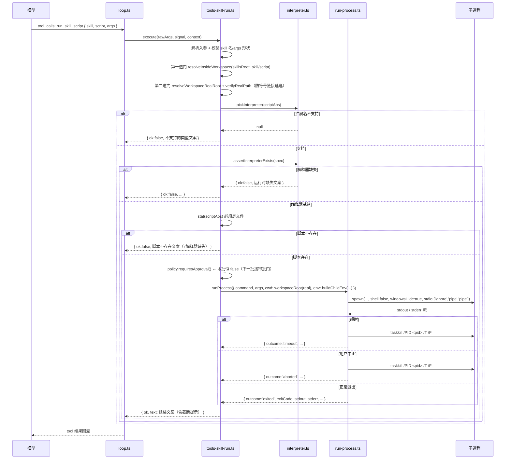

# mini-agent · 增量设计：嵌入式解释器 runtime + `run_skill_script`

> 版本：v1.1 · 编写：高见远（架构师） · 类型：**增量设计**（不重写 `docs/ARCHITECTURE.md`）
> 🆕 **变更记录（2026-10-13）**：`run_skill_script` 支持的文件类型由 4 种放开到 **9 种**（新增 `.exe` / `.bat` / `.cmd` / `.ps1` / `.sh`，对齐 WorkBuddy），并配套放宽子进程 `PATH`（5 类新增类型追加 Windows 系统目录）。逐条改动见 §2.6 / §2.8 / §2.9 / §12.1；`RUN_TIMEOUT_MS`（30 秒）、`OUTPUT_LIMIT_CHARS`（8000）与路径围栏均**未变**。
> 输入：主理人齐活林派发任务 + `src/main/harness/{types,tools,tools-search}.ts`、`ipc.ts`、`electron-builder.yml`、`package.json` 现状取证
> 下游：寇豆码（工程师）实现
> 🚫 硬约束：本轮**只出设计、不改任何业务代码**（只新建本文档）；不得执行任何命令（含只读的 `git status` / `grep` / `ls` / `wc`）；不得启动浏览器 / 查 DOM。查资料用 WebSearch / WebFetch。
> 📌 参考边界：`docs/HARNESS-ARCHITECTURE.md` 是**另一份未落地**的 Python + LangGraph 子进程设计稿。本文**不采用其技术选型**（不引 LangGraph、不把 harness 搬到 Python），仅在「安全边界」论述上与之对齐。

---

## 0. 结论速览

| 项 | 结论 |
|---|---|
| 本批范围 | **只做「解释器通路 + `run_skill_script`」**；不做技能加载（SKILL.md / 三级披露）、不做审批门（下一批），但**预留审批门挂点** |
| Python 运行时 | **`python-build-standalone` 的 `install_only_stripped`**（Windows x86_64，`.tar.gz`）≈ **22 MB 压缩 / 约 60–80 MB 解压**。**不用**官方 embeddable |
| Node 运行时 | **不额外打包**，复用 Electron 内置 Node：`process.execPath` + `ELECTRON_RUN_AS_NODE=1`。省 ~34 MB 压缩 / ~80 MB 解压 |
| 打包落点 | `extraResources`（不是 `asarUnpack`），落在 `<resources>/runtime/`，运行时用 `process.resourcesPath` 拼 |
| 支持的扩展名 | **`.py` / `.js` / `.mjs` / `.cjs` / `.exe` / `.bat` / `.cmd` / `.ps1` / `.sh`**（**9 种**，2026-10-13 由 4 种放开）。`.sh` 改由**系统已装**的 bash 执行（应用**不内置** bash）；未列出的扩展名（如 `.rb` / 无扩展名）一律拒绝 |
| 技能根 | **`<userData>/skills/`**（可写、非 asar）。脚本必须落在技能根内；跨技能共用的程序放技能根下的 `.bin/`（§12.3） |
| 脚本围栏 | 复用既有**双门守卫**（注入式工厂，不另造一套、不反向 import `tools.ts`）。判据是「**最终路径是否落在 `skillsRoot` 内**」——`..` 本身不被禁，逃出根才拒绝 |
| spawn | **参数数组**，`shell: false`，`windowsHide: true`，`stdio: ['ignore','pipe','pipe']`。**唯一例外**：`.bat` / `.cmd` 经 `cmd.exe /d /s /c` 执行，需要 `windowsVerbatimArguments: true`（§2.6 / §2.8） |
| env | **白名单重建**，绝不 `{ ...process.env }`（避免把密钥/系统凭据交给第三方脚本） |
| cwd | 钉死 `context.workspaceRoot` |
| 超时 | 默认 **30 秒**；到时 **kill 整个进程树**（Windows 用 `taskkill /T /F`，`child.kill()` 不够） |
| 输出上限 | **stdout+stderr 合计 8000 字符**（沿用搜索工具纪律） |
| 入参形状 | `{ skill, script, args }` —— `script` 默认**相对技能目录**；以 `@/` 开头则相对**技能根**（引用 `.bin/` 里的共享程序，§12.3） |
| 失败语义 | **五类互不混淆**，各自回灌独立中文文案（§7）。🔴 这是本项目最易复发的缺陷 |
| 新依赖 | **无**（纯 Node 内置模块） |

---

## 1. 背景与目标

现状：手写 harness 已有 9 个工具，**全部是纯 JS，没有任何一条 spawn 子进程的通路**（`tools.ts` 674 行 + `tools-search.ts`）。技能包（skill）将来由用户导入，每个技能目录里带自己的脚本（Python / JS）。要让这些脚本跑起来，必须先有一条**受控的、随应用分发的**解释器通路。

**目标**：给定 `{skill, script, args}`，在工作区内以固定 cwd、白名单 env、超时时限运行该脚本，把 stdout/stderr 带回给模型。

**明确不在本批**（见 §11）：技能加载（解析 `SKILL.md` / 三级披露）、审批门、脚本依赖安装（`pip install`）、脚本向模型回传结构化数据。

**为什么 runtime 必须「嵌入」**：目标是「装上应用就能跑技能脚本」，不假设用户机器有 python / node，也不允许脚本依赖系统解释器的版本与已装包。因此解释器必须随应用打包。

---

## 2. 实现方案

### 2.1 分层

```
harness/tools.ts  ← 组合根（主进程专属；★唯一 import runtime-paths.ts 的地方）
   │  构造时注入三件：
   │    ① WorkspacePathGuards  （既有双门守卫，同 tools-search 的做法）
   │    ② RuntimeResolver      （接口）── 实现来自 skill-runtime/runtime-paths.ts（★唯一 import electron 的运行时模块）
   │    ③ SkillRunPolicy       （默认 requiresApproval: () => false）
   └──注册──> harness/tools-skill-run.ts   工具：define / execute / 五类失败文案 / 审批挂点
                     │  仅经注入取得「守卫 + runtime 根」；**自身不 import electron**
                     └─> skill-runtime/*
                           ├─ interpreter.ts  （扩展名 → 解释器；前缀参数；env 装配）  无 electron
                           └─ run-process.ts  （spawn + 超时 + 杀进程树 + 输出截断）     无 electron
skills/paths.ts ── skillsRoot()（<userData>/skills）──> 经 ToolContext.skillsRoot 下发
```

> 🔴 **运行时路径如何到达执行层（本图的关键点）**：`runtime-paths.ts` **必须** import electron（用 `app.isPackaged` / `process.resourcesPath`），而 `tools-skill-run.ts` / `interpreter.ts` / `run-process.ts` **必须**保持无 electron（可测、无环）。桥接方式是**注入**（与 `guards` 同款）：`tools.ts`（组合根）`import { createRuntimeResolver } from '../skill-runtime/runtime-paths'` → 构造 resolver → 作为 `createSkillRunTools` 的**第二参数**注入。`tools-skill-run.ts` 只 `import type { RuntimeResolver }`（**编译期擦除，无运行时依赖**），在 `execute` 里调 `runtime.resolveRuntimeRoot()` 拿到一个**纯字符串**，再把它向下传给 `pickInterpreter` / `buildChildEnv`。这样「取路径」这件事只在边界发生一次，纯逻辑模块全程不碰 electron。

**为什么拆 3 个模块**：`tools.ts` 已 674 行且有「整文件重写丢代码」前科 —— 新工具**必须**独立成模块；进程执行、路径解析、解释器分派三件事彼此独立，拆开后各自可读、可换（例如将来换运行时只改 `runtime-paths.ts`）。

**与既有工具的差异**：这是**唯一一个会启动子进程**的工具。它是「不可信代码执行」的唯一入口，因此安全约束密度最高。

### 2.2 复用既有安全资产（不另造一套）

`tools.ts` 里既有**双门路径守卫**（私有函数）：`resolveInsideWorkspace`(L49) / `resolveWorkspaceRealRoot`(L86) / `verifyRealPath`(L108)，已通过**注入式工厂** `createSearchTools(guards)`（L645）传给 `tools-search.ts`，以避免 `tools-search ↔ tools` import 环。

`run_skill_script` **沿用同一模式**：工厂 `createSkillRunTools(guards, runtime, policy)`，由 `tools.ts` 注入守卫（+ runtime resolver，见 §2.1）。**唯一区别**：这里的「根」是 **skillsRoot**（不是 workspaceRoot）—— 守卫本身接受 `root` 参数，天然可复用。

> 守卫的类型 `WorkspacePathGuards` 目前从 `tools-search.ts` 导出，可直接 **type-only import** 复用（`tools-search` 不 import 本模块，故无环）。

### 2.3 runtime 选型（🔴 全篇最关键）

#### 候选对比

| 方案 | 压缩体积 | 解压体积 | 关键限制 | 结论 |
|---|---|---|---|---|
| 官方 `python-3.13.x-embed-amd64.zip` | **10.4 MB** | ~25 MB | **默认禁用 `site`**（靠 `python3xx._pth` 控制 `sys.path`）；**不自带 pip**；`Lib/` 为**精简子集**；无 venv、无 `ensurepip` 默认 | ❌ **不用** |
| **`python-build-standalone` `install_only_stripped`** | **≈ 22 MB** | **≈ 60–80 MB** | 与 `install_only` **唯一差别是去掉了 debug symbols**（官方原文）；同样**不含静态库/C 头文件** | ✅ **采用** |
| `python-build-standalone` `install_only` | ~35–40 MB | ~90–100 MB | 与 `_stripped` **只差 debug symbols**（这是它更大的**唯一**来源）；构建转换步骤本就含 `Strip Static Library`（移除 `libpython*.a`），故**同样无法编译 C 扩展** | ❌ **不为「编 C 扩展」而升它**（买不到那个能力） |
| `python-build-standalone` `full` | 数百 MB 级 | 更大 | 「All files and artifacts used in build」—— 含静态库 / 头文件，**只有需要编译 C 扩展时才用它** | 备选（极少数场景） |
| 官方 `node-v22.x-win-x64.zip` | ~34 MB | ~80 MB | 多打一份 Node | ❌ 用 Electron 内置 Node 替代 |
| Node 官方 `node-vXX-win-x64.7z` | ~22 MB | ~80 MB | 需 7-Zip 解压 | 备选（若必须独立 Node） |

#### 结论与理由

1. **Python 采用 `python-build-standalone` 的 `install_only_stripped`。**
   - **下载 URL 模式**（pin 具体 tag + 版本）：
     ```
     https://github.com/astral-sh/python-build-standalone/releases/download/<TAG>/cpython-<VER>+<TAG>-x86_64-pc-windows-msvc-install_only_stripped.tar.gz
     ```
     具体实例（写进抓取脚本的常量并校验 SHA256）：
     ```
     cpython-3.13.5+20250723-x86_64-pc-windows-msvc-install_only_stripped.tar.gz
     ```
     > 抓取脚本运行时应从 release 页选**固定的 <TAG>+<VER>**（不要用 `latest`），并把 SHA256 写死比对。
   - **体积**：压缩 ≈ 22 MB；解压 ≈ 60–80 MB（以实际为准）。解压后布局：`python/python.exe`、`python/Lib/`、`python/DLLs/`、`python/Scripts/pip.exe`。
   - **为什么不用官方 embeddable**：它靠 `python3xx._pth` 接管 `sys.path` 并**默认禁用 `site`** —— 意味着 `site-packages` 不生效、第三方包静默 import 失败、pip 需手工启用。对「模型即兴写的脚本」这是**静默失败**的温床，与项目「不让模型基于错误事实下结论」的原则直接冲突。`install_only` 系列是**完整 CPython**，`sys.path` 正常、pip 可用，行为与用户预期一致。
   - **候选之间到底差在哪（据官方文档，已校正）**：`install_only_stripped` 与 `install_only` 的差别**只有 debug symbols**（官方原文：*"An `install_only_stripped` archive … is equivalent to `install_only`, but without debug symbols"*）。而该项目 `install_only` 的构建转换步骤里**本就包含 `Strip Static Library`（移除 `libpython*.a`）** ⇒ **两者都没有静态库、都不能编译 C 扩展**。要编译 C 扩展必须用 **`full`** 归档（"All files and artifacts used in build"），体积大得多。
   - **为什么仍选 `_stripped`（校正后的理由）**：debug symbols 对**嵌入式运行时**毫无用处（我们不做原生调试），只会白占体积 ⇒ 去掉它是**纯收益**。**不是「为省体积而牺牲 C 扩展」** —— 因为 `install_only` 本来也编不了 C 扩展，升它一级**买不到**那项能力。技能脚本应优先只用**标准库 + 纯 Python 包**；若将来真的必须编译 C 扩展，升档目标是 **`full`（不是 `install_only`）**。此为明示取舍，见 §12 待拍板。
2. **Node 不额外打包 —— 复用 Electron 内置 Node。**
   - Electron 主进程本身就是 Node；通过 `process.execPath` + 环境变量 `ELECTRON_RUN_AS_NODE=1`，可让**同一个可执行文件**以纯 Node 模式运行脚本。Electron 官方文档明确支持该环境变量，且这是打包应用里「不依赖用户系统 Node」的**标准做法**。
   - 收益：**零额外体积**（Electron 二进制已在包里），且与主进程 Node 版本天然一致。
   - ⚠️ **硬性约束**：该机制依赖 Electron 的 `runAsNode` fuse **处于启用状态**。**不得**在 `electron-builder.yml` 的 `electronFuses` 里设置 `runAsNode: false`（那会让 `ELECTRON_RUN_AS_NODE` 被忽略）。当前项目**未配置 `electronFuses`**，默认启用 —— 保持现状即可。
   - 🟡 **待实现时实测确认的点（本条为推理，尚未实证）**：`ELECTRON_RUN_AS_NODE=1` 会让 Electron 二进制**跳过 app 入口、直接以 Node 模式启动**，因此（推理）**不会**走到主进程的单实例逻辑 `requestSingleInstanceLock()` —— 推论是「运行脚本**不会**意外拉起第二个应用实例、也不会误触发单实例锁」。**此结论仅为推理，未经实测。** 实现 T-R03 时**必须实测一次**（脚本运行期间用任务管理器确认 Electron 进程数、并确认单实例锁行为符合预期），确认后**再**把本条改为已证事实。**在此之前，任何文档与结论都不得把它当已证事实引用。**
   - **备选**（若实测 `ELECTRON_RUN_AS_NODE` 有兼容问题）：打包官方 `node-v22.x-win-x64.zip`，落 `<resources>/runtime/node/`，`resolveNodeExe()` 改指它。`runtime-paths.ts` 已把它做成**单一函数**，切换成本极低。

#### 体积总账

| 项 | 增量 |
|---|---|
| Python（pbs stripped，压缩） | **≈ +22 MB** |
| Python（解压后） | **≈ +60–80 MB** |
| Node（Electron 内置复用） | **+0** |
| 安装包净增（NSIS `compression: maximum` 已开） | **≈ +22 MB 量级** |

### 2.4 打包落点

**asar 内的可执行文件无法 spawn**，必须让 runtime 落到 asar **之外**。二选一：

| 方案 | 落点 | 评价 |
|---|---|---|
| **`extraResources`** | `<resources>/runtime/...` | ✅ **采用**：路径干净、与 asar 结构解耦、`process.resourcesPath` 直接拼 |
| `asarUnpack` | `<resources>/app.asar.unpacked/...` | ❌ 路径与 asar 内部布局耦合，迁移麻烦 |

**`electron-builder.yml` 追加内容（确切）**：

```yaml
extraResources:
  # ① 随应用分发的解释器 runtime
  #    asar 内的可执行文件无法 spawn，必须放在 asar 之外
  - from: resources/runtime            # 抓取脚本产出目录，已在 .gitignore（见 §6.1）
    to: runtime
    filter:
      - "**/*"
  # ② 第三方许可声明 —— 放 resources/licenses/（**不进** gitignore，随源码入库）→ <resources>/licenses/
  #    ⚠️ 放 resources/runtime/ 是错的：那目录已 gitignore，声明文件不进库、clone 后缺失
  - from: resources/licenses
    to: licenses
    filter:
      - "**/*"
```

说明：
- `from` 相对**项目根**；`to` 相对**打包后的 `<resources>`**。最终路径：`<resources>/runtime/python/python.exe` 与 `<resources>/licenses/THIRD-PARTY-NOTICES.txt`。
- **为何许可声明单列一条**：`resources/runtime/` 已被 `.gitignore`（抓取产物），许可声明必须放**入库**的 `resources/licenses/`，否则 clone 后缺失（详见 §9.2）。
- `files:` 无需改动（`extraResources` 独立于 `files`）。
- **`resources/runtime/` 必须存在**才能打包（由抓取脚本产出，见 §6.1）。缺失时 electron-builder 会告警/失败 —— 故把抓取步骤挂在 `dist:win` 之前（§6.1）。

### 2.5 运行时路径解析

**两个态**：

| 态 | runtime 根 |
|---|---|
| 打包态 | `path.join(process.resourcesPath, 'runtime')` |
| 开发态 | `path.join(app.getAppPath(), 'resources', 'runtime')` |

🔴 **绝不使用 `__dirname` 拼打包态路径** —— 打包后主进程代码在 `app.asar` 内，`__dirname` 会指向 asar 内部，spawn 必然失败。

判定用 `app.isPackaged`。开发态用 `app.getAppPath()`：electron-vite 开发期它返回**项目根**（含 `package.json` 的目录），故拼出 `<项目根>/resources/runtime`，与打包后的相对布局一致。

```ts
// src/main/skill-runtime/runtime-paths.ts  ★ 边界适配器（唯一 import electron 的运行时模块）
import { app } from 'electron';
import * as path from 'node:path';

/** runtime 根：打包态在 <resources>/runtime；开发态在 <项目根>/resources/runtime */
export function resolveRuntimeRoot(): string {
  return app.isPackaged
    ? path.join(process.resourcesPath, 'runtime')
    : path.join(app.getAppPath(), 'resources', 'runtime');
}

/** 注入接口：只暴露「取根」这一件事，不含任何 electron 类型（详见 §4.2） */
export interface RuntimeResolver { resolveRuntimeRoot(): string; }

/** electron 侧实现；由组合根 tools.ts 构造并注入给 tools-skill-run.ts */
export function createRuntimeResolver(): RuntimeResolver {
  return { resolveRuntimeRoot };
}

/** 内置 Node 可执行文件：复用 Electron 自身（以 ELECTRON_RUN_AS_NODE 模式运行） */
export function resolveNodeExe(): string {
  return process.execPath;   // process.execPath 是 Node 全局属性，非 electron API
}
```

> 📌 Python 可执行文件路径（`resolvePythonExe`）**不在这里** —— 它已被移到 `interpreter.ts` 作为**纯函数** `resolvePythonExe(runtimeRoot)`（接受注入进来的 runtime 根，避免 interpreter 依赖 electron）。见 §2.6 / §4.3。

### 2.6 解释器白名单（按扩展名分派）

| 扩展名 | 解释器 | 命令 + 前缀参数 |
|---|---|---|
| `.py` | 内置 CPython | `resolvePythonExe(runtimeRoot)`（来自 `interpreter.ts` 的**纯函数**），前缀 **`['-B']`**（🔴 **有意不含 `-I`**，见下） |
| `.js` | Electron 内置 Node | `process.execPath`，env 带 `ELECTRON_RUN_AS_NODE=1` |
| `.mjs` | 同上 | 同上 |
| `.cjs` | 同上 | 同上 |
| `.exe` | 程序自身 | 直接用**绝对路径** spawn 该 `.exe` 本身（**不再额外传一次脚本路径**），无前缀参数 |
| `.bat` / `.cmd` | 系统 `cmd.exe` | `cmd.exe /d /s /c`。命令行被 cmd **二次解析**，故参数由我们按 cmd 规则引号化、并把整串**再包一层引号**（配合 `/s`）；**含 `"` `%` `!` `^` `&` `\|` `<` `>` `(` `)` 或换行符的参数一律拒绝执行**（防注入），拒绝文案首句为「参数不安全，已拒绝执行：」。**唯一**需要 `windowsVerbatimArguments: true` 的类型。 |
| `.ps1` | 系统 PowerShell | `%SystemRoot%\System32\WindowsPowerShell\v1.0\powershell.exe`，前缀 `-NoProfile -NonInteractive -ExecutionPolicy Bypass -File` |
| `.sh` | **系统已装**的 bash | 应用**不内置** bash。候选顺序：`%SystemRoot%\System32\bash.exe`（WSL）→ `%ProgramFiles%\Git\bin\bash.exe` → `%ProgramFiles(x86)%\Git\bin\bash.exe` → `%LOCALAPPDATA%\Programs\Git\bin\bash.exe`；全都找不到时报专门文案「**运行时缺失：Bash**」（不静默失败）。 |
| 其它（`.rb` / 无扩展名…） | — | **拒绝** |

- 🔴 **`-I`：有意不加，请勿加回。** 曾考虑用 `-I`（isolated，隐含 `-E` + `-P`）做隔离，但经推演其**代价大于收益**，两条硬伤：
  - **(a) 中文输出必然乱码。** `-I` 隐含 `-E`（忽略全部 `PYTHON*` 环境变量）⇒ §2.9 里设的 `PYTHONUTF8` / `PYTHONIOENCODING` **全部失效**。Python 在 stdout 为**管道（非 tty）**时按 **locale 编码**输出，中文 Windows 上是 **cp936/GBK**；而我们用 `string_decoder('utf8')` 解码 ⇒ 脚本里 `print("中文")` **直接乱码**。中文用户**第一次跑就会撞上**。
  - **(b) 脚本目录不进 `sys.path`（`-I` 在 3.11+ 隐含 `-P`）⇒ 技能脚本无法 `import` 同目录的辅助模块。** 技能包典型结构是 `scripts/main.py` + `scripts/utils.py`，`-I` 下 `main.py` 里的 `import utils` **直接失败** —— 实打实的功能损失。
  - **而 `-I` 那点隔离，我们本就有更可靠的来源**：①「不读 `PYTHONPATH`」—— 我们的 env 白名单**压根不给它**，`-E` 完全冗余；②「不加载用户 site」—— 去掉 `-I` 后 `PYTHONNOUSERSITE=1`（§2.9）**才真的生效**；③「防越界」—— 真正拦越界的是**双门守卫**（§2.7），与解释器参数无关。
  - **结论：前缀只用 `['-B']`，靠 env 白名单做隔离，不靠 `-I`。** 后人若看到「隔离更安全」想顺手加回 `-I`，请先读本条 (a)(b)。
- **`-B`**：不写 `__pycache__`，避免在 skills 目录里留下脏文件。
- **`.sh` 现在为什么支持（2026-10-13 由用户拍板，对齐 WorkBuddy）**：不再假设「Windows 上没有 bash」，改用**系统已装**的 bash —— 应用**不内置** bash，按候选顺序探测：`%SystemRoot%\System32\bash.exe`（WSL）→ `%ProgramFiles%\Git\bin\bash.exe` → `%ProgramFiles(x86)%\Git\bin\bash.exe` → `%LOCALAPPDATA%\Programs\Git\bin\bash.exe`。**全都找不到时给专门文案「运行时缺失：Bash」，不静默失败**。这是本类型新增的**外部依赖代价**：`.sh` 能跑与否取决于用户机器是否装了 Git Bash 或 WSL。
- **`.bat` / `.cmd` 为什么要额外防护**：它们经 `cmd.exe /d /s /c` 执行，命令行会被 cmd **二次解析** —— 这是本轮新引入的**唯一**「再解析」面。对策：命令行由我们按 cmd 规则引号化并把整串**再包一层引号**（配合 `/s`），且**含 `"` `%` `!` `^` `&` `\|` `<` `>` `(` `)` 或换行符的参数一律拒绝执行**（防注入），拒绝文案首句为「参数不安全，已拒绝执行：」。这两类也是**唯一**需要 `windowsVerbatimArguments: true` 的类型。
- **`.ps1` 的代价**：经 `%SystemRoot%\System32\WindowsPowerShell\v1.0\powershell.exe`，前缀 `-NoProfile -NonInteractive -ExecutionPolicy Bypass -File`。用 `-ExecutionPolicy Bypass` 等价于**放开 PowerShell 的执行策略**，是本类型明确接受的取舍。
- **`.exe` 的语义**：直接用**绝对路径** spawn 该程序本身，**不再额外把脚本路径作为参数传入**（`.exe` 本身就是被执行的程序）。
- **白名单仍是白名单**：以上 9 种之外的扩展名（如 `.rb` / 无扩展名）**一律拒绝**。
- 扩展名比较**统一转小写**，且以**路径最后一段**的扩展名为准。

### 2.7 脚本路径围栏

**技能根约定位置**：

```
<userData>/skills/<skill-name>/...        ← 技能包目录（用户导入，可写）
        ├── scripts/main.py                ← 脚本（script 参数相对技能目录）
        └── bin/westock.exe                ← 单技能自用的程序（同上，相对技能目录）

<userData>/skills/.bin/westock.exe        ← 技能根下的共享程序目录（多个技能共用）
```

- **为什么放 `<userData>/skills/`**：技能包将来**由用户导入**，必须**可写**；正因如此**不能放在只读的 asar 里**（也不能放 `resources/`，那是安装目录，可能无写权限、且升级会被覆盖）。
- **解析（两种 `script` 写法）**：
  - 默认（相对技能目录）：`abs = path.join(skillsRoot, skill, script)`；
  - 以 `@/` 开头（相对技能根，用于引用 `.bin/` 里的共享程序）：`abs = path.join(skillsRoot, script.slice(2))`。
  两条的**根都是 `skillsRoot`**，走同一套守卫 ⇒ 安全边界完全一致（见 §12.3）。
- **为什么需要 `@/`**：若只写退层路径（如 `../../.bin/x`），正确的「退几层」会随技能的嵌套深度变化（根下技能退 1 层、套件内技能退 2 层），模型极易算错；而算错的后果是「脚本不存在」这种无从自纠的报错。

**五步校验（顺序固定）**：

1. `skill` 必须是**单个安全路径段**：匹配 `/^[A-Za-z0-9][A-Za-z0-9._-]*$/`（**必须以字母或数字开头**），且不等于 `.` / `..`。否则直接拒绝（挡住 `skill="../../.."` 这类注入）。**收紧理由**：点开头的目录名一律不是技能——如导入临时目录 `.importing-<rand>`；若放行点开头，导入途中被强杀残留的 `.importing-*`（内含完整 `SKILL.md`）会被 registry 当成正常技能注入清单。该正则自 T-L01 起**上移到** `src/main/skills/names.ts`（技能名的唯一事实来源），`tools-skill-run.ts:31` 与 `tools-skill-read.ts:18` 从这里 import，不再有本地常量。
2. **第一道门**：`guards.resolveInsideWorkspace(skillsRoot, joinedPath)`（`joinedPath` 见上面的两种解析）→ 纯字符串越界检查。**这一门判的是「最终路径是否落在根内」，不是「路径里是否含 `..`」** —— 所以 `..` 本身并不被禁，只有**逃出 `skillsRoot`** 才拒绝。
3. **第二道门**：`guards.resolveWorkspaceRealRoot(skillsRoot)` + `guards.verifyRealPath(realRoot, target)` → realpath 复核，**防符号链接逃逸**。
4. **扩展名白名单**（§2.6）。
5. `stat` 必须是**文件**（不是目录），且存在。

> 守卫函数的参数名虽叫 `root / relPath`，但语义是**任意根 + 相对路径**，直接传 `skillsRoot` 即可 —— **不要**复制一份守卫。

### 2.8 spawn：参数数组，除 `.bat` / `.cmd` 外不拼 shell

```ts
const child = spawn(command, [...prefixArgs, scriptAbs, ...args], {
  cwd: workspaceRoot,            // 钉死工作区
  env: childEnv,                 // 白名单重建（§2.9）
  shell: false,                  // 🔴 绝不启用 shell（.bat / .cmd 亦然：我们直接 spawn cmd.exe，不用 Node 的 shell 选项）
  windowsVerbatimArguments: options.verbatimArgs,  // 🔴 仅 .bat / .cmd 为 true（经 cmd.exe 二次解析）；其余类型 false/省略
  windowsHide: true,             // 不闪控制台窗口
  stdio: ['ignore', 'pipe', 'pipe'],  // 不给 stdin：脚本读输入会立刻 EOF 而不是挂死
  detached: false,               // 留在本进程组，便于 taskkill /T
});
```

- **除 `.bat` / `.cmd` 外**，`command` 与每个参数都是**独立数组元素**，由 Node 按平台规则引号化 —— **不存在 shell 字符串拼接**，因此没有 shell 注入面。`.bat` / `.cmd` 是唯一例外：它们经 `cmd.exe /d /s /c` 执行，命令行由**我们**按 cmd 规则引号化并把整串再包一层引号（配合 `/s`、置 `windowsVerbatimArguments: true`），且**含元字符的参数被拒绝**（§2.6），故同样无可利用的注入面。
- **`args` 参数校验**（来自模型，不可信）：必须是 `string[]`；元素个数 ≤ `ARGS_MAX_COUNT`（16）；每个元素长度 ≤ `ARG_MAX_CHARS`（1000）；**不得含 `\0`**。非法即拒绝并说明。
- `stdio[0] = 'ignore'`：脚本里的 `input()` / `readline()` 会立刻读到 EOF，而不是**挂到超时**。这是「不要静默挂死」的关键一步。

### 2.9 env 白名单重建（🔴 绝不 `{ ...process.env }`）

**为什么**：主进程的 `process.env` 可能携带 **API Key、云凭据、以及 Electron/safeStorage 相关状态**。整个透传等于把这些交给**第三方技能脚本** —— 技能是用户导入的、模型可影响其参数，这属于明确的密钥外泄面。

**原则**：**允许清单（allowlist）+ 显式覆盖**，而不是黑名单过滤。没在白名单里的变量**一律不传**。

```ts
// src/main/skill-runtime/run-process.ts
const ENV_BASE_ALLOWLIST = [
  'SystemRoot', 'windir',            // Windows 运行时必需（部分 API / 临时目录解析）
  'TEMP', 'TMP',                     // 临时目录
  'PATHEXT',                         // 让子进程解析 .exe（无害）
  'NUMBER_OF_PROCESSORS',
] as const;

export function buildChildEnv(kind: InterpreterKind, runtimeRoot: string): Record<string, string> {
  const env: Record<string, string> = {};
  for (const key of ENV_BASE_ALLOWLIST) {
    const value = process.env[key];
    if (typeof value === 'string') env[key] = value;
  }
  if (kind === 'python') {
    const pyDir = path.join(runtimeRoot, 'python');
    // PATH 只含运行时自身目录：脚本能找到 python / pip 的 console 脚本，但找不到系统工具
    env.PATH = [pyDir, path.join(pyDir, 'Scripts')].join(path.delimiter);
    env.PYTHONIOENCODING = 'utf-8';       // stdout/stderr 固定 UTF-8，与我们的解码一致
    env.PYTHONUTF8 = '1';
    env.PYTHONUNBUFFERED = '1';           // 实时输出，避免超时前拿不到任何内容
    env.PYTHONDONTWRITEBYTECODE = '1';    // 不写 __pycache__
    env.PYTHONNOUSERSITE = '1';           // 不加载用户 site-packages
  } else {
    const nodeDir = path.dirname(resolveNodeExe());
    env.PATH = nodeDir;                   // 仅运行时目录
    env.ELECTRON_RUN_AS_NODE = '1';       // 🔴 让 Electron 二进制以纯 Node 模式运行
  }
  return env;
}
```

> 🆕 **2026-10-13 更新**：上面的 `buildChildEnv` 样例只展示了 `python` / `node` 两类。放开 9 种类型后，`kind` 覆盖 9 种（`python` / `node` / `exe` / `bat` / `cmd` / `ps1` / `sh`），`PATH` 按上表「分两档」装配（`.py` / `.js` 仍只给运行时自身目录；其余 5 类追加 Windows 系统目录）。
>
> ⚠️ 上面这些 `PYTHON*` 变量（`PYTHONUTF8` / `PYTHONIOENCODING` / `PYTHONUNBUFFERED` / `PYTHONNOUSERSITE` 等）**真正生效的前提是不加 `-I`** —— §2.6 已裁定**不加 `-I`**，故它们**全部生效**；若哪天有人把 `-I` 加回，`-I` 隐含的 `-E` 会让它们**全部失效**（中文输出随即乱码）。这就是本设计「**用 env 白名单做隔离、不靠 `-I`**」这条路线得以成立的依据。

**显式排除（务必写进注释，防止后人「顺手补上」）**：

| 排除项 | 原因 |
|---|---|
| `APPDATA` / `USERPROFILE` / `HOME` / `LOCALAPPDATA` | 指向用户私有目录；脚本应通过工作区拿数据，不应被默认授予「家目录在哪」 |
| `ComSpec` | 不给 shell 句柄 → Python `subprocess(shell=True)` 会失败（**有意为之**：杜绝脚本再套一层 shell） |
| 系统 `PATH` / `Path` | 分两档：`.py` / `.js` 两类**只给运行时自身目录**；`.exe` / `.bat` / `.cmd` / `.ps1` / `.sh` 这 5 类**追加 Windows 系统目录**（`%SystemRoot%\System32`、`%SystemRoot%`、`System32\Wbem`、`System32\WindowsPowerShell\v1.0`），让脚本内能调用 `where` / `findstr` / `tar` / `powershell` / `taskkill`。两档都**不含用户 PATH**（用户自装的 node / git / npm 仍调不到） |
| `NODE_OPTIONS` | Electron 在打包态本就禁用其大部分；也不给脚本注入启动选项的口子 |
| 任何 `*_KEY` / `*_TOKEN` / `*_SECRET` / `DEEPSEEK_*` / `SUPABASE_*` | **核心目标**：绝不外泄凭据。allowlist 天然覆盖（它们不在名单里） |
| `ELECTRON_*`（除我们要设的 `ELECTRON_RUN_AS_NODE`） | 避免把 Electron 主进程内部状态泄漏给脚本 |

> 取舍说明：仍**不给 `ComSpec`**。`PATH` 上分两档：`.py` / `.js` 只给运行时自身目录；`.exe` / `.bat` / `.cmd` / `.ps1` / `.sh` 这 5 类**追加了 Windows 系统目录**（让脚本能调 `where` / `findstr` / `tar` / `powershell` / `taskkill`），但仍**不包含用户 PATH**（用户自装的 node / git / npm 仍调不到）。这条放宽是用户于 **2026-10-13** 明确要求的，且**只放宽了「系统目录」这一档**；「任意命令执行 / 通用 shell 工具」仍未做。变更记录见 §12.1。

### 2.10 cwd 与工作区

- `cwd = context.workspaceRoot`（**钉死**）。脚本里所有相对路径读写都落在工作区，与 `read_text_file` / `write_text_file` 的沙箱一致，用户心智统一。
- spawn 前先做一次 `guards.resolveWorkspaceRealRoot(context.workspaceRoot)`；目录不存在时**提前失败**并给可读文案（否则 spawn 会抛 `ENOENT`，被误报成「脚本不存在」—— 正是 §7 要防的混淆）。**cwd 用 realRoot**（realpath 后的路径），与其它工具口径一致。

### 2.11 超时、中止、杀进程树

- 默认超时 **`RUN_TIMEOUT_MS = 30_000`**（30 秒）。
- **Windows 上 `child.kill()` 只杀直接子进程，不杀孙进程** → 必须杀**整棵树**：
  ```
  taskkill /PID <child.pid> /T /F
  ```
  即 timeout / abort 时执行 `spawn('taskkill', ['/PID', String(pid), '/T', '/F'], { windowsHide: true })`。
  （Node 无内置 Job Object API；`taskkill /T` 是 Windows 上最简单可靠的树杀手段。）
- 非 Windows 分支：`child.kill('SIGKILL')`（保留跨平台可编译性，本项目当前只出 Windows）。
- **中止联动**：`signal`（用户点「停止」）→ 立即走同一条树杀路径，`outcome = 'aborted'`。
- 无论哪条收尾路径，都要 **`await` 到子进程 `close` 事件**再返回，避免留下僵尸句柄与晚到的输出。

### 2.12 输出上限与截断

- **stdout + stderr 合计上限 `OUTPUT_LIMIT_CHARS = 8000`**（沿用 `list_dir` / `search_text` 的纪律）。
- 边收边计数：累计达到上限后**继续排空管道但不累计**（否则管道写满会阻塞子进程、把正常脚本拖成超时），并置 `stdoutTruncated` / `stderrTruncated`。
- 解码：`Buffer` 累积后按 UTF-8 解码；**注意多字节字符可能跨 chunk**（用 `string_decoder` 或在 `close` 后一次性解码已收缓冲）。
- 截断时必须**显式告知**并**给出可行下一步**（见 §7）：

  > `⚠ 输出超过 8000 字符上限，已截断（stdout 截断 / stderr 截断）。上面的内容不完整。提示：让脚本把结果写入工作区文件，再用 read_text_file 读取。`

### 2.13 入参形状

采用 **`{ skill, script, args }`**（不是单一路径）：

| 字段 | 类型 | 说明 |
|---|---|---|
| `skill` | string，必填 | 技能目录名（skills 根下的**一级目录名**），如 `my-skill` |
| `script` | string，必填 | **默认相对技能目录**的脚本路径，如 `scripts/main.py`；以 `@/` 开头表示相对**技能根**，如 `@/.bin/westock.exe`（§12.3）。支持 9 种：`.py` / `.js` / `.mjs` / `.cjs` / `.exe` / `.bat` / `.cmd` / `.ps1` / `.sh` |
| `args` | string[]，可选 | 传给脚本的命令行参数，默认 `[]` |

**为什么不是单一路径**：将来「技能加载」会以**技能**为组织单元（技能目录含 `SKILL.md` + 资源 + 脚本），工具语义理应与之一致 —— 模型先说「用哪个技能」，再说「跑其中哪个脚本」。若只给一个相对路径，将来技能加载落地后还得再改一次契约。`skill` 单独成字段还能在**进入文件系统之前**就把它卡成**单个安全路径段**（§2.7 第 1 步），这是单一路径做不到的一层防御。

`define(context).description` **必须**拼入真实 `context.skillsRoot`（既有纪律：工具声明是模型唯一的环境事实）：

```ts
description:
  `运行技能包里的脚本（在当前工作区目录下执行）。技能根目录为 ${skillsRoot}；` +
  `skill 填技能目录名（如 my-skill），script 填相对该技能目录的脚本路径（如 scripts/main.py），` +
  `或以 @/ 开头表示相对技能根（如 @/.bin/westock.exe，用于引用技能根 .bin/ 里的共享程序）。` +
  `支持的文件类型：.py / .js / .mjs / .cjs / .exe / .bat / .cmd / .ps1 / .sh（共 9 种）。` +
  `脚本的工作目录=当前工作区，可读写工作区内文件；工作区外与技能目录外的路径一律拒绝。` +
  `stdout/stderr 合计最多回传 8000 字符，超出会被截断；执行超过 30 秒会被终止。` +
  `脚本输出过长时，让它把结果写进工作区文件，再用 read_text_file 读取。`
```

### 2.14 审批门预留挂点（下一批接这里）

本批**不实现审批**，但把**唯一的决策点**显式留出来：

```ts
// src/main/harness/tools-skill-run.ts
export interface SkillRunRequest { skill: string; script: string; args: string[]; }

/** 执行前策略：下一批的「审批门」就实现这个接口 */
export interface SkillRunPolicy {
  /** 是否需要用户批准后才执行（本批恒为 false） */
  requiresApproval: (context: ToolContext, request: SkillRunRequest) => boolean;
}

const DEFAULT_POLICY: SkillRunPolicy = { requiresApproval: () => false };

export function createSkillRunTools(
  guards: WorkspacePathGuards,
  runtime: RuntimeResolver,                        // ← 注入运行时路径（不含 electron），见 §2.1 / §4.5
  policy: SkillRunPolicy = DEFAULT_POLICY,
): HarnessTool[];
```

- `execute` 在**完成全部校验、真正 spawn 之前**，插入一行：`if (policy.requiresApproval(context, request)) { …等待批准… }`。本批该判断恒为 false，**行为零变化**。
- **下一批的接法**（对齐 `PROJECT_GUIDE.md §9.1.1` 的既定方案）：
  1. `ToolContext` 新增可选回调 `requestApproval?: (req) => Promise<boolean>`（与既有可选字段 `emitPlan?` 同构，`types.ts:42` 已有先例）；
  2. 主进程新增 `chat:approval`（主→渲染）/ `chat:approve`（渲染→主）通道 + `pendingApprovals: Map<toolCallId, {resolve, reject}>`；
  3. `policy.requiresApproval` 改为按「脚本是否首次运行 / 是否属于本次会话已批准集合」判定；
  4. **中止联动**：用户点停止时必须 `reject` 所有挂起 Promise，否则 loop 永久卡住（与现有 abort 路径一起处理）。
- 换言之：**本批交付「可执行」，下一批只需替换 `policy` 并接两条 IPC，不改工具主体**。

---

## 3. 文件列表（新增 + 修改，含预估行数）

### 新增

| 文件（相对仓库根） | 预估行数 | 职责 |
|---|---|---|
| `src/main/skill-runtime/runtime-paths.ts` | ~70 | **边界适配器**（唯一 import electron）：dev / 打包两态 runtime 根 + `RuntimeResolver` 接口（`resolvePythonExe` 已移到 `interpreter.ts`） |
| `src/main/skill-runtime/interpreter.ts` | ~90 | 扩展名白名单 → 解释器 + 前缀参数 + env 种类；解释器存在性检查 |
| `src/main/skill-runtime/run-process.ts` | ~190 | `spawn` 封装：env 白名单、cwd、stdio、超时、杀进程树、输出截断、结果归一 |
| `src/main/harness/tools-skill-run.ts` | ~230 | `createSkillRunTools(guards, runtime, policy)`：`define` / `execute` / 五类失败文案 / 审批挂点（**无 electron**） |
| `src/main/skills/paths.ts` | ~30 | `skillsRoot()` = `<userData>/skills`；`ensureSkillsRoot()`（按需创建） |
| `scripts/fetch-runtime.mjs` | ~130 | **用户手动运行一次**：下载 + 校验 SHA256 + 解压 Python runtime 到 `resources/runtime/`（幂等） |
| `resources/licenses/THIRD-PARTY-NOTICES.txt` | ~10 | 第三方许可声明（CPython/PSF、OpenSSL 等）；**入库**（**不**在 `.gitignore`），随 `extraResources` 投到 `<resources>/licenses/` |
| `docs/SKILL-RUNTIME-DESIGN.md` | — | 本文档 |

### 修改

| 文件 | 改动 | 预估 |
|---|---|---|
| `src/main/harness/types.ts` | `ToolContext` 新增 `skillsRoot: string`（+注释） | ~5 行 |
| `src/main/ipc.ts` | 构造 `ToolContext` 处（现 L629-636）补 `skillsRoot` | ~2 行 |
| `src/main/harness/tools.ts` | ① import 工厂 + `runtime-paths`（构造 resolver） ② 构造 `skillRunTools = createSkillRunTools(guards, runtime)` ③ `HARNESS_TOOLS` 展开 ④ `allowlist` 传入 | ~7 行 |
| `electron-builder.yml` | 追加 `extraResources`（**两条**：runtime + licenses，§2.4） | ~9 行 |
| `package.json` | 新增 script `fetch-runtime`；`dist:win` 前置抓取（§6.1） | ~2 行 |
| `.gitignore` | 追加 `resources/runtime/`（**不含** `resources/licenses/`） | ~1 行 |

> **不改**：`harness/loop.ts`、`harness/index.ts`（barrel 已 `export { HARNESS_TOOLS }`，注册即生效）、`tools-search.ts`、`providers/*`、`shared/*`、`preload/*`、`renderer/*`。

---

## 4. 数据结构与接口定义

### 4.1 `ToolContext`（改造）

```ts
// src/main/harness/types.ts（在现有字段后追加）
export interface ToolContext {
  workspaceRoot: string;
  backupRoot: string;
  conversationId: string;
  memoryEnabled: boolean;
  emitPlan?: (plan: PlanStep[]) => void;
  /**
   * 技能根目录（绝对路径）：<userData>/skills。
   * 与 workspaceRoot 同层下发 —— 「脚本只能跑在**技能根内**」这条围栏需要一个可信的根，
   * 而它既不能从 relative path 推出来，也不能放模块级全局（并发生成会互相覆盖）。
   */
  skillsRoot: string;
}
```

### 4.2 `runtime-paths.ts`

```ts
// src/main/skill-runtime/runtime-paths.ts
// ★ 边界适配器：本文件 import electron（app.isPackaged / process.resourcesPath）。
//   它不被 tools-skill-run.ts / interpreter.ts / run-process.ts 直接 import ——
//   那三个模块只经**注入的 RuntimeResolver 接口**取路径，保持无 electron、可测、无环。

/** 注入给 tools-skill-run.ts 的接口：只暴露「取 runtime 根」一件事，不含任何 electron 类型 */
export interface RuntimeResolver {
  /** runtime 根目录：dev = 项目内 resources/runtime；打包 = <resources>/runtime */
  resolveRuntimeRoot(): string;
}

/** electron 侧实现；由组合根 tools.ts 构造并注入 */
export function createRuntimeResolver(): RuntimeResolver;

/** 便捷直调（等价于 createRuntimeResolver().resolveRuntimeRoot()；供测试替身/非注入场景对照） */
export function resolveRuntimeRoot(): string;

/** Node 可执行文件 = process.execPath（Node 全局，**非** electron API） */
export function resolveNodeExe(): string;
```

> ⚠️ **注意区分「直接」与「间接」依赖 electron**：`runtime-paths.ts` 本身 import electron 是**必要的**（它就是边界）；本设计保证 **纯逻辑模块（tools-skill-run / interpreter / run-process）不直接 import、且运行时不触 electron API**。`tools.ts` 会**间接**依赖 electron —— 这是可接受的（它是主进程专属模块，不在 renderer / 无 electron 环境加载）。

### 4.3 `interpreter.ts`

```ts
export type InterpreterKind = 'python' | 'node' | 'exe' | 'bat' | 'cmd' | 'powershell' | 'bash';  // 2026-10-13 由 2 种扩至覆盖 9 种扩展名（`.bat` / `.cmd` 同归 `cmd` 分支）

export interface InterpreterSpec {
  kind: InterpreterKind;
  /** spawn 的 program */
  command: string;
  /** 紧跟 program 的前置参数（python 只用 `-B`；**有意不含 `-I`**，见 §2.6） */
  prefixArgs: string[];
}

/** 支持的文件类型（单一事实来源；description 文案也从这里取） */
export const SUPPORTED_EXTENSIONS: readonly string[] = ['.py', '.js', '.mjs', '.cjs', '.exe', '.bat', '.cmd', '.ps1', '.sh'];

/** python 解释器绝对路径：纯函数 `join(runtimeRoot, 'python', 'python.exe')`（**不** import electron） */
export function resolvePythonExe(runtimeRoot: string): string;

/**
 * 按扩展名选择解释器；不支持时返回 null（调用方给拒绝文案）。
 * runtimeRoot 由调用方从**注入的 RuntimeResolver** 取得 —— 本模块**不 import electron**。
 */
export function pickInterpreter(scriptAbsPath: string, runtimeRoot: string): InterpreterSpec | null;

/** 解释器文件是否真的存在；缺失时给可读原因（区别于「脚本不存在」） */
export function assertInterpreterExists(
  spec: InterpreterSpec,
): Promise<{ ok: true } | { ok: false; text: string }>;
```

### 4.4 `run-process.ts`

```ts
export interface RunProcessOptions {
  command: string;
  args: string[];
  cwd: string;
  env: Record<string, string>;
  timeoutMs: number;
  outputLimitChars: number;
  signal: AbortSignal;
  /** 🔴 仅 `.bat` / `.cmd` 为 true（命令行经 cmd.exe 二次解析）；其余类型省略/false（§2.8） */
  verbatimArgs?: boolean;
}

export type RunOutcome = 'exited' | 'timeout' | 'aborted' | 'spawn-error';

export interface RunProcessResult {
  outcome: RunOutcome;
  /** outcome==='exited' 时非 null */
  exitCode: number | null;
  stdout: string;
  stderr: string;
  /** 累计输出是否超过上限（stdout / stderr 分开标记） */
  stdoutTruncated: boolean;
  stderrTruncated: boolean;
  elapsedMs: number;
  /** outcome==='spawn-error' 时的原因（如 ENOENT / EACCES） */
  errorText?: string;
}

export function buildChildEnv(kind: InterpreterKind, runtimeRoot: string): Record<string, string>;
export function runProcess(options: RunProcessOptions): Promise<RunProcessResult>;
```

### 4.5 `tools-skill-run.ts`

```ts
import type { WorkspacePathGuards } from './tools-search';               // type-only 复用，无环
import type { RuntimeResolver } from '../skill-runtime/runtime-paths';   // type-only：编译期擦除，**无**运行时依赖（不会拖入 electron）

export interface SkillRunRequest { skill: string; script: string; args: string[]; }
export interface SkillRunPolicy {
  requiresApproval: (context: ToolContext, request: SkillRunRequest) => boolean;
}

export function createSkillRunTools(
  guards: WorkspacePathGuards,
  runtime: RuntimeResolver,   // ← 解决「执行层拿不到 runtime 根」的缺口：经注入到达，本模块不 import electron
  policy?: SkillRunPolicy,
): HarnessTool[];
```

**`run_skill_script` 的 JSON Schema 原文**（`define(context).parameters`）：

```json
{
  "type": "object",
  "properties": {
    "skill": {
      "type": "string",
      "description": "技能目录名（技能根目录下的一级目录名），例如 my-skill"
    },
    "script": {
      "type": "string",
      "description": "脚本路径：相对该技能目录（例 scripts/main.py），或以 @/ 开头表示相对技能根（例 @/.bin/westock.exe，引用技能根 .bin/ 下的共享程序）。支持 .py / .js / .mjs / .cjs / .exe / .bat / .cmd / .ps1 / .sh"
    },
    "args": {
      "type": "array",
      "items": { "type": "string" },
      "description": "传给脚本的命令行参数数组（可省略）；最多 16 个，每个不超过 1000 字符"
    }
  },
  "required": ["skill", "script"]
}
```

---

## 5. 限流与常量

```ts
// tools-skill-run.ts
const ARGS_MAX_COUNT = 16;
const ARG_MAX_CHARS = 1000;

// skills/names.ts（技能名的唯一事实来源；本模块与 tools-skill-read.ts 经 import 使用，均无本地副本）
const SKILL_NAME_PATTERN = /^[A-Za-z0-9][A-Za-z0-9._-]*$/;   // 必须以字母/数字开头

// run-process.ts
const RUN_TIMEOUT_MS = 30_000;          // 30 秒
const OUTPUT_LIMIT_CHARS = 8_000;       // stdout + stderr 合计（沿用搜索工具纪律）
```

**取值依据**：
- `OUTPUT_LIMIT_CHARS = 8000`：与 `list_dir` / `search_text` 一致（那 8000 的推导见 `HARNESS-SEARCH-DESIGN.md §6.1`）。统一口径的价值在于：模型对「一次工具结果多大」只需要建立**一个**直觉。且 8000 ≈ `read_text_file` 单文件上限（20000）的 40%，让「脚本结果太长就落盘再读」成为自然选择。
- `RUN_TIMEOUT_MS = 30000`：工具调用会**同步阻塞 agent loop** —— 在脚本返回前，loop 的**当前这一轮不会结束**，UI 也拿不到后续进展。因此该值约束的是**单次工具调用**的阻塞时长（即用户感知的「卡住」），**与 loop 总轮数无关**：普通脚本 <5 秒即可完成，30 秒给足余量；同时 30 秒已到「用户明显感到卡顿」的量级，再长会让人觉得应用死了。理论上「连续多轮各自撞满 30s」会累积成分钟级总时长（需模型每一步都触发超时，属病态场景），但抑制它靠的是**每轮上限**而非收紧单次上限。可调，见 §12。
- `ARGS_MAX_COUNT/ARG_MAX_CHARS`：防止模型用超长参数把命令行撑爆（Windows 命令行长度上限约 32K）。

---

## 6. 关键流程

### 6.1 资源获取（一次性，**由用户手动运行**）

项目禁止 agent 执行命令，**runtime 二进制不能由 agent 下载**。因此提供 `scripts/fetch-runtime.mjs`，由**用户/CI 手动运行一次**：

```jsonc
// package.json（新增）
"scripts": {
  "fetch-runtime": "node scripts/fetch-runtime.mjs",
  "dist:win": "node scripts/fetch-runtime.mjs && electron-vite build && electron-builder --win --x64"
}
```

> `fetch-runtime.mjs` **幂等**：`resources/runtime/python/python.exe` 已存在则直接跳过（除非 `--force`）。
> 它做三件事：① 按固定 `<TAG>+<VER>` 下载 `.tar.gz`；② 校验 SHA256；③ `tar -xzf` 解压到 `resources/runtime/`（Windows 10 1803+ 自带 `tar.exe`）。
> `resources/runtime/` 进 `.gitignore`（二进制不入库）。

**替代方案**（若用户不想引入「首次构建需联网下载」）：把解压后的 runtime **提交进仓库**。代价是仓库 +60~80 MB 二进制。**推荐前者**。

### 6.2 执行主流程



### 6.3 `execute` 伪代码

```text
execute(rawArgs, signal, context):
  try:
      if signal.aborted: return { ok:false, text:'已停止：脚本执行被用户中止' }
      { skill, script, args } = parseArgs(rawArgs)

      # ① 入参形状
      if typeof skill !== 'string' || typeof script !== 'string': return 参数错误（缺 skill/script）
      if !SKILL_NAME_PATTERN.test(skill) || skill === '.' || skill === '..': return 拒绝（技能名非法）
      if args 不是 string[] 或超 ARGS_MAX_COUNT 或元素超长或含 \0: return 拒绝（参数非法）

      skillsRoot = context.skillsRoot

      # ② 双门围栏（复用注入守卫）
      r1 = guards.resolveInsideWorkspace(skillsRoot, `${skill}/${script}`)
      if !r1.ok: return { ok:false, text: r1.text }        # 越界
      rr = await guards.resolveWorkspaceRealRoot(skillsRoot)
      if !rr.ok: return { ok:false, text: rr.text }        # skills 根不存在
      v  = await guards.verifyRealPath(rr.realRoot, r1.target)
      if !v.ok: return { ok:false, text: v.text }          # 符号链接逃逸

      # ③ 脚本存在性（先判，避免与「解释器缺失」混淆）
      st = await stat(r1.target).catch(()=>null)
      if !st:     return { ok:false, text: 脚本不存在文案 }
      if !st.isFile(): return { ok:false, text: 目标不是文件文案 }

      # ④ 解释器（runtimeRoot 来自**注入的 resolver**，本模块不 import electron）
      runtimeRoot = runtime.resolveRuntimeRoot()      # 纯字符串，向下传递
      spec = pickInterpreter(r1.target, runtimeRoot)
      if !spec: return { ok:false, text: 不支持类型文案（列出支持项） }
      ex = await assertInterpreterExists(spec)
      if !ex.ok: return { ok:false, text: ex.text }        # 运行时缺失（≠脚本不存在）

      # ⑤ cwd 必须存在（否则 spawn ENOENT 会被误报）
      ws = await guards.resolveWorkspaceRealRoot(context.workspaceRoot)
      if !ws.ok: return { ok:false, text: ws.text }

      # ⑥ 审批挂点（本批恒放行）
      if policy.requiresApproval(context, { skill, script, args }): …（下一批）…

      # ⑦ 执行
      result = await runProcess({
        command: spec.command,
        args: [...spec.prefixArgs, r1.target, ...args],
        cwd: ws.realRoot,
        env: buildChildEnv(spec.kind, runtimeRoot),
        timeoutMs: RUN_TIMEOUT_MS,
        outputLimitChars: OUTPUT_LIMIT_CHARS,
        signal,
      })
      return render(result, { skill, script })

  catch error:
      return { ok:false, text: `脚本执行失败：${messageOf(error)}` }   # 自吞异常
```

### 6.4 `render` 组装规则（成功即 `ok:true`）

```
render(result, req):
  header = `已运行 ${req.skill}/${req.script}（${kind}，退出码 ${exitCode}，耗时 ${(elapsedMs/1000).toFixed(1)} 秒）`
  body   = stdout 段 + stderr 段（各自有分隔标题；为空则省略该段）
  notes  = []
  if stdoutTruncated || stderrTruncated:
      notes.push(`⚠ 输出超过 ${OUTPUT_LIMIT_CHARS} 字符上限，已截断（stdout 截断 / stderr 截断）。上面的内容不完整。提示：让脚本把结果写入工作区文件，再用 read_text_file 读取。`)
  if exitCode === 0 && stdout 与 stderr 皆空:
      notes.push('脚本正常结束（退出码 0），但没有产生任何输出。')
  return { ok: exitCode === 0, text: [header, ...] + notes }
```

`ok` 判定：

| 情形 | `ok` |
|---|---|
| `outcome='exited'` 且 `exitCode=0` | **true**（即使输出被截断 —— 脚本确实成功） |
| `outcome='exited'` 且 `exitCode≠0` | false |
| `outcome='timeout'` / `'aborted'` / `'spawn-error'` | false |
| 被围栏/白名单/参数校验拒绝 | false |

---

## 7. 🔴 失败语义：五类必须互不混淆

> 这是本项目**最易复发的缺陷**：把「部分成功 / 超时 / 预算耗尽」讲成「不存在 / 失败」，会让模型据此向用户**断言错误结论**（例如「工作区里没有这个文件」「脚本有问题」，而真相是「超时了」或「输出被截断了」）。

| # | 情形 | 触发 | 回灌文案（要点） | `ok` |
|---|---|---|---|---|
| 1 | **脚本不存在** | `stat` 失败 | `脚本不存在：<skill>/<script>（技能根目录：<skillsRoot>）。已确认不是解释器问题。请向用户确认该技能包内脚本的相对路径，不要凭猜测重试。` | false |
| 2 | **解释器缺失** | `assertInterpreterExists` 失败 | `运行时缺失：找不到内置 <python/node> 解释器（期望路径：<exe>）。**这不是脚本的问题**——脚本文件存在。请重新安装应用；.js 脚本可改用内置 Node 运行（无需额外下载）。` | false |
| 3 | **超时** | `outcome='timeout'` | `执行超时：<skill>/<script> 运行超过 30 秒，已终止（含子进程）。**这不是「脚本不存在」也不是「运行失败」**——脚本确实启动了，只是没有在时限内结束。可能原因：数据过大、死循环、或在等待输入（本工具不提供 stdin）。以下是超时前捕获的部分输出：…` | false |
| 4 | **非零退出码** | `outcome='exited'` 且 `exitCode≠0` | `脚本执行失败：退出码 <N>（<kind>，耗时 <t> 秒）。脚本本身已启动并主动退出（非超时、非文件不存在）。stderr：…` | false |
| 5 | **输出被截断** | `stdoutTruncated || stderrTruncated` | `⚠ 输出超过 8000 字符上限，已截断。**上面的结果不完整**。提示：让脚本把结果写入工作区文件，再用 read_text_file 读取。` | 视退出码（截断**不**单方面判失败） |
| 附 6 | **用户中止** | `outcome='aborted'` | `已被用户中止：<skill>/<script>（已终止进程树）。以下是中止前捕获的部分输出：…` | false |
| 附 7 | **无输出但成功** | exit 0 且双空 | `脚本正常结束（退出码 0），但没有产生任何输出。`（**不可**写成「无结果 = 失败」） | true |

**强制措辞规则**（写进实现注释）：
1. **解释器缺失**与**脚本不存在**必须用**不同的首句**，且相互声明排除（「已确认不是解释器问题」/「这不是脚本的问题」）。
2. **超时**文案必须显式声明「脚本已启动」「不是不存在、不是失败」。
3. **截断**文案必须显式声明「结果不完整」，并给出可行的下一步（落盘 + `read_text_file`）。
4. `exit 0` + 空输出**不等于失败**。
5. 凡涉及「未找到 / 不完整」的结论，文案要说明**覆盖范围**（如「仅覆盖已捕获的部分」）。

**为什么不把「输出被截断」判为失败**：脚本退出码 0 说明它**成功完成**；截断只影响**我们看到多少**。判失败会让模型重跑脚本，而重跑同样会被截断 —— 死循环。正确引导是「落盘再读」。

---

## 8. 有序任务列表

| ID | 任务 | 涉及文件 | 依赖 | 优先级 | 验收（静态） |
|---|---|---|---|---|---|
| **T-R01** | **契约与资源基础层**：`skills/paths.ts`（`skillsRoot()`）；`runtime-paths.ts`（两态解析 + 导出 `RuntimeResolver` 接口与 `createRuntimeResolver()`）；`harness/types.ts` 加 `skillsRoot`；`scripts/fetch-runtime.mjs`（下载+校验+解压，幂等）；`electron-builder.yml` 加 `extraResources`（**两条**：runtime + licenses）；`.gitignore` 加 `resources/runtime/`（**不含** `resources/licenses/`）；`package.json` 加 `fetch-runtime` 并在 `dist:win` 前置；**`resources/licenses/THIRD-PARTY-NOTICES.txt`（新，入库）** | `src/main/skills/paths.ts`(新)、`src/main/skill-runtime/runtime-paths.ts`(新)、`src/main/harness/types.ts`、`scripts/fetch-runtime.mjs`(新)、`resources/licenses/THIRD-PARTY-NOTICES.txt`(新)、`electron-builder.yml`、`.gitignore`、`package.json` | — | P0 | 打包态用 `process.resourcesPath`、**无 `__dirname`**；`runtime-paths.ts` 导出 `RuntimeResolver`/`createRuntimeResolver` 且是**唯一** import electron 的运行时模块；`extraResources` 含 runtime→`runtime` **与** licenses→`licenses` 两条；`resources/runtime/` 已 gitignore、**`resources/licenses/` 未 gitignore**；脚本幂等且校验 SHA256。**⚠️「许可声明」一条在原派单中被遗漏（engineer 未擅自扩范围，做得对），待另立任务补** |
| **T-R02** | **进程执行层**：`run-process.ts` —— env 白名单重建、`shell:false`、`windowsHide:true`、`stdio:['ignore','pipe','pipe']`、超时、`taskkill /T /F` 树杀、输出边收边限、`RunProcessResult` 归一 | `src/main/skill-runtime/run-process.ts`(新) | T-R01 | P0 | 无 `{...process.env}`；无 `shell:true`；存在 `taskkill` `/T` `/F`；stdout+stderr 合计 8000 上限；`abort` 与 `timeout` 走同一收尾 |
| **T-R03** | **解释器层**：`interpreter.ts` —— 扩展名白名单、**前缀仅 `-B`（有意不含 `-I`，§2.6）**、`.js/.mjs/.cjs` → Electron-as-Node、`assertInterpreterExists` | `src/main/skill-runtime/interpreter.ts`(新) | T-R01 | P0 | 仅 `.py/.js/.mjs/.cjs`（**2026-10-13 起扩展为 9 种**，见 §2.6 / §12.1）；**Python 前缀不含 `-I`、仅 `-B`**（勿加回，见 §2.6）；Node 走 `process.execPath`；缺失文案与「脚本不存在」不同句 |
| **T-R04** | **工具层**：`tools-skill-run.ts` —— 工厂 `createSkillRunTools(guards, runtime, policy)`（注入守卫 + runtime resolver + 策略；**无 electron**）、`define`（description 拼 `skillsRoot` + JSON schema）、`execute`（§6.3 七步）、**五类失败文案**（§7）、审批挂点 | `src/main/harness/tools-skill-run.ts`(新) | T-R01、T-R02、T-R03 | P0 | 复用 `WorkspacePathGuards`（不另造校验）；`skill` 名字段正则校验；五类文案齐全且首句互不相同；`policy.requiresApproval` 存在且默认 false；`execute` 全程 try/catch |
| **T-R05** | **接线**：`ipc.ts` 构造 `ToolContext` 补 `skillsRoot`；`tools.ts` import 工厂 **+ import `runtime-paths.ts`**（构造 resolver）→ 构造 `createSkillRunTools(guards, runtime)` → `HARNESS_TOOLS` 展开 | `src/main/ipc.ts`、`src/main/harness/tools.ts` | T-R01、T-R04 | P0 | `tools.ts` **仅 4 处 Edit**（禁止 Write 整文件重写）；构造出 resolver 并作为第二参数传入工厂；`HARNESS_TOOLS` 变 10 元素（后续追加 `read_skill` 后为 11 元素，见 `SKILL-LOADING-DESIGN.md §8`）；`harness/index.ts` 无需改 |
| **T-R06** | **静态自查 + 手动验收脚本**：逐条核对 §13 清单；产出主理人可照做的手动验收步骤 | 无代码改动（自检报告） | T-R05 | P0 | 每条给出「文件+行」证据；验收步骤非开发者可执行 |

**关键路径**：T-R01 →（T-R02 ∥ T-R03）→ T-R04 → T-R05 → T-R06。

---

## 9. 依赖与资源清单

### 9.1 npm 依赖

```
（无新增）
```

全部基于 Node 内置：`node:child_process`、`node:fs`、`node:path`、`node:url`、`node:crypto`（SHA256）、`node:stream`（`string_decoder`）。**不引入**任何进程管理 / 解压 / 下载库。

### 9.2 打包资源（随应用分发）

| 资源 | 版本 | 来源 URL（模式） | 压缩 | 解压 | 许可 |
|---|---|---|---|---|---|
| CPython runtime | python-build-standalone `<TAG>` / CPython `3.13.x` | `https://github.com/astral-sh/python-build-standalone/releases/download/<TAG>/cpython-<VER>+<TAG>-x86_64-pc-windows-msvc-install_only_stripped.tar.gz` | ≈ 22 MB | ≈ 60–80 MB | CPython: PSF License；分发含 OpenSSL(Apache-2.0) 等第三方组件 → **须随应用附许可声明** |
| Node runtime | 复用 Electron 内置（无独立资源） | — | 0 | 0 | — |

**打包体积影响**：NSIS 安装包净增 ≈ 22 MB 量级（`compression: maximum` 已开）。

**许可合规（🔴 位置在此纠正；⚠️ 本项在 T-R01 原派单中被遗漏，待另立任务补）**：第三方许可声明**不能**放 `resources/runtime/` —— 该目录**已被 `.gitignore`**（它是 `fetch-runtime.mjs` 的抓取产出目录），放进去的声明文件**不进版本库**，别人 clone 后就没有它、打包时自然缺失。**正确位置：`resources/licenses/`**（**不进** gitignore，随源码入库），再在 `electron-builder.yml` 的 `extraResources` 里**另加一条**把它投到 `<resources>/licenses/`。文件内列出 CPython（PSF）与随附库（OpenSSL 等）的许可。这是分发自第三方运行时的基本要求。

---

## 10. 共享知识（跨文件约定）

1. **工具声明是模型唯一的环境事实**：`define(context).description` 必须拼入真实 `skillsRoot`（照抄 `readTextFile.define` 的做法）。
2. **`define` 是方法不是静态字段**；`execute` 必须**自吞异常**（`harness/types.ts:57`），绝不向上抛。
3. **cwd / env / 路径三者都是安全边界**：cwd 钉工作区、env 白名单、路径双门 —— 缺一不可。
4. **绝不透传 `process.env`**：allowlist 重建，未列出的变量一律不传。
5. **spawn 只用参数数组**：`shell:false`；**除 `.bat` / `.cmd` 外**不得拼接命令行字符串。`.bat` / `.cmd` 是唯一例外——命令行由我们按 cmd 规则引号化并把整串再包一层引号（配合 `/s`、`windowsVerbatimArguments: true`），且**含元字符的参数被拒绝**（§2.6 / §2.8）。
6. **杀进程必须杀树**：Windows 上 `child.kill()` 只杀直接子进程；用 `taskkill /PID <pid> /T /F`。
7. **输出量纪律统一为 8000 字符**：与 `list_dir` / `search_text` 同口径。
8. **失败语义必须分类**：一类的文案不得借用另一类的措辞（§7）；「部分成功 / 超时 / 截断」不得讲成「不存在 / 失败」。
9. **复用而非复制**：路径校验只用 `tools.ts` 注入的双门守卫；`tools-skill-run.ts` **不得反向 import `tools.ts`**（沿用 `tools-search.ts` 的工厂注入模式，避免 import 环）。
10. **不做通用 shell / exec 工具**：这是项目既定决策（`tools.ts` 现状只有文件类工具）。`run_skill_script` 是**唯一**的子进程入口，且只执行**技能根内的受支持脚本**（技能包目录内，或技能根下 `.bin/` 里的共享程序，§12.3）。**不得**由此派生出「随便跑命令」的能力。
11. **实施纪律**：`tools.ts` 已 674 行且有「整文件重写丢代码」前科 —— 改动**只用 Edit 定点改**（4 处），**禁止 Write 整文件重写**。新文件优先新建，创建后的修改同样优先 Edit。
12. **ES2022 合规**：`tsconfig.node.json` 锁 `target/lib = ES2022` + `noUnusedLocals` + `noUnusedParameters` —— 禁用 ES2023+ 方法，不留未使用变量/参数。

---

## 11. 本期不做（明确排除）

| 排除项 | 归属 |
|---|---|
| 技能加载（解析 `SKILL.md`、三级披露） | 后续批次 |
| **审批门**（提交待批准 / `chat:approval` / `chat:approve`） | 下一批；本批只留挂点（§2.14） |
| 脚本依赖安装（`pip install` / `npm install`） | 不在本批；且 `_stripped` 不含 C 头文件（§2.3） |
| `.exe` / `.sh` / `.ps1` / `.bat` / `.cmd` 支持 | ~~不在本批（§2.6）~~ → **已于 2026-10-13 放开**（§2.6 / §12.1）；其余类型（如 `.rb` / 无扩展名）仍拒绝 |
| 脚本向模型回传结构化数据（JSON 契约） | 后续；本批只回传 stdout/stderr 文本 |
| 脚本读写工作区外的文件 | **永不**（围栏只允许技能目录 + cwd=工作区；但脚本内部仍可用绝对路径越过 cwd 读写 —— 见 §12 风险 R3） |
| 沙箱化（AppContainer / Job Object 限制文件与网络） | 不在本批 |
| 并发运行多个脚本 | 不在本批（loop 本就串行执行工具） |
| 渲染层改动 | 无需：工具步骤复用既有 `chat:step` |

---

## 12. 能力放宽：实施记录与待拍板项

### 12.1 脚本类型放宽（2026-10-13 已实施）

§2.6 的扩展名扩容与 §2.9 的 `PATH` 放宽由用户于 **2026-10-13** 拍板，**对齐 WorkBuddy**。

**已实施**
- `run_skill_script` 支持的文件类型 **4 种 → 9 种**：新增 `.exe` / `.bat` / `.cmd` / `.ps1` / `.sh`（§2.6）。
- 子进程 `PATH`：`.exe` / `.bat` / `.cmd` / `.ps1` / `.sh` 这 5 类**追加 Windows 系统目录**（`%SystemRoot%\System32`、`%SystemRoot%`、`System32\Wbem`、`System32\WindowsPowerShell\v1.0`），让脚本内可调 `where` / `findstr` / `tar` / `powershell` / `taskkill`（§2.9）。
- 配套防护：`.bat` / `.cmd` 引入参数元字符拒绝（`"` `%` `!` `^` `&` `|` `<` `>` `(` `)` 与换行符）；`.ps1` 使用 `-ExecutionPolicy Bypass`；`.sh` 找不到 bash 时报「运行时缺失：Bash」专文案（§2.6 / §2.8）。

**仍未实施（有意不做）**
- **「任意命令执行」与通用 shell / 终端工具**（不存在 `run_command` 之类）—— 仍是有意的安全选择。
- 仍**不给** `ComSpec`；仍**不给**用户 `PATH`（用户自装的 node / git / npm 仍调不到）。
- 沙箱化（AppContainer / Job Object）、并发运行多个脚本、审批门 —— 均未做（§11）。

**未变的常量 / 语义**：`RUN_TIMEOUT_MS` 仍 **30 秒**，`OUTPUT_LIMIT_CHARS` 仍 **8000 字符（stdout+stderr 合计）**，路径越界守卫与五类失败语义均不变。

### 12.2 其余待拍板项（5 条，各附推荐）

| # | 事项 | 我的推荐 | 理由 |
|---|---|---|---|
| **Q1** | 是否接受 **JS 复用 Electron 内置 Node**（而非另打官方 Node）？ | ✅ **接受** | 省 ~34 MB 压缩 / ~80 MB 解压；版本与主进程一致；官方支持的 `ELECTRON_RUN_AS_NODE` 机制。唯一约束：不得关闭 `runAsNode` fuse（当前未配置，默认开） |
| **Q2** | Python 用 **`_stripped`（≈22 MB）** 还是 **`install_only`（≈35–40 MB）**？ | ✅ **`_stripped`** | 两者**唯一差别是 debug symbols**（官方原文），而 debug symbols 对嵌入式运行时**毫无意义、白占体积**。`install_only` **同样不能编译 C 扩展**（其构建流程本就 `Strip Static Library`），升它一级买不到任何能力；真要编 C 扩展得用 **`full`** 归档。故此处选小的那个是**纯收益** |
| **Q3** | 超时 **30 秒** 是否合适？ | ✅ **30 秒** | 该值约束的是**单次工具调用**的阻塞时长（用户感知的「卡住」= 一次调用），**与 loop 总轮数无关**。普通脚本 <5 秒，30s 给足余量又能在坏脚本上及时止损。理论上「连续多轮各撞满 30s」会累积成分钟级，但那是病态场景，抑制它靠每轮上限而非收紧单次值。可调常量 |
| **Q4** | 技能根放 **`<userData>/skills/`** 是否认可？ | ✅ **认可** | 用户导入的技能包必须可写；asar 只读、安装目录升级会被覆盖 |
| **Q5** | 脚本能否调用系统命令（`PATH` 是否只给运行时目录、是否给 `ComSpec`）？ | ✅ **已于 2026-10-13 部分放宽** | 用户要求放宽，**仅放宽「追加 Windows 系统目录」这一档**（见 §12.1）；仍不给 `ComSpec`、仍不含用户 `PATH`。若需要进一步放宽（如脚本要调 git / node），建议在审批门落地后再做 |

> 其余决策（8000 字符输出上限、五类失败文案、`{skill,script,args}` 形状、`extraResources`）已按既有项目纪律确定，无需用户拍板。

### 12.3 技能根共享程序目录 `.bin` 与 `@/` 前缀（2026-10-13 已实施）

**背景**：`finance-data` 套件下的 `westock-data` 与 `westock-screener` 共用同一个 `westock` CLI。若按 §2.7 原样只允许「相对技能目录」，则每个技能都得各装一份，且**技能包重新导入时该副本会丢失**（导入是照抄源包）。用户 2026-10-13 拍板：**在技能根下开一个共享目录**。

**已实施**
- 约定：技能根下的 **`.bin/`** 存放跨技能共用的程序。点开头 = 应用内部产物，天然不参与技能枚举（`isSkillPack` 要求目录内有 `SKILL.md`，`.bin` 没有）。
- `run_skill_script` 的 `script` 新增第二种写法：**以 `@/` 开头表示相对技能根**（如 `@/.bin/westock.exe`）。常量 `SKILL_ROOT_PREFIX` / `SHARED_BIN_DIR` 的**单一事实来源是 `src/main/skills/names.ts`**（`tools-skill-run.ts` 与 `tools-skill-read.ts` 都从那里 import）。
- `script` 只写 `@/` 本身会被拒绝（它只表示技能根，后面必须接具体文件）。
- 「脚本不存在」的回灌文案新增两条出路：① 先用 `read_skill` 读该技能的 SKILL.md，确认它到底提供哪些脚本；② 找共享程序请看技能根的 `.bin/`。**动因**：真机上模型曾对同一个不存在的路径**原样重试 3 次**，只回「不存在」它无从自纠。

**🔴 命令行 → `script`/`args` 映射规则（本节真正解决问题的一环，2026-10-13 二次修复）**

上一轮交付后，真机上模型**仍然把整条命令填进了 `script`**（`script="quote sh600030"`），报错与之前一模一样。逐层排查后定位到**两个独立成因**：

1. **`read_skill` 的能力提示根本没触发**：`withCapabilityNotice` 只在 SKILL.md 的 frontmatter 用 `allowed-tools` 声明了「本应用不具备的能力」时才插入。而 `finance-data/westock-data` **根本没有 `allowed-tools` 字段** ⇒ 模型读完 SKILL.md，**一个字适配提示都没看到**，于是直接照抄文档里的 `westock quote sh600519`。
2. **`.bin/` 里压根没有程序**：安装步骤从未执行过。

修法：
- `tools-skill-read.ts` 新增 **`withHostNotice`（无条件附加）** —— 与 frontmatter 无关，**每次** `read_skill` 读取都在正文前附上「命令行 → `script` + `args`」的拆解规则（`script` = 程序文件本身；`args` = 命令行里剩下的每一个词逐项入数组；**绝不要把子命令/参数/整条命令写进 `script`**）。
- `run_skill_script` 的 description 在同一位置插入**同样的映射规则**（双保险）。
- 「脚本不存在」的回灌文案新增**第 ③ 条出路**：若 `.bin/` 下还没有那个程序，**模型自己先跑安装脚本装上**（附 `script="scripts/setup.cjs"` + `args=["-d", "<技能根>\.bin"]` 的完整示例），装好后再运行。三处文案都明确写了「**不要先问用户，这是你自己的职责**」。

**仍未解决（已知限制）**：模型**无法直接感知 `.bin/` 里有什么**（`list_dir` 的根绑 `context.workspaceRoot`，而技能根在工作区之外 ⇒ 列不了；`define()` 又是同步方法，没法在 description 里读目录）。故它只能「试一次 → 失败 → 照文案去装」。要让它**事先**判断，得把技能根下的目录状态注入系统消息（改 `catalog.ts` + IPC 契约），本批未做。

> 教训：**「只在条件命中时才提示」的机制，会把「条件不命中」静默变成「零提示」**。凡是「模型照着文档照搬外部命令」这类**与文档内容强相关、与 frontmatter 无关**的风险，提示必须无条件。

**🔴 安全边界一个字未变（本节要点）**
- 守卫**未改动**：`resolveInsideWorkspace` 判的是「最终路径是否落在根内」，而根一直是 `skillsRoot` ⇒ 放进 `skills/.bin/` 的路径**本来就在允许范围内**，无需放开任何东西。
- 仍然**逃不出技能根**：`@/../x` 之类会被同一道门拒绝。
- 仍然**没有**通用命令执行入口；仍然**不给** `ComSpec`、**不给**用户 `PATH`（§12.1 / §12.2 的结论继续有效）。
- 附带好处：`@/` 与技能嵌套深度无关，模型不必再数「退几层」。

**未做（有意）**
- **未**在应用启动时自动创建 `.bin/`（`ensureSkillsRoot` 仍只建技能根本身）：装程序时由安装脚本自己建（`setup.cjs` 走 `fs.mkdirSync(..., { recursive: true })`），用户手动放文件时自己建一次即可。
- **未**给 `script` 再加别的寻址语法（如按名字解析、多根查找）。

---

## 13. 风险与静态自查清单

| 风险 | 规避 |
|---|---|
| **密钥外泄给脚本** | env allowlist 重建；显式排除 `*_KEY/*_TOKEN/*_SECRET`（§2.9） |
| **脚本逃出技能目录** | `skill` 单段正则 + 双门守卫 + realpath 复核（§2.7） |
| **符号链接逃逸** | 复用 `verifyRealPath`（第二道门） |
| **shell 注入** | `spawn` 参数数组 + `shell:false`（§2.8）；`.bat` / `.cmd` 的 `cmd.exe` 二次解析面由「参数元字符拒绝」封堵（§2.6） |
| **子进程残留（Windows）** | `taskkill /PID /T /F`（§2.11） |
| **脚本挂死在等待输入** | `stdio[0]='ignore'` → 立即 EOF，不等超时（§2.8） |
| **输出打爆上下文** | 8000 字符合计上限 + 截断提示（§2.12） |
| **asar 内 spawn 失败** | `extraResources` + `process.resourcesPath`（§2.4 / §2.5） |
| **打包时 runtime 缺失** | `dist:win` 前置幂等抓取（§6.1） |
| **失败语义混淆（最高频缺陷）** | §7 五类文案 + 强制措辞规则 |
| **C 扩展装不上** | 明示限制（§2.3）：`_stripped` 与 `install_only` **皆无静态库**、都不能编译 C 扩展；真要编译需升 **`full`** 归档 |
| **runtime 来源不可复现** | pin `<TAG>+<VER>` + SHA256 校验（§2.3 / §6.1） |
| **许可合规** | 随附第三方许可声明（§9.2） |
| **整文件重写 `tools.ts` 丢代码** | 只用 Edit，4 处定点（§10.11） |
| **R3（残留风险，明示）** | `cwd` 钉死只约束**相对路径**；脚本仍可用绝对路径读写工作区外文件、发起网络请求。本轮**不做沙箱**（§11）。审批门 + 沙箱是后续批次的课题 —— 文档必须如实写明，不得让读者误以为已隔离文件系统与网络 |

### 静态自查清单（T-R06 逐条核对）

- [ ] `tools-skill-run.ts` **自身不 import electron**，且取运行时路径**只经注入的 `RuntimeResolver` 接口**（`import type`，编译期擦除）⇒ **运行时不依赖 electron API**；`interpreter.ts` / `run-process.ts` 同样不含 electron。
- [ ] ⚠️ 明确区分「**直接** import electron」与「**间接**依赖 electron」：electron 只出现在 `runtime-paths.ts`（边界适配器）与 `tools.ts`（组合根，构造并注入 resolver）。`tools.ts` **会间接依赖 electron**，这**可接受**（主进程专属、不在 renderer/无 electron 环境加载）；本清单约束的是**纯逻辑模块**（tools-skill-run / interpreter / run-process）不**直接**触 electron。
- [ ] 路径校验**只**用注入的 `guards.*`，无重复实现的越界判断。
- [ ] `skill` 参数用 `SKILL_NAME_PATTERN` 校验且排除 `.` / `..`。
- [ ] `run-process.ts` 中**不存在** `{ ...process.env }`；env 由 `buildChildEnv` 白名单构建。
- [ ] `spawn` 调用含 `shell: false`、`windowsHide: true`、`stdio: ['ignore','pipe','pipe']`。
- [ ] 超时与 abort **都**调用同一套 `taskkill /PID <pid> /T /F` 收尾，并 `await` 到 `close`。
- [ ] 输出上限为 stdout+stderr **合计** 8000，且在排空管道后仍计数正确（不阻塞子进程）。
- [ ] 五类失败文案齐全，且首句互不相同；「超时」文案含「脚本已启动」与「不是不存在/不是失败」。
- [ ] 「解释器缺失」文案声明「这不是脚本的问题」；「脚本不存在」文案声明「已确认不是解释器问题」。
- [ ] 截断文案含「结果不完整」+ 「写入工作区文件后用 read_text_file 读取」。
- [ ] `exit 0` + 空输出 → `ok:true` + 「没有产生任何输出」。
- [ ] `createSkillRunTools` 参数顺序为 `(guards, runtime, policy)`；**第三参数** `policy` 存在且默认 `requiresApproval: () => false`。
- [ ] `runtime-paths.ts` 用 `app.isPackaged` 分支；打包分支用 `process.resourcesPath`，**无 `__dirname`**。
- [ ] `interpreter.ts` 的 Python 前缀**仅 `['-B']`、不含 `-I`**（§2.6；加回 `-I` ⇒ 中文输出乱码 + 同目录 `import` 失败，且 §2.9 的 `PYTHON*` 全失效）。
- [ ] `electron-builder.yml` 的 `extraResources` 含**两条**：`from: resources/runtime → to: runtime` **与** `from: resources/licenses → to: licenses`。
- [ ] `scripts/fetch-runtime.mjs` 幂等（存在即跳过）+ 校验 SHA256。
- [ ] `resources/runtime/` 已在 `.gitignore`；**`resources/licenses/` 未进 `.gitignore`**（否则声明文件不入库、打包缺失）。
- [ ] `tools.ts` 改动**仅 4 处**（本批 runtime 接线；后续 `read_skill` 批次另加 3 处）；`HARNESS_TOOLS` 本批后为 10 元素，**追加 `read_skill` 后为 11 元素**（7 内置 + `list_dir`/`search_text` + `run_skill_script` + `read_skill`）。
- [ ] `harness/index.ts`、`loop.ts`、`tools-search.ts`、`shared/**`、`renderer/**`、`preload/**` 未改动。
- [ ] 无 ES2023+ 方法；无未使用变量/参数。
- [ ] 无新增 npm 依赖（`package.json` 的 dependencies/devDependencies 未变）。
